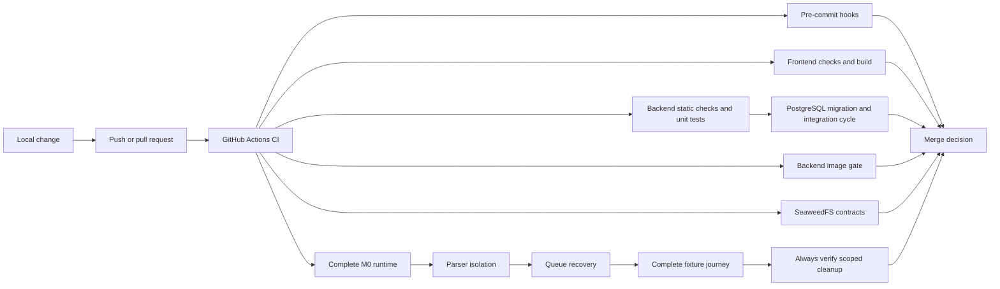

# GitHub Automation

This directory owns repository automation that runs after changes reach GitHub. It does not contain application runtime code.

## Contents

| Path               | Responsibility                                                                                   |
| ------------------ | ------------------------------------------------------------------------------------------------ |
| `workflows/ci.yml` | Runs deterministic application, persistence, image, storage, and complete-runtime verification. |

## Workflow

The frontend job installs the locked pnpm dependency graph, then runs formatting, linting, type
checking, tests, and the production build. The backend job installs the locked uv environment and
runs the same deterministic verification command documented for local development. It then migrates
an empty PostgreSQL 17 service, seeds the synthetic workspaces, runs all integration tests, checks
metadata drift, and proves the reviewed migration can downgrade to base and upgrade back to head.
Contract-drift checks are included through the normal frontend and backend test commands. Separate
jobs verify backend images and SeaweedFS behavior. The bounded `Complete M0 runtime` job proves
parser isolation, forced worker-loss recovery, and the browser-facing fixture journey. Its final
`always()` step fails if a scoped verifier container, network, volume, or temporary acceptance image
remains after either success or failure.

The workflow keeps the stable job name `Complete M0 runtime`, but workflow YAML cannot make a check
mandatory for merging. Repository branch protection must select that exact check name as required.

## Maintenance rules

- Keep workflow permissions at the minimum required level.
- Pin third-party actions to reviewed commit hashes and retain a version comment.
- Use the repository's locked pnpm and uv environments.
- Keep full registry-dependent vulnerability and signature audits separate while they are not deterministic CI gates. The configured uv on-sync malware check remains an intentional fail-closed dependency-installation gate and requires OSV availability.
- Keep all container checks bounded, isolated by unique project names, and self-cleaning.
- Never place production credentials or private data in workflow files or logs. Fixed CI-only service values must remain isolated and disposable.

Developer commands and local setup remain documented in the root [`README.md`](../README.md). Repository-wide security and verification rules remain in [`AGENTS.md`](../AGENTS.md).
