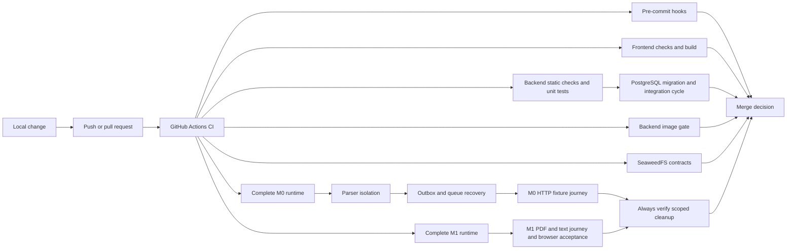

# GitHub Automation

This directory owns repository automation that runs after changes reach GitHub. It does not contain application runtime code.

## Contents

| Path               | Responsibility                                                                                   |
| ------------------ | ------------------------------------------------------------------------------------------------ |
| `workflows/ci.yml` | Runs deterministic application, persistence, image, storage, and complete-runtime verification. |
| `workflows/generation-key-check.yml` | Manually checks the configured OpenAI generation key with one bounded synthetic request. |
| `workflows/m1-provider-smoke.yml` | Manually verifies M1 provider compatibility on the approved synthetic fixture. |

## Workflow

The frontend job installs the locked pnpm dependency graph, then runs formatting, linting, type
checking, tests, and the production build. The backend job installs the locked uv environment and
runs the same deterministic verification command documented for local development. It then migrates
an empty PostgreSQL 17 service, seeds the synthetic workspaces, runs all integration tests, checks
metadata drift, and proves the reviewed migration can downgrade to base and upgrade back to head.
Contract-drift checks are included through the normal frontend and backend test commands. Separate
jobs verify backend images and SeaweedFS behavior. `Complete M0 runtime` checks parser isolation,
outbox scheduling, worker-loss and HTTP recovery, and the browser-facing HTTP fixture.
`Complete M1 runtime` verifies the PDF and text journey with deterministic providers and includes
Playwright browser acceptance. Both jobs run scoped resource-cleanup checks on success or failure.

The separate provider workflows run by manual dispatch. The generation-key check requires
confirmation of synthetic input. The M1 smoke also requires confirmation of the Pinecone Starter
scope. Regular pull-request CI uses deterministic credentials and provider doubles. Configure
required merge checks by job name in the repository ruleset.

## Maintenance rules

- Keep workflow permissions at the minimum required level.
- Pin third-party actions to reviewed commit hashes and retain a version comment.
- Use the repository's locked pnpm and uv environments.
- Keep full registry-dependent vulnerability and signature audits separate while they are not deterministic CI gates. The configured uv on-sync malware check remains an intentional fail-closed dependency-installation gate and requires OSV availability.
- Keep all container checks bounded, isolated by unique project names, and self-cleaning.
- Never place production credentials or private data in workflow files or logs. Fixed CI-only service values must remain isolated and disposable.

Developer commands and local setup remain documented in the root [`README.md`](../README.md). Repository-wide security and verification rules remain in [`AGENTS.md`](../AGENTS.md).
