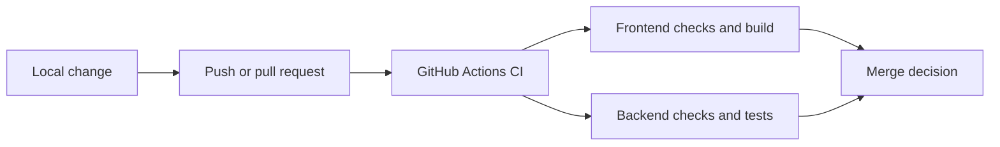

# GitHub Automation

This directory owns repository automation that runs after changes reach GitHub. It does not contain application runtime code.

## Contents

| Path               | Responsibility                                                               |
| ------------------ | ---------------------------------------------------------------------------- |
| `workflows/ci.yml` | Runs deterministic frontend and backend checks for pushes and pull requests. |

## Workflow

The frontend job installs the locked pnpm dependency graph, then runs formatting, linting, type checking, tests, and the production build. The backend job installs the locked uv environment, then runs Ruff formatting and linting, Mypy, and Pytest. Contract-drift checks are included through the normal frontend and backend test commands.

## Maintenance rules

- Keep workflow permissions at the minimum required level.
- Pin third-party actions to reviewed commit hashes and retain a version comment.
- Use the repository's locked pnpm and uv environments.
- Keep full registry-dependent vulnerability and signature audits separate while they are not deterministic CI gates. The configured uv on-sync malware check remains an intentional fail-closed dependency-installation gate and requires OSV availability.
- Add migration verification in M0.0 Step 3 and full container CI in M0, as specified in [`docs/08-m0-0-implementation-plan.md`](../docs/08-m0-0-implementation-plan.md).
- Never place credentials or private data in workflow files or logs.

Developer commands and local setup remain documented in the root [`README.md`](../README.md). Repository-wide security and verification rules remain in [`AGENTS.md`](../AGENTS.md).
