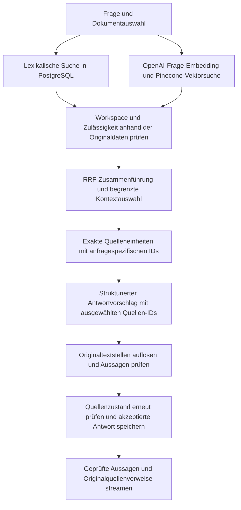

# Investment Research Archive

[English](README.md) · Deutsch

Quellenbasierte Dokumentenrecherche mit hybrider Suche und überprüfbaren Zitaten aus den Originalen.

PDFs importieren oder Text einfügen, Fragen zu gespeicherten Dokumenten stellen und die Belege
hinter jeder freigegebenen Aussage nachvollziehen. Die Anwendung verbindet lexikalische Suche
und Vektorsuche mit strukturierter Antwortgenerierung, serverseitig aufgelösten Quellenverweisen
und einer separaten Prüfung, ob die Quellen die Aussagen tatsächlich stützen.

[Architektur](docs/14-m1-5-portfolio.md#1-implemented-architecture) ·
[Evaluationsergebnisse](docs/14-m1-5-portfolio.md#3-recorded-evaluation-not-a-general-accuracy-claim) ·
[Lokale Demo](docs/14-m1-5-portfolio.md#4-safe-owner-run-local-demonstration) ·
[Entwicklungsumgebung](docs/development.md)

Dies ist ein lokales Applied-AI-Projekt für einen einzelnen Nutzer: ein Recherchearchiv, kein
Handelssystem und keine Anlageberatung. Diese Datei übersetzt den englischen Projektüberblick;
die Benutzeroberfläche und die verlinkte technische Detaildokumentation bleiben Englisch.

## Funktionen

- **Ein durchsuchbares Archiv aufbauen:** textbasierte PDFs oder eingefügten Text importieren
  und den Fortschritt von Textextraktion, Embedding-Erzeugung und Indexierung verfolgen.
- **Vorhandene Dokumente befragen:** gespeicherte Inhalte ohne erneuten Upload recherchieren
  oder eine Frage auf das aktuell verarbeitete Dokument beschränken.
- **Originalquellen prüfen:** ein zitiertes PDF auf der zugehörigen physischen Seite öffnen
  oder den exakten Textbereich im eingefügten Original hervorheben.
- **Grenzen der Belege erkennen:** vollständige, teilweise belegte, widersprüchliche und
  unzureichend belegte Antworten unterscheiden, statt Lücken still mit Modellwissen zu füllen.
- **Modelle getrennt auswählen:** Antwortmodell und Modell zur Aussagenprüfung unabhängig
  wählen, mit laufender Fortschrittsanzeige und sicheren Fehlermeldungen.

Die [synthetische Demo](docs/14-m1-5-portfolio.md#4-safe-owner-run-local-demonstration) zeigt
PDF-Recherche, genaue Textzitate, bewusste Enthaltung bei fehlenden Belegen im gewählten Suchbereich
und widersprüchliche Berichte. Alle Beispieldokumente sind fiktiv; private Recherchedaten werden
für die Demonstration nicht benötigt.

## So funktioniert die RAG-Pipeline

Das M1.5-Profil verwendet eine anwendungseigene Pipeline. Retrieval findet mögliche Textstellen;
die Generierung schlägt Aussagen vor; die Validierung entscheidet, was ausgegeben werden darf.



Der Dokumentimport läuft separat über Celery-Worker und einen Parser ohne Zugangsdaten.
PostgreSQL und der S3-kompatible Originalspeicher enthalten die maßgeblichen Daten. Pinecone
ist ein daraus abgeleiteter Index; Redis hält vorübergehenden Warteschlangenzustand. Der Browser
greift ausschließlich über die API auf Daten zu.

Die weiterhin verfügbare M1-Basisvariante wählt abwechselnd lexikalische und semantische Treffer
aus und löst vom Modell abgeschriebene Zitate auf. M1.5 verwendet ausdrücklich RRF und
Quellen-ID-basierte Generierung. Das Pinecone-BGE-Cross-Encoder-Reranking ist als separat
aktivierbares Experiment implementiert, im M1.5-Profil der Website aber nicht eingeschaltet.
M1 bleibt der Konfigurationsstandard; der Startbefehl unten wählt M1.5 ausdrücklich aus.

## Wichtige Architekturentscheidungen

- **Quellen-IDs statt abgeschriebener Zitate.** Das Modell wählt IDs aus einer begrenzten Menge
  von Quelleneinheiten. Der Server ermittelt den exakten Originaltext und dessen Positionen.
  So werden Abschreibfehler und Mehrdeutigkeiten bei wiederholten Texten vermieden. Eine
  ausgewählte ID allein beweist jedoch noch nicht, dass eine Aussage stimmt.
- **Zwei Prüfebenen.** Prüfungen gegen die maßgeblichen Daten kontrollieren Workspace, Version,
  Verarbeitung, zeitliche Zulässigkeit und exakte Textbereiche. Ein separates Modell bewertet,
  ob die aufgelösten Zitate alle wesentlichen Teile einer Aussage stützen. Diese inhaltliche
  Modellprüfung kann weiterhin Fehler machen.
- **Stabile Quellenverweise.** Zitate verweisen auf unveränderliche Dokumentversionen und
  Originaltextbereiche, nicht auf austauschbare Chunks oder Vektor-IDs. PDF- und
  Unicode-Textpositionen nutzen eine gemeinsame typisierte API.
- **Begrenzte Providernutzung.** Zeitlimits, Ein- und Ausgabegrenzen, dauerhaft gespeicherte
  Budgetreservierungen und modellspezifische Nutzungsdaten machen Fehler und geschätzte Kosten
  nachvollziehbar. Während externer Modellaufrufe bleibt die Transaktion zum Speichern der
  Antwort nicht offen.
- **Anwendungseigene Orchestrierung.** Typisierte Schnittstellen trennen Provider-SDKs von
  Fachlogik und Anwendungsabläufen. Prompts, Parser, Embeddings, Auswahlregeln und
  Evaluationskataloge sind versioniert.
- **Reproduzierbare Korrektheitsprüfungen.** Normale Tests verwenden deterministische Adapter.
  Live-Qualitätstests sind getrennt, ausdrücklich freizugeben und durch einen festgelegten
  Testbestand sowie ein Kostenlimit begrenzt.

Die [Architekturentscheidungen](docs/adr/README.md) und die
[Zuordnung zu den Codebereichen](docs/14-m1-5-portfolio.md#1-implemented-architecture) erklären
diese Grenzen genauer.

## Tech-Stack

| Bereich | Technologien und Aufgabe |
| --- | --- |
| Web | Next.js, React, TypeScript, Tailwind CSS; API-Zugriff über denselben Ursprung und Quellenanzeige |
| API und Fachlogik | Python, FastAPI, Pydantic; typisierte Verträge und Anwendungsdienste |
| Maßgeblicher Datenspeicher | PostgreSQL, SQLAlchemy, Alembic; Datensätze, lexikalische Suche und Migrationen |
| Originalspeicher | S3-kompatibler Speicher über Boto3; SeaweedFS im lokalen Compose-Stack |
| Hintergrundverarbeitung | Celery, Redis, pypdf; Verarbeitung über Warteschlangen und begrenzte Extraktion aus Text-PDFs |
| KI und Retrieval | OpenAI-Embeddings und strukturierte Generierung/Aussagenprüfung; Pinecone-Vektorindex; RRF; optionales BGE-Reranking |
| Qualität und Auslieferung | pytest, Ruff, Mypy, Frontend-Prüfungen, Playwright, GitHub Actions, Docker Compose |
| Werkzeuge und Tracing | uv, pnpm, OpenTelemetry-Trace-Kontext; maßgebliche Nutzungsabrechnung in PostgreSQL |

LangChain, LlamaIndex und LangGraph bilden nicht den Kern der Orchestrierung. Gehostete
LangSmith-Evaluation ist kein Bestandteil der implementierten Qualitätsnachweise. Das
[Systemdesign](docs/02-system-design.md) trennt den aktuellen Stand von der umfassenderen
Zielarchitektur.

## Evaluationsergebnisse

Die dokumentierte, vom Projektverantwortlichen ausgeführte Evaluation umfasst **zwölf geprüfte
Fragen zu drei synthetischen Originaldokumenten**. Dazu gehören beantwortbare Fragen, fehlende
Informationen, teilweise belegte Antworten, widersprüchliche Berichte, Dokumentauswahl,
wiederholte Formulierungen und kombinierte PDF-/Textbelege.

Der Lauf vom 09.10.2026 verwendete RRF, Quellen-Einheiten-Prompt v6, Luna für beide Modellrollen,
kein Reranking und die lokale **Diagnosevariante mit Begründungen zur Aussagenprüfung**. Er
bewertet weder den normalen Website-Prüfprompt mit reiner Ja-/Nein-Entscheidung noch stellt er
einen repräsentativen Benchmark für reale Dokumentbestände dar.

| Messgröße | Dokumentiertes Ergebnis |
| --- | --- |
| Ausführungsfehler / Bereinigung der Testressourcen | 0 von 12; Bereinigung bestätigt |
| Erwartete Antwortzustände | 12 von 12 |
| Strenge Übereinstimmung mit vorgegebenen Zitationszielen | 10 von 12 |
| Korrekte Enthaltungen ohne Zitate | 2 von 2 |
| Median / maximale Dauer je Frage | 4,895 s / 10,411 s |
| Geschätzte OpenAI-Gesamtkosten einschließlich Vorbereitung | 0,010813 USD |

Die exakte Zitationsgültigkeit lag bei 10/10 geprüften Antworten. Die strengere Zielwertung
berücksichtigte drei zusätzliche, echte Zuordnungsbelege in zwei Antworten als Abweichungen.
Das sind unterschiedliche Messgrößen, keine gemeinsame Genauigkeitsquote. Die Kosten beruhen
auf einer Schätzung anhand der im Repository hinterlegten Preise, enthalten keine
Pinecone-Abrechnung und sind weder eine Rechnung noch das maximal reservierte Budget.

Frühere kleine Ranking-Vergleiche belegten keinen Qualitätsvorteil, der eine automatische
Übernahme von RRF oder Reranking rechtfertigt. Der
[Evaluationsnachweis](fixtures/m1_5/closeout-review.md#prompt-v6-live-observation-and-qualitative-source-review--2026-10-09)
enthält Konfiguration, Quellenreview, Hashes und Einschränkungen. Änderungen am Fragenkatalog
und nichtdeterministische Modelle erlauben aus diesen Beobachtungen allein keine kausale
Vorher-/Nachher-Aussage.

## Lokal starten

Voraussetzungen: Docker Compose, Node.js 24, Python 3.14, pnpm und uv. Genaue Werkzeugversionen,
Installation, eigenständig einzurichtende Zugangsdaten und Budgetkonfiguration stehen in der
[Entwickleranleitung](docs/development.md#install). Live-Indexierung und -Recherche benötigen
OpenAI- und Pinecone-Zugangsdaten sowie freigegebene öffentliche oder synthetische Dokumente.
Dabei können Providerkosten entstehen.

Nach dieser Einrichtung im Hauptordner des Repositorys ausführen:

```shell
INVESTMENT_RESEARCH_RESEARCH_PROFILE=m1-5-citable-units \
  docker compose --env-file .env -f compose.yaml -f compose.m1-live.yaml up --build --detach --wait
```

<http://127.0.0.1:3000> öffnen, ein freigegebenes Dokument importieren, auf `SEARCHABLE` warten
und eine Frage stellen. Die normale M1.5-Aussagenprüfung der Website liefert eine
Ja-/Nein-Entscheidung ohne Diagnosebegründung. Beim Neuerstellen der API das Profil weiterhin
ausdrücklich setzen; ein gewöhnlicher Compose-Aufruf kann wieder M1 aktivieren. Die
[Demo-Anleitung](docs/14-m1-5-portfolio.md#4-safe-owner-run-local-demonstration) enthält konkrete
synthetische Fragen und Quellenprüfungen. Zugangsdaten niemals committen und Diagnosen mit
ungefilterten Inhalten niemals für private Dokumente aktivieren.

## Entwicklung und Tests

Frontend-Prüfungen laufen über pnpm, Backend-Prüfungen über uv. Die
[Prüfanleitung](docs/development.md#verify-changes) beschreibt Unit- und statische Prüfungen,
PostgreSQL- und Migrationstests in kurzlebigen Testumgebungen, Speicherverträge,
Parser-Isolation, Wiederherstellung der Warteschlangenverarbeitung und vollständige
Docker-/Browserabläufe. Die erforderliche CI verwendet deterministische Provider ohne echte
Zugangsdaten; Live-Qualitätstests sind getrennt und nur nach ausdrücklicher Aktivierung möglich.

Die [CI-Konfiguration](.github/workflows/ci.yml) und der
[Evaluationskorpus](fixtures/m1_5/README.md) zeigen reproduzierbare Prüfungen, statt sich
ausschließlich auf ein Status-Badge oder eine einzelne Demo zu verlassen.

## Umfang und Grenzen

- Der lokale Einzelnutzerbetrieb verwendet eine feste, serverseitige Identität und
  Loopback-Zugriff, keine Produktionsauthentifizierung oder öffentliche Bereitstellung.
  Nur freigegebene, nicht vertrauliche Dokumente dürfen externe Provider erreichen.
- PDF-Unterstützung extrahiert vorhandenen Text; für gescannte Bildseiten gibt es keine OCR.
  Komplexe Layouts, durch Zeilenumbrüche getrennte Wörter und die Trefferauswahl können dazu
  führen, dass Belege nicht gefunden werden.
- Die Generierung erhält begrenzten, ausgewählten Kontext, keine garantiert vollständige
  Lektüre aller PDF-Seiten. Quellen-IDs verhindern Abschreibfehler, aber nicht jeden Fehler
  bei Suche oder Modellschlussfolgerungen.
- Die Evaluation ist klein, synthetisch und durch die Entwicklung beeinflusst. Breitere
  Tests mit bislang ungenutzten Fällen, vollständige Zuverlässigkeit über den
  Dokumentlebenszyklus, Archivnavigation und dialogfähiges beziehungsweise geroutetes RAG
  bleiben spätere Arbeit. Die endgültige M1.5-Abnahme wird getrennt vom Funktionsstand erfasst.

Die nächsten Phasen behandeln zuverlässigen Import, Versionierung und Löschung, Archivsuche
und breitere Evaluation sowie anschließend die verbleibenden Routing- und Dialogfunktionen.
Umfang und Abnahmekriterien stehen im [Delivery-Plan](docs/05-delivery-plan.md).

## Dokumentation

- [Architektur und Datenverantwortung](docs/02-system-design.md)
- [Portfolio-Nachweise, Codeübersicht und Demo](docs/14-m1-5-portfolio.md)
- [Entwicklungsumgebung, Betrieb und Prüfungen](docs/development.md)
- [Evaluationskorpus und Quellenreview](fixtures/m1_5/README.md)
- [Sicherheitsgrenzen](docs/04-security-and-operations.md)
- [Architekturentscheidungen](docs/adr/README.md)
