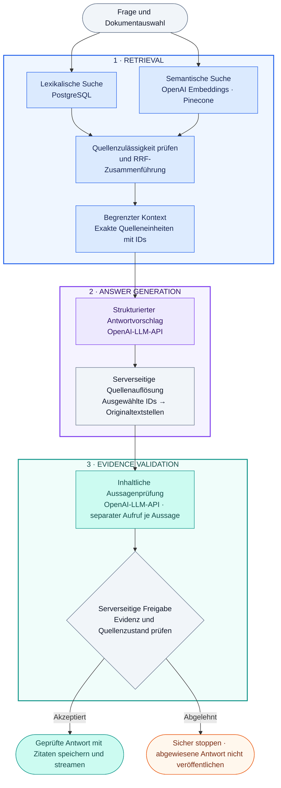

# Investment Research Archive

[English](README.md) · Deutsch

Quellenbasierte Dokumentenrecherche mit hybrider Suche und überprüfbaren Zitaten aus den Originalen.

PDFs importieren oder Text einfügen, Fragen zu gespeicherten Dokumenten stellen und die Belege
hinter jeder freigegebenen Aussage nachvollziehen. Eine lokale Applied-AI-Anwendung für einen
Nutzer: Hybride Suche findet Textstellen, ein Modell schlägt eine Antwort vor, und der Server
prüft vor der Ausgabe deren Belege aus den Originalquellen. Dies ist ein Recherchearchiv,
kein Handelssystem und keine Anlageberatung.

**Status: In aktiver Entwicklung.** Der zentrale RAG-Ablauf ist implementiert; eine breitere
Evaluation und die verbleibenden Produktmeilensteine stehen noch aus.

## Tech-Stack

| Bereich                    | Technologien und Aufgabe                                                                                             |
| -------------------------- | -------------------------------------------------------------------------------------------------------------------- |
| Frontend                   | Next.js, React, TypeScript, Tailwind CSS; Recherche-Arbeitsplatz und Originalquellenanzeige                          |
| Backend                    | Python, FastAPI, Pydantic; typisierte API und anwendungseigene Orchestrierung                                        |
| Maßgeblicher Datenspeicher | PostgreSQL, SQLAlchemy, Alembic; Datensätze, lexikalische Suche und Migrationen                                      |
| Originalspeicher           | S3-kompatibler Speicher über Boto3; SeaweedFS im lokalen Compose-Stack                                               |
| Hintergrundverarbeitung    | Celery, Redis, pypdf; Import über Warteschlangen und begrenzte Extraktion aus Text-PDFs                              |
| KI und Retrieval           | OpenAI-Embeddings und strukturierte Generierung/Aussagenprüfung; Pinecone-Vektorsuche; RRF; optionales BGE-Reranking |
| Qualität und Auslieferung  | pytest, Ruff, Mypy, Playwright, GitHub Actions, Docker Compose; uv und pnpm                                          |

LangChain, LlamaIndex und LangGraph bilden nicht den Kern der Orchestrierung. Gehostete
LangSmith-Evaluation ist kein Bestandteil der implementierten Qualitätsnachweise. Das
[Systemdesign](docs/02-system-design.md) trennt den aktuellen Stand von der umfassenderen
Zielarchitektur.

[Architektur](docs/14-m1-5-portfolio.md#1-implemented-architecture) ·
[Evaluationsergebnisse](docs/14-m1-5-portfolio.md#3-recorded-evaluation-not-a-general-accuracy-claim) ·
[Lokale Demo](docs/14-m1-5-portfolio.md#4-safe-owner-run-local-demonstration) ·
[Entwicklungsumgebung](docs/development.md)

Diese Datei übersetzt den englischen Projektüberblick. Die Benutzeroberfläche und die verlinkte
technische Detaildokumentation bleiben Englisch.


_Lokaler Recherche-Arbeitsplatz: gespeicherte Dokumente, Modellwahl und eine validierte Antwort
mit Dokument-, Veröffentlichungsdatum- und Seitenangaben._

## Funktionen

### Ein durchsuchbares Archiv aufbauen

Textbasierte PDFs oder eingefügten Text importieren und den Fortschritt von Textextraktion,
Embedding-Erzeugung und Indexierung verfolgen.

<details open>
<summary>Formular für den Dokumentimport ansehen</summary>


Das Formular vor dem Absenden: PDF oder eingefügten Text auswählen und Dokumentmetadaten
eintragen. Dieser Screenshot zeigt noch keine abgeschlossene Verarbeitung.

</details>

### Gespeicherte Quellen ansehen

Eine seitenweise Dokumentliste mit Verarbeitungsstatus anzeigen und vollständige PDF- oder
Textoriginale ohne vorherige Frage öffnen. Die Seitenleiste ausblenden oder Add source öffnen,
ohne aktuelle Frage oder Auswahl zu verlieren.

### Vorhandene Dokumente befragen

Gespeicherte Inhalte ohne erneuten Upload recherchieren oder eine Frage auf eines oder mehrere
ausgewählte, durchsuchbare Dokumente beschränken.

### Originalquellen prüfen

Ein zitiertes PDF auf der zugehörigen physischen Seite öffnen oder den exakten Textbereich im
eingefügten Original hervorheben. Zitate zeigen Dokumenttitel und bekannte Veröffentlichungsdaten;
ausgewählte Retrieval-Passagen sind getrennt einsehbar.

### Grenzen der Belege erkennen

Vollständige, teilweise belegte, widersprüchliche und unzureichend belegte Antworten unterscheiden,
statt Lücken still mit Modellwissen zu füllen.

### Modelle getrennt auswählen

Antwortmodell und Modell zur Aussagenprüfung unabhängig wählen, mit laufender Fortschrittsanzeige
und sicheren Fehlermeldungen. Die Prompts verlangen englische Antworttexte; Zitate bleiben im
Original unverändert.

### Dokumente entfernen

Einen ausdrücklich ausgewählten Stapel dauerhaft löschen und den Bereinigungsstatus verfolgen.
Dieser implementierte Ablauf bedeutet nicht, dass der gesamte Meilenstein für den
Dokumentlebenszyklus abgeschlossen ist.

### Abgewiesene Antworten lokal untersuchen

Optionale Diagnosen zeigen abgewiesene Aussagen, ausgewählte Textstellen und fehlgeschlagene
Prüfungen direkt beim Fehler, nie als akzeptierte Antwort.

Die [synthetische Demo](docs/14-m1-5-portfolio.md#4-safe-owner-run-local-demonstration) zeigt
PDF-Recherche, genaue Textzitate, bewusste Enthaltung bei fehlenden Belegen im gewählten Suchbereich
und widersprüchliche Berichte. Diese Anleitung verwendet fiktive Dokumente; private Recherchedaten
werden für die Demonstration nicht benötigt.


_Belege am Original überprüfen: Der zitierte Ausschnitt und die physische PDF-Seite 2 sind
gleichzeitig sichtbar. PDF-Zitate öffnen die Seite; exakte Bereichsmarkierungen gibt es bei
eingefügten Textoriginalen._

## So funktioniert die RAG-Pipeline

Das M1.5-Profil verwendet eine anwendungseigene Pipeline. Retrieval findet mögliche Textstellen;
die Generierung schlägt Aussagen vor; die Validierung entscheidet, was ausgegeben werden darf.



### 1. Retrieval — Quellenfindung

Findet und sortiert Textstellen und stellt daraus einen begrenzten Kontext für die Antwortgenerierung
zusammen. Die Embedding-API wandelt die Frage in einen Vektor um; sie schreibt oder prüft keine Antwort.

### 2. Answer Generation — Antwortgenerierung per LLM-API

Erhält die Frage und die ausgewählten Quelleneinheiten. Er schlägt Antwortaussagen vor und wählt
deren Quellen-IDs aus. Den exakten Originaltext der Zitate liefert der Server, nicht das Modell.

### 3. Evidence Validation — Evidenzvalidierung per LLM-API und Serverprüfungen

Erhält jede vorgeschlagene Aussage, ihre aufgelösten Originalzitate und begrenzte Angaben zur
Dokumentzuordnung. Er bewertet, ob die Belege die gesamte Aussage stützen. Beide Rollen können
dasselbe Modell verwenden, laufen aber als getrennte Aufrufe mit unterschiedlichen Anweisungen.
Der Server prüft zusätzlich Antwortformat, Workspace, Quellenzulässigkeit und Zitationsregeln;
der Modellprüfer allein kann keine Antwort freigeben.

Der Dokumentimport läuft separat über Celery-Worker und einen Parser ohne Zugangsdaten.
PostgreSQL und der S3-kompatible Originalspeicher enthalten die maßgeblichen Daten. Pinecone
ist ein daraus abgeleiteter Index; Redis hält vorübergehenden Warteschlangenzustand. Der Browser
greift ausschließlich über die API auf Daten zu.

Die lexikalische Suche verwendet PostgreSQL-Volltextsuche (`tsvector`, GIN, `ts_rank_cd`), nicht
BM25. Die semantische Suche nutzt OpenAI-Embeddings und Pinecone. RRF verbindet Rangpositionen,
nicht unvergleichbare Rohwerte. Der Kontext ist begrenzt, keine vollständige Lektüre aller Dokumente.

Der lokale Standard mit echten Providern ist der M1.5-Pfad mit RRF und Quellen-IDs. Das
Pinecone-BGE-Cross-Encoder-Reranking ist als separat aktivierbares Experiment implementiert,
im Website-Profil aber nicht eingeschaltet. Die M1-Basisvariante bleibt zum Vergleich verfügbar;
Details stehen in der [Profilübersicht](docs/14-m1-5-portfolio.md#2-profiles-and-concrete-changes-from-m1).

## Wichtige Architekturentscheidungen

- **Quellen-IDs statt abgeschriebener Zitate.** Das Modell wählt IDs aus einer begrenzten Menge
  von Quelleneinheiten. Der Server ermittelt den exakten Originaltext und dessen Positionen.
  So werden Abschreibfehler und Mehrdeutigkeiten bei wiederholten Texten vermieden. Eine
  ausgewählte ID allein beweist jedoch noch nicht, dass eine Aussage stimmt.
- **Zwei Prüfebenen.** Prüfungen gegen die maßgeblichen Daten kontrollieren Workspace, Version,
  Verarbeitung, zeitliche Zulässigkeit und exakte Textbereiche. Ein separates Modell bewertet,
  ob die aufgelösten Zitate alle wesentlichen Teile einer Aussage stützen. Diese inhaltliche
  Modellprüfung kann weiterhin Fehler machen.
- **Stabile Quellenverweise.** Zitate verweisen auf unveränderliche Dokumentversionen und
  Originaltextbereiche, nicht auf austauschbare Chunks oder Vektor-IDs. PDF- und
  Unicode-Textpositionen nutzen eine gemeinsame typisierte API.
- **Begrenzte Providernutzung.** Zeitlimits, Ein- und Ausgabegrenzen, dauerhaft gespeicherte
  Budgetreservierungen und modellspezifische Nutzungsdaten machen Fehler und geschätzte Kosten
  nachvollziehbar. Während externer Modellaufrufe bleibt die Transaktion zum Speichern der
  Antwort nicht offen.
- **Anwendungseigene Orchestrierung.** Typisierte Schnittstellen trennen Provider-SDKs von
  Fachlogik und Anwendungsabläufen. Prompts, Parser, Embeddings, Auswahlregeln und
  Evaluationskataloge sind versioniert.
- **Reproduzierbare Korrektheitsprüfungen.** Normale Tests verwenden deterministische Adapter.
  Live-Qualitätstests sind getrennt, ausdrücklich freizugeben und durch einen festgelegten
  Testbestand sowie ein Kostenlimit begrenzt.

Die [Architekturentscheidungen](docs/adr/README.md) und die
[Zuordnung zu den Codebereichen](docs/14-m1-5-portfolio.md#1-implemented-architecture) erklären
diese Grenzen genauer.

<details open>
<summary>Antwort mit Belegen aus mehreren Dokumenten ansehen</summary>


Jede akzeptierte Aussage hat eine eigene Belegkarte. Dieses Beispiel verbindet Quellen aus
zwei Berichten; es demonstriert die Oberfläche, nicht die vollständige Auffindung aller relevanten Vereinbarungen.

</details>

<details open>
<summary>Ausgewählten Retrieval-Kontext ansehen</summary>


Die geordnete Kontextübersicht zeigt acht Chunks aus zwei Dokumenten. Die einzelnen Passagen
sind im Screenshot eingeklappt und lassen sich in der Anwendung öffnen. Das sind ausgewählte
Kontextpassagen, nicht alle Kandidaten vor der Zusammenführung, validierte Zitate oder ein
Nachweis, dass jede Passage verwendet wurde.

</details>

<details open>
<summary>Fallbeispiel: Abkürzungen bei der Evidenzaufteilung — vorher und nachher</summary>

### Vorher — unvollständige Belege korrekt abgewiesen


Die Satzaufteilung trennte den Quellentext nach `U.S.`. Dadurch lag `and Canada` außerhalb der
ausgewählten Quelleneinheit. Die vorgeschlagene Aussage nannte beide Länder, die ausgewählten
Belege jedoch nicht. Die Evidenzvalidierung wies die Antwort ab, statt die unvollständig belegte
Aussage auszugeben.

### Nachher — vollständige Textstelle erhalten


Die korrigierte Aufteilung erkennt die Abkürzung und erhält `U.S. and Canada` in einer exakten
Quelleneinheit. Das spätere lokale Beispiel zeigt den vollständigen Beleg und eine akzeptierte
Aussage. Die Korrektur betrifft die Quellenaufbereitung, nicht die Pflicht, jede Aussage zu validieren.

Die [Regressionstests für Quelleneinheiten](backend/tests/unit/test_citable_units.py) decken
`U.S.` und `U.K.`, weiterführenden Text, ausdrückliche Absatzgrenzen, exakte Unicode-Positionen
und Größenlimits der Quelleneinheiten ab. Die Screenshots veranschaulichen den beobachteten
Fehler und eine spätere erfolgreiche Ausgabe; sie sind kein kontrollierter Vergleich der
Modellqualität und keine Garantie für zukünftige Antworten.

</details>

Die Screenshots zeigen vom Projektverantwortlichen bereitgestellte lokale UI-Beispiele mit
Unternehmensberichten. Sie sind vom folgenden synthetischen Evaluationskorpus getrennt und
keine zusätzlichen Qualitätsmessungen.

## Evaluationsergebnisse

Die dokumentierte, vom Projektverantwortlichen ausgeführte Evaluation umfasst **zwölf geprüfte
Fragen zu drei synthetischen Originaldokumenten**. Dazu gehören beantwortbare Fragen, fehlende
Informationen, teilweise belegte Antworten, widersprüchliche Berichte, Dokumentauswahl,
wiederholte Formulierungen und kombinierte PDF-/Textbelege.

Der Lauf vom 09.10.2026 verwendete RRF, Quellen-Einheiten-Prompt v6, Luna für beide Modellrollen,
kein Reranking und die lokale **Diagnosevariante mit Begründungen zur Aussagenprüfung**. Er
bewertet weder den normalen Website-Prüfprompt mit reiner Ja-/Nein-Entscheidung noch stellt er
einen repräsentativen Benchmark für reale Dokumentbestände dar.

| Messgröße                                                | Dokumentiertes Ergebnis         |
| -------------------------------------------------------- | ------------------------------- |
| Ausführungsfehler / Bereinigung der Testressourcen       | 0 von 12; Bereinigung bestätigt |
| Erwartete Antwortzustände                                | 12 von 12                       |
| Strenge Übereinstimmung mit vorgegebenen Zitationszielen | 10 von 12                       |
| Korrekte Enthaltungen ohne Zitate                        | 2 von 2                         |

Die exakte Zitationsgültigkeit lag bei 10/10 geprüften Antworten. Die strengere Zielwertung
berücksichtigte drei zusätzliche, echte Zuordnungsbelege in zwei Antworten als Abweichungen.
Das sind unterschiedliche Messgrößen, keine gemeinsame Genauigkeitsquote. Der aktuelle
Quellen-ID-Antwortprompt ist v8; der historische v6-Lauf belegt weder dessen Qualität noch die
Zuverlässigkeit auf IREN, Nebius oder anderen realen Dokumentbeständen. Laufzeit- und geschätzte
Kostenmessungen, Konfiguration und Review-Grenzen stehen im
[ausführlichen Evaluationsbericht](docs/14-m1-5-portfolio.md#3-recorded-evaluation-not-a-general-accuracy-claim).

Frühere kleine Ranking-Vergleiche belegten keinen Qualitätsvorteil, der eine automatische
Übernahme von RRF oder Reranking rechtfertigt. Der
[Evaluationsnachweis](fixtures/m1_5/closeout-review.md#prompt-v6-live-observation-and-qualitative-source-review--2026-10-09)
enthält Konfiguration, Quellenreview, Hashes und Einschränkungen. Änderungen am Fragenkatalog
und nichtdeterministische Modelle erlauben aus diesen Beobachtungen allein keine kausale
Vorher-/Nachher-Aussage.

## Lokal starten

Voraussetzungen: Docker Compose, Node.js 24, Python 3.14, pnpm und uv. Genaue Werkzeugversionen,
Installation, eigenständig einzurichtende Zugangsdaten und Budgetkonfiguration stehen in der
[Entwickleranleitung](docs/development.md#install). Live-Indexierung und -Recherche benötigen
OpenAI- und Pinecone-Zugangsdaten sowie freigegebene öffentliche oder synthetische Dokumente.
Dabei können Providerkosten entstehen.

Nach dieser Einrichtung im Hauptordner des Repositorys ausführen:

```shell
docker compose --env-file .env -f compose.yaml -f compose.m1-live.yaml up --build --detach --wait
```

<http://127.0.0.1:3000> öffnen, ein freigegebenes Dokument importieren, auf `SEARCHABLE` warten
und eine Frage stellen. Die normale M1.5-Aussagenprüfung der Website liefert eine
Ja-/Nein-Entscheidung ohne Diagnosebegründung. Ein alter ausdrücklicher Eintrag
`INVESTMENT_RESEARCH_RESEARCH_PROFILE=m1` in der Umgebung überschreibt weiterhin den Standard;
diesen entfernen oder auf `m1-5-citable-units` setzen. Die
[Demo-Anleitung](docs/14-m1-5-portfolio.md#4-safe-owner-run-local-demonstration) enthält konkrete
synthetische Fragen und Quellenprüfungen. Zugangsdaten niemals committen und Diagnosen mit
ungefilterten Inhalten niemals für private Dokumente aktivieren.

Für begrenzte Retrieval- und Kontextexperimente [config/rag.toml](config/rag.toml) bearbeiten;
die [Konfigurationsanleitung](config/README.md) erklärt die fünf Einstellungen, Grenzen und den
API-Neustart.

## Entwicklung und Tests

Frontend-Prüfungen laufen über pnpm, Backend-Prüfungen über uv. Die
[Prüfanleitung](docs/development.md#verify-changes) beschreibt Unit- und statische Prüfungen,
PostgreSQL- und Migrationstests in kurzlebigen Testumgebungen, Speicherverträge,
Parser-Isolation, Wiederherstellung der Warteschlangenverarbeitung und vollständige
Docker-/Browserabläufe. Die erforderliche CI verwendet deterministische Provider ohne echte
Zugangsdaten; Live-Qualitätstests sind getrennt und nur nach ausdrücklicher Aktivierung möglich.

Die [CI-Konfiguration](.github/workflows/ci.yml) und der
[Evaluationskorpus](fixtures/m1_5/README.md) zeigen reproduzierbare Prüfungen, statt sich
ausschließlich auf ein Status-Badge oder eine einzelne Demo zu verlassen.

## Dokumentation

- [Architektur und Datenverantwortung](docs/02-system-design.md)
- [Portfolio-Nachweise, Codeübersicht und Demo](docs/14-m1-5-portfolio.md)
- [Entwicklungsumgebung, Betrieb und Prüfungen](docs/development.md)
- [Evaluationskorpus und Quellenreview](fixtures/m1_5/README.md)
- [Sicherheitsgrenzen](docs/04-security-and-operations.md)
- [Architekturentscheidungen](docs/adr/README.md)
