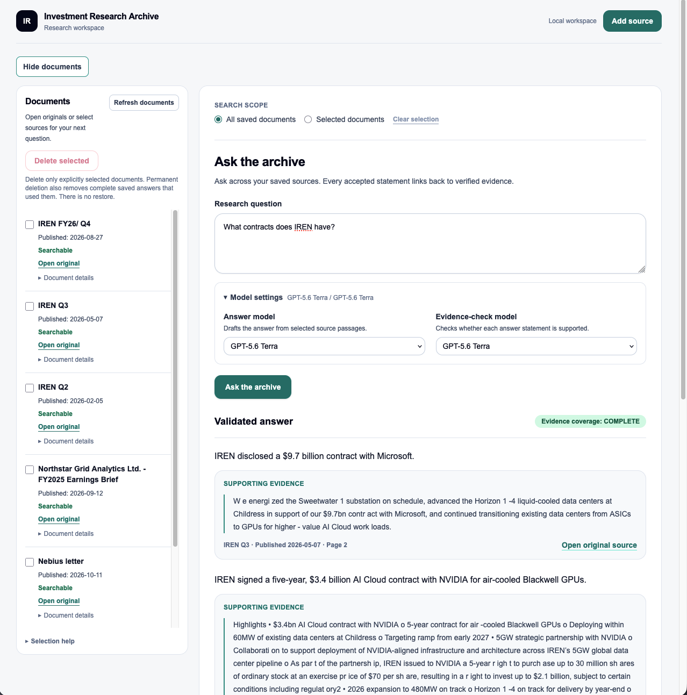
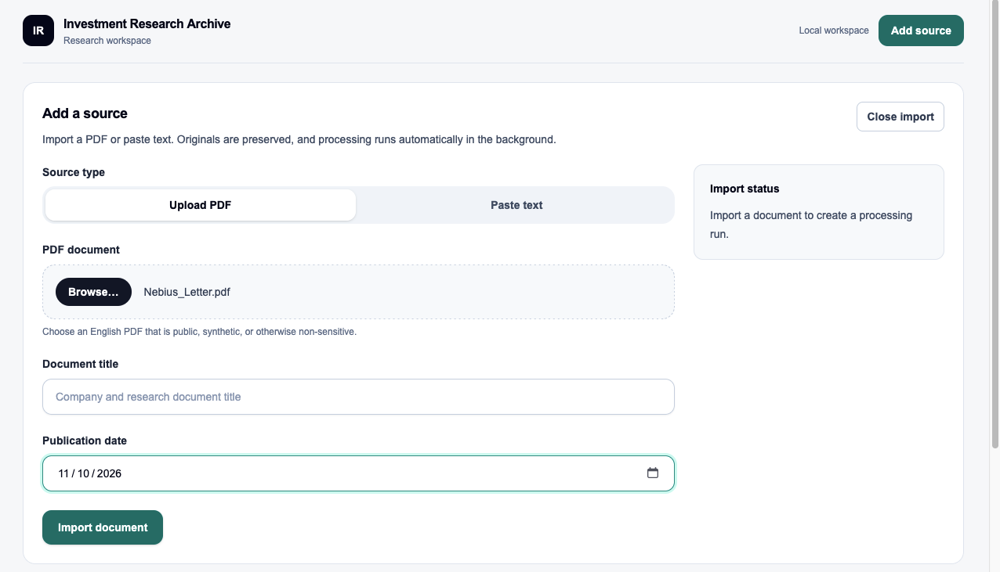
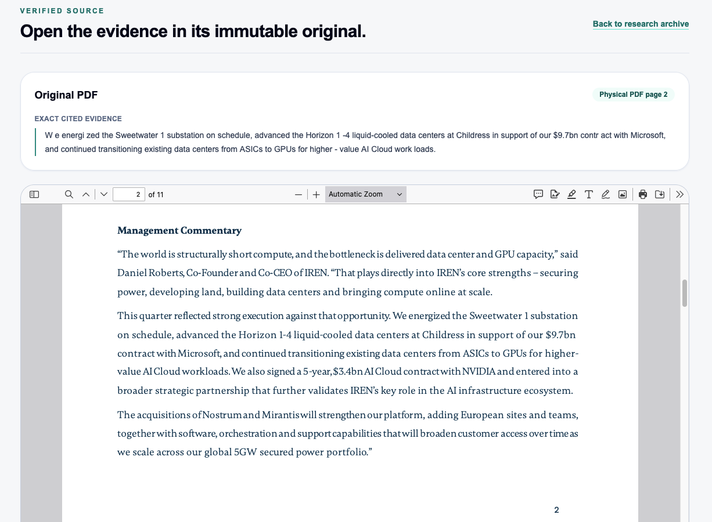
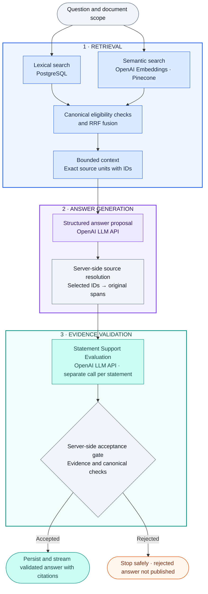
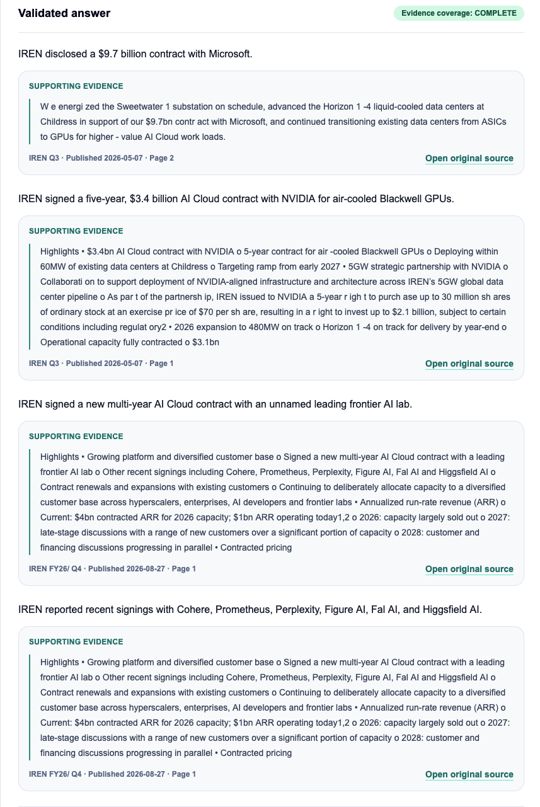
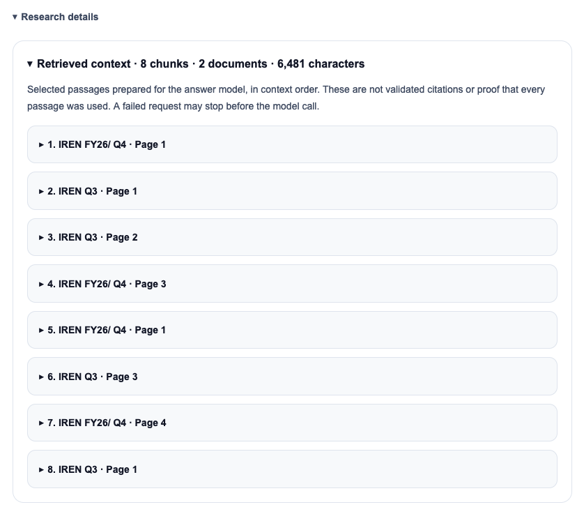
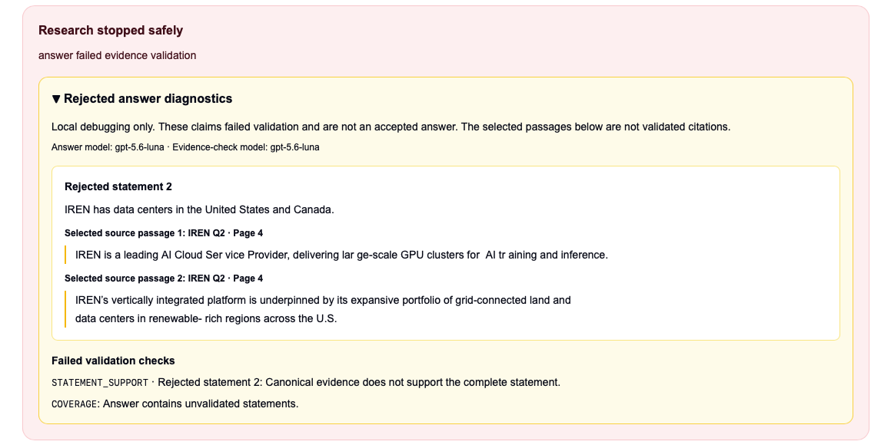
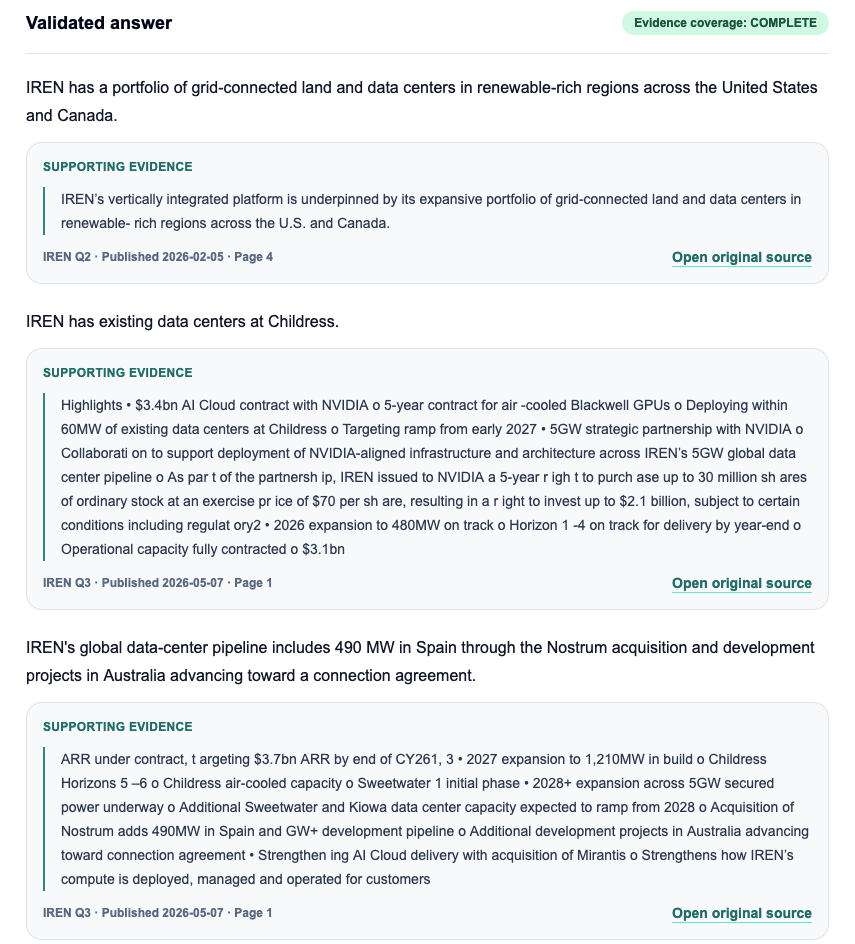

# Investment Research Archive

English · [Deutsch](README.de.md)

Evidence-grounded document research with hybrid retrieval and verifiable original-source citations.

Import PDFs or paste text, ask questions over saved documents, and inspect the evidence behind
each accepted statement. Built as a local, single-user Applied AI application: hybrid search finds
passages, a model proposes an answer, and the server checks its original-source evidence before
publishing it. This is a research archive, not a trading system or an investment-advice service.

**Status: In active development.** The core RAG workflow is implemented; broader evaluation
and remaining product milestones are still pending.

## Tech stack

| Area                  | Technologies and role                                                                                 |
| --------------------- | ----------------------------------------------------------------------------------------------------- |
| Frontend              | Next.js, React, TypeScript, Tailwind CSS; research workspace and original-source viewing              |
| Backend               | Python, FastAPI, Pydantic; typed API and application-owned orchestration                              |
| Canonical data        | PostgreSQL, SQLAlchemy, Alembic; records, lexical search, and migrations                              |
| Original storage      | S3-compatible storage through Boto3; SeaweedFS in local Compose                                       |
| Background processing | Celery, Redis, pypdf; queued ingestion and bounded text-PDF parsing                                   |
| AI and retrieval      | OpenAI embeddings and structured generation/support; Pinecone dense search; RRF; opt-in BGE reranking |
| Quality and delivery  | pytest, Ruff, Mypy, Playwright, GitHub Actions, Docker Compose; uv and pnpm                           |

LangChain, LlamaIndex, and LangGraph are not the orchestration core. Hosted LangSmith evaluation
is not part of the implemented quality evidence. The [system design](docs/02-system-design.md)
separates current behavior from the broader target architecture.

[Architecture](docs/14-m1-5-portfolio.md#1-implemented-architecture) ·
[Evaluation evidence](docs/14-m1-5-portfolio.md#3-recorded-evaluation-not-a-general-accuracy-claim) ·
[Local demo](docs/14-m1-5-portfolio.md#4-safe-owner-run-local-demonstration) ·
[Developer setup](docs/development.md)



_Local research workspace: saved documents, model selection, and a validated answer with
document, publication-date, and page references._

## What you can do

### Build a searchable archive

Import text-based PDFs or pasted text and follow automatic parsing, embedding, and indexing progress.

<details open>
<summary>View the document import form</summary>



The form before submission: choose a PDF or pasted text and enter document metadata.
This screenshot does not show processing completion.

</details>

### Browse saved sources

View a paginated document list with processing status and open complete PDF or text originals
without first asking a question. Hide the sidebar or open the Add source panel without losing
the current question or selection.

### Ask saved evidence

Research existing documents without another upload, or restrict a question to one or more
selected searchable documents.

### Inspect the source

Open a cited original PDF at its physical page or highlight the exact range in a pasted-text
original. Citations include document titles and publication dates when known; selected retrieval
passages are inspectable separately.

### See evidence limits

Distinguish complete, partial, conflicting, and insufficient answers instead of silently filling
gaps from general model knowledge.

### Choose models independently

Select the answer model and the statement-support model separately, with live progress and safe
failure messages. Generated prose is instructed to remain English; quotations retain their
original text.

### Remove saved documents

Select an explicit batch for permanent deletion and track cleanup receipts. This implemented
flow does not imply that the full lifecycle milestone is complete.

### Inspect rejected answers locally

Opt-in diagnostics show rejected statements, selected source excerpts, and failed checks directly
with the error, never as accepted answers.

The [synthetic demo walkthrough](docs/14-m1-5-portfolio.md#4-safe-owner-run-local-demonstration)
shows PDF research, exact text citations, scoped abstention, and conflicting reports. That
walkthrough uses fictional documents; no private research data is needed to demonstrate the system.



_Verify the evidence against the original: the cited excerpt and physical PDF page 2 are visible
together. PDF citations open the page; exact range highlighting is available for pasted-text originals._

## How the RAG pipeline works

The M1.5 profile runs an application-owned pipeline. Retrieval finds candidate passages;
generation proposes claims; validation determines what can be published.



### 1. Retrieval

Finds and ranks passages, then prepares bounded context for generation. The embedding API
converts the question into a vector; it does not write or validate an answer.

### 2. Answer Generation — LLM API

Receives the question and selected source units. It proposes answer statements and chooses
their source IDs; the server, not the model, supplies the exact original quotations.

### 3. Evidence Validation — LLM API and server checks

Receives each proposed statement, its resolved original quotations, and restricted document
attribution context. It assesses whether the evidence supports the complete statement. Both
roles can use the same model, but run as separate calls with different instructions. The server
also enforces schema, workspace, eligibility, and citation rules; the statement-support model alone cannot
authorize publication.

Ingestion runs separately through Celery workers and a credential-free parser boundary.
PostgreSQL and S3-compatible original storage are canonical; Pinecone is a derived index and
Redis holds transient queue state. The browser accesses data only through the API.

Lexical search uses PostgreSQL full-text search (`tsvector`, GIN, `ts_rank_cd`), not BM25.
Dense search uses OpenAI embeddings and Pinecone; RRF combines rank positions, not incompatible
raw scores. Context is bounded, not an exhaustive reading of every document.

The provider-backed local default is the M1.5 RRF/source-ID path. Pinecone BGE cross-encoder
reranking is implemented as a separate opt-in experiment, not enabled by that website profile.
The retained M1 baseline remains available for comparison; details are in the
[profile guide](docs/14-m1-5-portfolio.md#2-profiles-and-concrete-changes-from-m1).

## Engineering decisions

- **Source IDs, not copied quotations.** The model selects bounded source-unit IDs. The server
  resolves their exact original text and offsets, avoiding quote-copying and repeated-text
  ambiguity without treating a selected ID as proof of a claim.
- **Two validation layers.** Canonical checks enforce workspace, version, processing, temporal,
  and exact-span rules. A separate model evaluates whether the resolved quotes support every
  material part of a proposed statement. Semantic model decisions remain fallible.
- **Stable citation identity.** Citations point to immutable document versions and original
  ranges, not replaceable chunks or vector IDs. PDF and Unicode text locators share a typed API.
- **Bounded provider usage.** Timeouts, input/output limits, durable budget reservations, and
  model-specific usage records make failure and estimated cost visible. Provider calls do not
  hold the answer-writing transaction open.
- **Application-owned orchestration.** Typed ports isolate provider SDKs from domain/application
  code. Prompts, parsers, embeddings, selection policies, and evaluation catalogs are versioned.
- **Reproducible correctness checks.** Normal tests use deterministic adapters; live quality
  evaluation is separate, explicitly authorized, corpus-bound, and cost-bounded.

The [architecture decisions](docs/adr/README.md) and
[code map](docs/14-m1-5-portfolio.md#1-implemented-architecture) explain these boundaries in detail.

<details open>
<summary>View a multi-document answer with supporting evidence</summary>



Each accepted statement has its own evidence card. This example combines sources from two
reports; it is a UI demonstration, not proof that retrieval found every relevant agreement.

</details>

<details open>
<summary>Inspect the selected retrieval context</summary>



The ordered context overview lists eight chunks from two documents. Individual passages are
collapsed in this screenshot and can be expanded in the application. These are selected context
passages, not all pre-fusion candidates, validated citations, or proof that every passage was used.

</details>

<details open>
<summary>Case study: abbreviation-aware evidence segmentation — before and after</summary>

### Before — incomplete evidence correctly rejected



Sentence segmentation split the source after `U.S.`, leaving `and Canada` outside the selected
source unit. The proposed statement mentioned both countries, but its selected evidence did not.
Evidence validation rejected the answer rather than publishing the incompletely supported claim.

### After — complete source passage preserved



Abbreviation-aware segmentation preserves `U.S. and Canada` in one exact source unit. The
subsequent local example includes the complete supporting passage and an accepted statement.
The fix changes source preparation, not the requirement for every statement to pass validation.

The [source-unit regression tests](backend/tests/unit/test_citable_units.py) cover `U.S.` and
`U.K.`, continuation text, explicit paragraph boundaries, exact Unicode offsets, and source-unit
size limits. The screenshots illustrate the observed failure and later successful output;
they are not a controlled comparison of model quality or a guarantee of future answers.

</details>

The screenshots show owner-provided local UI examples with company reports. They are separate
from the synthetic evaluation corpus below and are not additional quality measurements.

## Evaluation evidence

The recorded owner-run evaluation uses **12 reviewed questions across three synthetic originals**.
It includes answerable questions, missing information, partial coverage, conflicting reports,
document scope, repeated wording, and combined PDF/text evidence.

The 2026-10-09 observation used RRF, source-unit prompt v6, Luna for both model roles, no reranker,
and the local **support-reason diagnostic variant**. It is not an evaluation of the normal
Boolean-only website support prompt or a representative real-world benchmark.

| Measurement                     | Recorded observation      |
| ------------------------------- | ------------------------- |
| Execution failures / cleanup    | 0 of 12; verified cleanup |
| Expected coverage states        | 12 of 12                  |
| Strict citation target matching | 10 of 12                  |
| Correct uncited abstentions     | 2 of 2                    |

Exact citation validity was 10/10 checked answers; the stricter target score penalized three
additional genuine attribution links across two answers. These are distinct metrics, not a
single accuracy percentage. The current source-unit answer prompt is v8; the historical v6 run
does not establish its quality or reliability on IREN, Nebius, or other real-document archives.
Latency and estimated-cost measurements, configuration, and review limitations remain in the
[detailed evaluation guide](docs/14-m1-5-portfolio.md#3-recorded-evaluation-not-a-general-accuracy-claim).

Earlier small ranking comparisons did not establish a quality advantage justifying automatic
adoption of RRF or reranking. The
[evaluation record](fixtures/m1_5/closeout-review.md#prompt-v6-live-observation-and-qualitative-source-review--2026-10-09)
preserves configuration, source review, hashes, and limitations. Catalog changes and stochastic
models prevent a causal before/after claim from these observations alone.

## Run locally

Prerequisites: Docker Compose, Node.js 24, Python 3.14, pnpm, and uv. Exact supported tool versions,
dependency installation, owner-managed credentials, and budget setup are in the
[development guide](docs/development.md#install). Live indexing/research requires OpenAI and
Pinecone credentials and approved public or synthetic documents; provider charges may apply.

After completing that setup, run from the repository root:

```shell
docker compose --env-file .env -f compose.yaml -f compose.m1-live.yaml up --build --detach --wait
```

Open <http://127.0.0.1:3000>, import an approved document, wait for `SEARCHABLE`, and ask a question.
The normal M1.5 website checker returns a Boolean support decision, without diagnostic reasons.
An old explicit `INVESTMENT_RESEARCH_RESEARCH_PROFILE=m1` environment setting still overrides the
default; remove it or select `m1-5-citable-units`. The
[demo guide](docs/14-m1-5-portfolio.md#4-safe-owner-run-local-demonstration) gives concrete
synthetic questions and citation checks. Never commit credentials or enable raw diagnostics for
private content.

For bounded retrieval and context experiments, edit [config/rag.toml](config/rag.toml);
the [tuning guide](config/README.md) explains the five settings, bounds, and API restart.

## Development and testing

Frontend checks run through pnpm; backend checks through uv. The
[verification guide](docs/development.md#verify-changes) documents unit/static checks,
disposable PostgreSQL and migration tests, storage contracts, parser isolation, queue recovery,
and complete Docker/browser journeys. Required CI uses credential-free deterministic providers;
live-provider quality tests are separate and opt-in.

See [CI configuration](.github/workflows/ci.yml) and the
[evaluation corpus](fixtures/m1_5/README.md) for reproducible checks rather than relying on a
badge or a one-off demo alone.

## Documentation

- [Architecture and data ownership](docs/02-system-design.md)
- [Portfolio evidence, implementation map, and demo](docs/14-m1-5-portfolio.md)
- [Developer setup, operations, and verification](docs/development.md)
- [Evaluation corpus and source review](fixtures/m1_5/README.md)
- [Security boundaries](docs/04-security-and-operations.md)
- [Architectural decisions](docs/adr/README.md)
