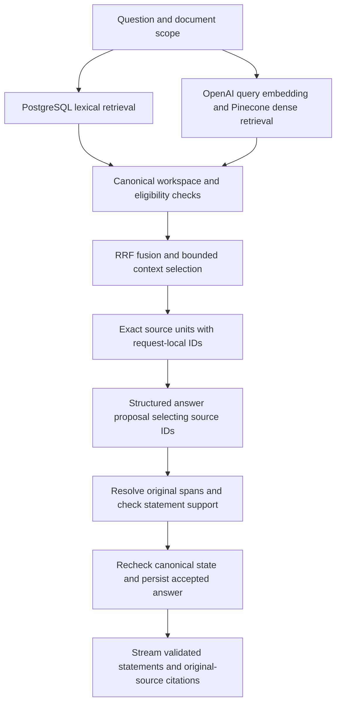

# Investment Research Archive

English · [Deutsch](README.de.md)

Evidence-grounded document research with hybrid retrieval and verifiable original-source citations.

Import PDFs or paste text, ask questions over saved documents, and inspect the evidence behind
each accepted statement. The application combines lexical and vector retrieval with structured
generation, server-resolved source references, and a separate statement-support check.

[Architecture](docs/14-m1-5-portfolio.md#1-implemented-architecture) ·
[Evaluation evidence](docs/14-m1-5-portfolio.md#3-recorded-evaluation-not-a-general-accuracy-claim) ·
[Local demo](docs/14-m1-5-portfolio.md#4-safe-owner-run-local-demonstration) ·
[Developer setup](docs/development.md)

This is a local, single-user Applied AI project. It is a research archive, not a trading system
or an investment-advice service.

## What you can do

- **Build a searchable archive:** import text-based PDFs or pasted text and follow automatic
  parsing, embedding, and indexing progress.
- **Browse saved sources:** view a paginated document list with processing status and open
  complete PDF or text originals without first asking a question.
- **Ask saved evidence:** research existing documents without another upload, or restrict a
  question to one or more selected searchable documents.
- **Inspect the source:** open a cited original PDF at its physical page or highlight the exact
  range in a pasted-text original.
- **See evidence limits:** distinguish complete, partial, conflicting, and insufficient
  answers instead of silently filling gaps from general model knowledge.
- **Choose models independently:** select the answer model and the statement-support model
  separately, with live progress and safe failure messages.

The [synthetic demo walkthrough](docs/14-m1-5-portfolio.md#4-safe-owner-run-local-demonstration)
shows PDF research, exact text citations, scoped abstention, and conflicting reports. All example
documents are fictional; no private research data is needed to demonstrate the system.

## How the RAG pipeline works

The M1.5 profile runs an application-owned pipeline. Retrieval finds candidate passages;
generation proposes claims; validation determines what can be published.



Ingestion runs separately through Celery workers and a credential-free parser boundary.
PostgreSQL and S3-compatible original storage are canonical; Pinecone is a derived index and
Redis holds transient queue state. The browser accesses data only through the API.

The retained M1 baseline alternates lexical/dense hits and resolves model-copied quotes.
M1.5 explicitly selects RRF and source-ID generation. Pinecone BGE cross-encoder reranking is
implemented as a separate opt-in experiment, not enabled by the website's M1.5 profile.
M1 remains the configuration default; the local command below selects M1.5 explicitly.

## Engineering decisions

- **Source IDs, not copied quotations.** The model selects bounded source-unit IDs. The server
  resolves their exact original text and offsets, avoiding quote-copying and repeated-text
  ambiguity without treating a selected ID as proof of a claim.
- **Two validation layers.** Canonical checks enforce workspace, version, processing, temporal,
  and exact-span rules. A separate model evaluates whether the resolved quotes support every
  material part of a proposed statement. Semantic model decisions remain fallible.
- **Stable citation identity.** Citations point to immutable document versions and original
  ranges, not replaceable chunks or vector IDs. PDF and Unicode text locators share a typed API.
- **Bounded provider usage.** Timeouts, input/output limits, durable budget reservations, and
  model-specific usage records make failure and estimated cost visible. Provider calls do not
  hold the answer-writing transaction open.
- **Application-owned orchestration.** Typed ports isolate provider SDKs from domain/application
  code. Prompts, parsers, embeddings, selection policies, and evaluation catalogs are versioned.
- **Reproducible correctness checks.** Normal tests use deterministic adapters; live quality
  evaluation is separate, explicitly authorized, corpus-bound, and cost-bounded.

The [architecture decisions](docs/adr/README.md) and
[code map](docs/14-m1-5-portfolio.md#1-implemented-architecture) explain these boundaries in detail.

## Tech stack

| Area | Technologies and role |
| --- | --- |
| Web | Next.js, React, TypeScript, Tailwind CSS; same-origin API access and source viewing |
| API and domain | Python, FastAPI, Pydantic; typed contracts and application services |
| Canonical data | PostgreSQL, SQLAlchemy, Alembic; records, lexical search, and migrations |
| Original storage | S3-compatible storage through Boto3; SeaweedFS in local Compose |
| Background processing | Celery, Redis, pypdf; queued processing and bounded text-PDF parsing |
| AI and retrieval | OpenAI embeddings and structured generation/support; Pinecone dense index; RRF; optional BGE reranking |
| Quality and delivery | pytest, Ruff, Mypy, frontend checks, Playwright, GitHub Actions, Docker Compose |
| Tooling and tracing | uv, pnpm, OpenTelemetry trace context; canonical usage accounting in PostgreSQL |

LangChain, LlamaIndex, and LangGraph are not the orchestration core. Hosted LangSmith evaluation
is not part of the implemented quality evidence. The [system design](docs/02-system-design.md)
separates current behavior from the broader target architecture.

## Evaluation evidence

The recorded owner-run evaluation uses **12 reviewed questions across three synthetic originals**.
It includes answerable questions, missing information, partial coverage, conflicting reports,
document scope, repeated wording, and combined PDF/text evidence.

The 2026-10-09 observation used RRF, source-unit prompt v6, Luna for both model roles, no reranker,
and the local **support-reason diagnostic variant**. It is not an evaluation of the normal
Boolean-only website support prompt or a representative real-world benchmark.

| Measurement | Recorded observation |
| --- | --- |
| Execution failures / cleanup | 0 of 12; verified cleanup |
| Expected coverage states | 12 of 12 |
| Strict citation target matching | 10 of 12 |
| Correct uncited abstentions | 2 of 2 |
| Median / maximum question latency | 4.895 s / 10.411 s |
| Estimated total OpenAI cost, including preparation | USD 0.010813 |

Exact citation validity was 10/10 checked answers; the stricter target score penalized three
additional genuine attribution links across two answers. These are distinct metrics, not a
single accuracy percentage. Cost is a repository-price estimate, excludes Pinecone billing,
and is not an invoice or the maximum reserved budget.

Earlier small ranking comparisons did not establish a quality advantage justifying automatic
adoption of RRF or reranking. The
[evaluation record](fixtures/m1_5/closeout-review.md#prompt-v6-live-observation-and-qualitative-source-review--2026-10-09)
preserves configuration, source review, hashes, and limitations. Catalog changes and stochastic
models prevent a causal before/after claim from these observations alone.

## Run locally

Prerequisites: Docker Compose, Node.js 24, Python 3.14, pnpm, and uv. Exact supported tool versions,
dependency installation, owner-managed credentials, and budget setup are in the
[development guide](docs/development.md#install). Live indexing/research requires OpenAI and
Pinecone credentials and approved public or synthetic documents; provider charges may apply.

After completing that setup, run from the repository root:

```shell
INVESTMENT_RESEARCH_RESEARCH_PROFILE=m1-5-citable-units \
  docker compose --env-file .env -f compose.yaml -f compose.m1-live.yaml up --build --detach --wait
```

Open <http://127.0.0.1:3000>, import an approved document, wait for `SEARCHABLE`, and ask a question.
The normal M1.5 website checker returns a Boolean support decision, without diagnostic reasons.
Keep the explicit profile when recreating the API; an ordinary Compose invocation can restore
M1. The [demo guide](docs/14-m1-5-portfolio.md#4-safe-owner-run-local-demonstration) gives concrete
synthetic questions and citation checks. Never commit credentials or enable raw diagnostics for
private content.

## Development and testing

Frontend checks run through pnpm; backend checks through uv. The
[verification guide](docs/development.md#verify-changes) documents unit/static checks,
disposable PostgreSQL and migration tests, storage contracts, parser isolation, queue recovery,
and complete Docker/browser journeys. Required CI uses credential-free deterministic providers;
live-provider quality tests are separate and opt-in.

See [CI configuration](.github/workflows/ci.yml) and the
[evaluation corpus](fixtures/m1_5/README.md) for reproducible checks rather than relying on a
badge or a one-off demo alone.

## Scope and limitations

- Local single-user operation uses a fixed server-owned identity and loopback access, not
  production authentication or public hosting. Only approved non-sensitive documents may
  reach external providers.
- PDF support extracts existing text; scanned image pages have no OCR path. Complex layouts,
  line-break word splitting, and retrieval ranking can cause missed evidence.
- Generation receives bounded selected context, not a guaranteed exhaustive reading of every
  PDF page. Source IDs prevent copying errors, not all retrieval or model-reasoning failures.
- The evaluation is small, synthetic, and developer-informed. Broader held-out quality testing,
  full ingestion/lifecycle reliability, archive discovery, and conversational/routed RAG remain
  later work. M1.5 final acceptance is tracked separately from implemented capabilities.

The next stages address ingestion/version/deletion reliability, archive discovery and broader
evaluation, then the remaining routed/conversational RAG work. See the
[delivery plan](docs/05-delivery-plan.md) for scope and gates.

## Documentation

- [Architecture and data ownership](docs/02-system-design.md)
- [Portfolio evidence, implementation map, and demo](docs/14-m1-5-portfolio.md)
- [Developer setup, operations, and verification](docs/development.md)
- [Evaluation corpus and source review](fixtures/m1_5/README.md)
- [Security boundaries](docs/04-security-and-operations.md)
- [Architectural decisions](docs/adr/README.md)
