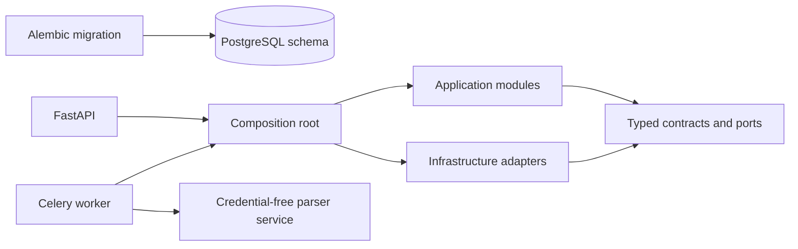

# Backend

This directory contains the shared Python application package used by the FastAPI API, Celery
worker, credential-free parser service, and development commands. It is not an API-only codebase;
the processes share typed application contracts while retaining different permissions and entry
points.

## Structure

| Path                       | Responsibility                                                                   |
| -------------------------- | -------------------------------------------------------------------------------- |
| `.dockerignore`            | Positive allowlist for the minimal, secret-free backend build context.           |
| `Dockerfile`               | Reproducible non-root API, migration, worker, and parser image targets.          |
| `alembic.ini`              | Secret-free Alembic paths and logging configuration.                             |
| `migrations/`              | Reviewed, ordered PostgreSQL schema history and migration environment.           |
| `pyproject.toml`           | Python package metadata, dependencies, and Ruff, Mypy, and Pytest configuration. |
| `uv.lock`                  | Reproducible Python dependency resolution.                                       |
| `scripts/`                 | Seed, contract, image, service, and isolation verification utilities.            |
| `src/investment_research/` | Shared application package, process entry points, composition, and modules.      |
| `tests/`                   | Deterministic unit tests and opt-in PostgreSQL integration tests.                |

## Runtime relationship

Only the composition root may select concrete adapters. Domain and application code must not depend on FastAPI routes, database implementations, or provider SDKs. Module dependency rules are enforced by backend tests.
The worker is the only application process allowed to bridge canonical backend services and the
isolated parser network. The parser receives bounded PDF bytes and versioned non-secret limits, not
workspace identifiers, object keys, or service credentials.

## Container image

The multi-stage `Dockerfile` pins the Python and uv images by immutable multi-platform digest. Its
builder installs the exact locked runtime dependencies without development tools; the final image
contains only the virtual environment and application source. It runs as UID/GID `65532`, and that
user cannot modify the copied source tree. Dependencies, source, and runtime configuration remain
separate layers so ordinary source edits do not reinstall dependencies.

The separate `verification` target includes development dependencies and tests. Its builder makes
copied tests readable and directories traversable for the non-root runtime, even when a local test
file has owner-only permissions. This normalization changes only the image, not host permissions,
and grants no additional write permissions. Production targets do not include the test tree.

| Target      | Current entry point                          | M0 role                                                        |
| ----------- | -------------------------------------------- | -------------------------------------------------------------- |
| `api`       | Uvicorn with the FastAPI application factory | Public application API with liveness and readiness checks.     |
| `migration` | Alembic `upgrade head`                       | Applies reviewed schema history before application startup.    |
| `worker`    | Celery processing worker                     | Claims queued runs and owns canonical storage and persistence. |
| `parser`    | Private Uvicorn parser application           | Parses bounded PDF bytes without canonical-service secrets.    |

The migration target receives only PostgreSQL configuration, exits after Alembic reaches `head`,
and never seeds data. Repeated execution is safe because Alembic applies only revisions that the
database has not recorded yet.

The API image checks its aggregate `/ready` endpoint, which requires the exact database migration,
the Celery broker, and the configured S3 bucket. The worker image instead runs a bounded Celery
control ping addressed to its own node name. The parser checks only its credential-free internal
HTTP endpoint. The one-shot migration target correctly declares no healthcheck.

No application configuration or credential is accepted as a build argument. Required values are
injected only when a container starts. The build context uses a positive allowlist, so environment
files, virtual environments, documentation, caches, and local outputs never reach Docker. Tests are
allowlisted for the separate verification target and are not copied into production targets.
The executable image gate and its guarantees are documented in
[`scripts/README.md`](scripts/README.md#backend-image-verification). The final runtime isolation
gate is documented under
[`Parser-isolation verification`](scripts/README.md#parser-isolation-verification).

Installation, startup, and verified commands are documented in the repository [`README.md`](../README.md). Architecture and ownership rules are defined in [`docs/02-system-design.md`](../docs/02-system-design.md), the completed proof structure in [`docs/08-m0-0-implementation-plan.md`](../docs/08-m0-0-implementation-plan.md), and the active runtime replacement sequence in [`docs/09-m0-implementation-plan.md`](../docs/09-m0-implementation-plan.md).
