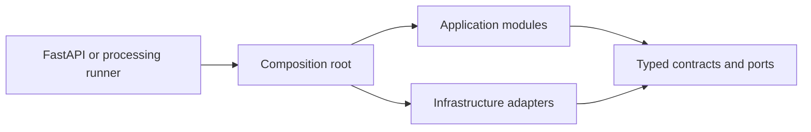

# Backend

This directory contains the shared Python application package used by the FastAPI process and, later, the M0.0 processing runner and Celery worker. It is not an API-only codebase.

## Structure

| Path                       | Responsibility                                                                   |
| -------------------------- | -------------------------------------------------------------------------------- |
| `alembic.ini`              | Secret-free Alembic paths and logging configuration.                             |
| `migrations/`              | Reviewed, ordered PostgreSQL schema history and migration environment.           |
| `pyproject.toml`           | Python package metadata, dependencies, and Ruff, Mypy, and Pytest configuration. |
| `uv.lock`                  | Reproducible Python dependency resolution.                                       |
| `scripts/`                 | Checked development utilities, currently OpenAPI export and verification.        |
| `src/investment_research/` | Application package, composition root, API boundary, and modules.                |
| `tests/`                   | Deterministic unit tests and later integration and acceptance tests.             |

## Runtime relationship

Only the composition root may select concrete adapters. Domain and application code must not depend on FastAPI routes, database implementations, or provider SDKs. Module dependency rules are enforced by backend tests.

Installation, startup, and verified commands are documented in the repository [`README.md`](../README.md). Architecture and ownership rules are defined in [`docs/02-system-design.md`](../docs/02-system-design.md) and [`docs/08-m0-0-implementation-plan.md`](../docs/08-m0-0-implementation-plan.md).
