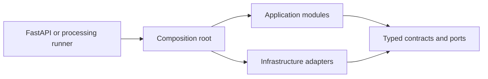

# Backend

This directory contains the shared Python application package used by the FastAPI process and the
M0.0 processing runner. The later Celery worker will invoke the same application service, so this is
not an API-only codebase.

## Structure

| Path                       | Responsibility                                                                     |
| -------------------------- | ---------------------------------------------------------------------------------- |
| `.dockerignore`            | Positive allowlist for the minimal, secret-free backend build context.             |
| `Dockerfile`               | Reproducible non-root API, worker, and parser image targets.                       |
| `alembic.ini`              | Secret-free Alembic paths and logging configuration.                               |
| `migrations/`              | Reviewed, ordered PostgreSQL schema history and migration environment.             |
| `pyproject.toml`           | Python package metadata, dependencies, and Ruff, Mypy, and Pytest configuration.   |
| `uv.lock`                  | Reproducible Python dependency resolution.                                         |
| `scripts/`                 | Checked OpenAPI, seed, and isolated PostgreSQL verification utilities.             |
| `src/investment_research/` | Shared application package, API and runner entry points, composition, and modules. |
| `tests/`                   | Deterministic unit tests and opt-in PostgreSQL integration tests.                  |

## Runtime relationship

Only the composition root may select concrete adapters. Domain and application code must not depend on FastAPI routes, database implementations, or provider SDKs. Module dependency rules are enforced by backend tests.

## Container image

The multi-stage `Dockerfile` pins the Python and uv images by immutable multi-platform digest. Its
builder installs the exact locked runtime dependencies without development tools; the final image
contains only the virtual environment and application source. It runs as UID/GID `65532`, and that
user cannot modify the copied source tree. Dependencies, source, and runtime configuration remain
separate layers so ordinary source edits do not reinstall dependencies.

| Target   | Current entry point                            | M0 role                                                               |
| -------- | ---------------------------------------------- | --------------------------------------------------------------------- |
| `api`    | Uvicorn with the FastAPI application factory   | Runnable API image with a `/ready` Docker health check.               |
| `worker` | The retained M0.0 single-job processing runner | Build foundation replaced by the Celery entry point in M0 Step 3.     |
| `parser` | A minimal Python runtime check                 | Build foundation replaced by the credential-free parser in M0 Step 3. |

No application configuration or credential is accepted as a build argument. Required values are
injected only when a container starts. The build context uses a positive allowlist, so environment
files, virtual environments, tests, documentation, caches, and local outputs never reach Docker.
The executable image gate and its guarantees are documented in
[`scripts/README.md`](scripts/README.md#backend-image-verification).

Installation, startup, and verified commands are documented in the repository [`README.md`](../README.md). Architecture and ownership rules are defined in [`docs/02-system-design.md`](../docs/02-system-design.md), the completed proof structure in [`docs/08-m0-0-implementation-plan.md`](../docs/08-m0-0-implementation-plan.md), and the active runtime replacement sequence in [`docs/09-m0-implementation-plan.md`](../docs/09-m0-implementation-plan.md).
