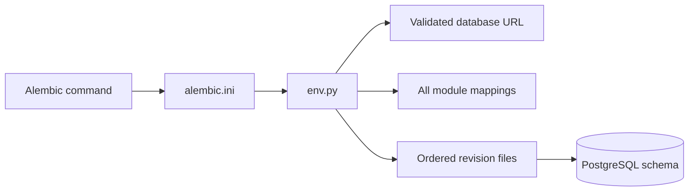

# Database Migrations

Alembic owns every PostgreSQL schema change. Application startup must never call
`Base.metadata.create_all()` or mutate the schema implicitly.

## Structure

```text
alembic.ini
└── migrations/
    ├── env.py
    ├── script.py.mako
    └── versions/
        └── 0001_m0_0_schema.py
```

| Path | Responsibility |
| --- | --- |
| `alembic.ini` | Locates this directory and configures migration logging. |
| `env.py` | Loads validated settings and the complete application-owned metadata. |
| `script.py.mako` | Provides the typed template for later revisions. |
| `versions/` | Stores the immutable, ordered schema history. |

## Runtime flow



For local development, the database URL is derived from the root `.env` PostgreSQL values. An
explicit `INVESTMENT_RESEARCH_DATABASE_URL` overrides that file for CI and isolated tooling. The URL
must not be written to `alembic.ini`, revision files, logs, examples, or committed environment files.

## Apply and verify

From `backend/`, with the local PostgreSQL service running and the database URL configured:

```shell
uv run alembic -c alembic.ini upgrade head
uv run alembic -c alembic.ini check
uv run alembic -c alembic.ini current
```

`upgrade head` applies every missing revision. `check` fails when current SQLAlchemy mappings would
produce new migration operations. `current` reports the revision recorded in PostgreSQL.

To inspect SQL without connecting to PostgreSQL:

```shell
uv run alembic -c alembic.ini upgrade head --sql
```

Offline output can contain schema details and should be reviewed rather than committed as a build
artifact.

## Revision rules

- Generate a proposal with Alembic, then review every operation before committing it.
- Keep old revision files independent of current ORM models and application services.
- Use deterministic names for constraints and indexes.
- Preserve workspace boundaries in every cross-table relationship.
- Put irreversible data transformations behind an explicit backup and rollout plan.
- Test upgrade, drift detection, constraints, and rollback against PostgreSQL.
- Never use `create_all()` as a migration shortcut.

Autogeneration does not detect expression changes to CHECK constraints with unchanged names.
Review and write those operations explicitly, then test their upgrade and downgrade behavior
against PostgreSQL; a passing `alembic check` alone is insufficient for this case.
See [Alembic's CHECK-constraint detection limits](https://alembic.sqlalchemy.org/en/latest/autogenerate.html#detecting-check-constraints).
Revision `0009_m1_5_reranking_operations` uses this approach to admit research-owned reranking
records. Downgrade refuses to discard that operation kind while its accounting records exist.

The initial revision also installs PostgreSQL triggers that reject updates and deletes for
`document_versions` and `original_artifacts`. Corrections create a new document version instead of
rewriting preserved source history.
