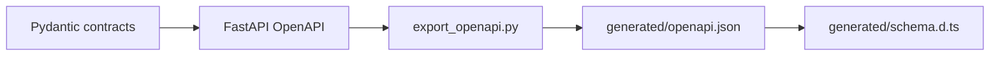
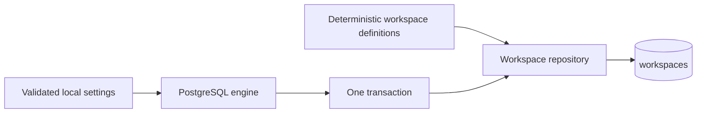
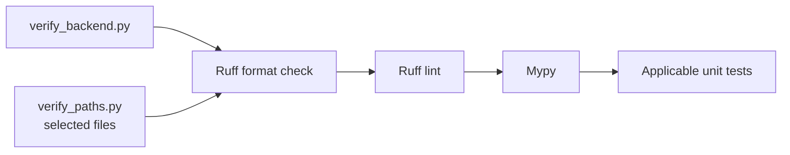
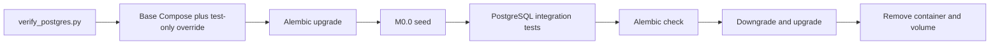
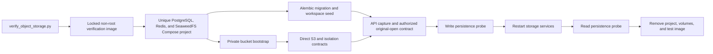
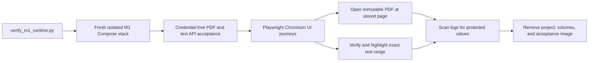

# Backend Scripts

This directory contains small, reviewable development utilities. Scripts support the application but are not imported by runtime request handlers.

## Contents

| File                          | Responsibility                                                                           |
| ----------------------------- | ---------------------------------------------------------------------------------------- |
| `__init__.py`                 | Makes development commands importable for tests and `python -m` execution.               |
| `docker_secrets.py`           | Creates portable read-only Compose secret files inside a private temporary directory.    |
| `export_openapi.py`           | Exports the FastAPI OpenAPI document or verifies that the committed snapshot is current. |
| `reset_local.py`              | Recreates only the fixed local Compose runtime after exact confirmation.                 |
| `seed_m0_0.py`                | Idempotently creates the two deterministic synthetic M0.0 workspaces.                    |
| `verify_backend.py`           | Runs all deterministic backend static checks and unit tests.                             |
| `verify_backend_images.py`    | Builds and exercises every backend image target in an isolated runtime.                  |
| `verify_m0_runtime.py`        | Proves the complete fixture journey through the production-shaped M0 runtime.            |
| `verify_m1_provider_smoke.py` | Runs one explicit, bounded M1 external-provider compatibility smoke.                     |
| `plan_m1_5_live_baseline.py`  | Validates the approved M1.5 preflight and bounds sequential invocation reservations.      |
| `compare_m1_5_retrieval.py`   | Scores paired M1/RRF offline contexts from identical qualified lanes without answer-quality claims. |
| `m1_5_live_providers.py`      | Wraps existing provider ports with reservations and content-free usage records.          |
| `m1_5_live_diagnostics.py`    | Classifies failures using fixed categories and allowlisted adapter metadata only.        |
| `m1_5_local_output.py`        | Displays opt-in synthetic model proposals and decisions only in a local interactive terminal. |
| `m1_5_live_index.py`          | Owns a fresh bounded evaluation namespace and verifies scoped cleanup.                   |
| `m1_5_live_runner.py`         | Measures the frozen corpus through canonical M1 research and persisted-answer readback.  |
| `m1_5_live_runtime.py`        | Owns disposable PostgreSQL and role-specific provider clients for evaluation.            |
| `m1_5_live_settings.py`       | Loads only evaluation providers and budget, including existing local Compose secret files. |
| `verify_m1_5_live_baseline.py` | Defaults to free preflight; paid evaluation requires explicit execution and confirmations. |
| `verify_object_storage.py`    | Exercises SeaweedFS S3 contracts in an isolated internal Docker network.                 |
| `verify_parser_isolation.py`  | Exercises the final parser image, protocol, resources, and network isolation.            |
| `verify_paths.py`             | Runs deterministic checks for explicitly selected backend Python files.                  |
| `verify_postgres.py`          | Runs migrations, seeds, and integration tests in an isolated disposable PostgreSQL.      |
| `verify_queue_recovery.py`    | Proves live Celery redelivery and lease-based recovery after worker loss.                |
| `verify_runtime_cleanup.py`   | Fails when an M0 runtime verifier leaves a scoped Docker resource behind.                |

The M1.5 evaluation commands, fixture provenance, output schema, and opt-in boundaries are
documented in the [corpus guide](../../fixtures/m1_5/README.md#opt-in-live-baseline). The live
runner is a development tool and reuses the synthetic integration fixture builders; normal
application request handlers never import it. Required CI uses deterministic test ports, not
live keys or paid calls.

Both live-plan commands accept `--retrieval-policy m1|rrf|rrf_rerank`, defaulting to M1. The runner resolves
that frozen profile into the canonical retrieval service and records its actual selector version
in the admission plan, v2 observations, and summary. Budgets, prompts, model choices, provider
permissions, and the application default are unchanged. Free preflight never loads keys; live
execution still requires explicit confirmations. Reranking additionally requires its dedicated key
and allowance confirmation; see the [reranking guide](#standalone-m15-reranking-configuration-preparation).
Separate live runs are not a paired snapshot
comparison. See the [live selector guide](../../fixtures/m1_5/README.md#live-selector-experiment).

The paired retrieval comparison uses the existing PostgreSQL verifier and optional
`INVESTMENT_RESEARCH_M1_5_RRF_COMPARISON_OUTPUT` path. Its integration test retrieves once per case
and supplies the same canonical lanes to the frozen M1 and RRF selectors. The scorer checks the
reviewed corpus, reports evidence availability and context-order changes, and never changes the
application default. Generation, support evaluation, provider cost, and browser behavior are not
measured. See the [paired comparison guide](../../fixtures/m1_5/README.md#paired-m1rrf-offline-comparison)
for the verified workflow, observations, and limitations.

## Contract flow



The script uses test settings, produces stable sorted JSON, and writes to `frontend/src/lib/api/generated/openapi.json` by default. Its `--check` mode does not rewrite the snapshot; it fails when the committed file is missing or stale.

Generated artifacts must not be edited manually. The complete command sequence is documented in the repository [`README.md`](../../README.md#update-api-contracts).

## Seed flow



The seed command uses the same local workspace identifier as the fixed M0.0 identity provider and
adds a second sanitized workspace for negative isolation tests. Repeated runs leave identical rows
unchanged. An existing deterministic identifier with different data aborts and rolls back the whole
seed transaction instead of overwriting data.

The Python module accepts validated host PostgreSQL configuration for isolated tooling. The normal
Compose workflow instead runs it through the short-lived `seed` image target and `tools` profile.
That container joins only the private backend network, receives only the PostgreSQL secret, and
starts only after the one-shot migration has reached `head`. The verified commands are documented
in the repository [`README.md`](../../README.md#seed-or-reset-local-data).

## Safe local reset


`reset_local.py` deliberately accepts neither a Compose project name nor a filesystem deletion
target. It is fixed to the `investment-research-m0-0` project, requires the repository `backend/`
directory as the current working directory, checks repository markers, and requires the exact
confirmation phrase before invoking Docker. The destructive operation is limited to the named
Compose project's volumes. It then rebuilds the complete stack and uses the internal `seed`
container to restore only deterministic synthetic workspaces. A mismatched directory,
confirmation, missing Docker executable, or failed Compose command stops the workflow.

## Python verification



Both commands are read-only checks: they report formatting differences but never rewrite source
files. `verify_backend.py` checks the complete backend and all unit tests. `verify_paths.py` accepts
one or more existing `.py` files inside the backend, removes duplicate paths, and passes only selected
`tests/**/test_*.py` modules to Pytest. It rejects missing, non-Python, and out-of-backend paths.

Run the complete deterministic backend check from `backend/`:

```shell
uv run --locked python -m scripts.verify_backend
```

For focused feedback while editing, provide both implementation and test files when applicable:

```shell
uv run --locked python -m scripts.verify_paths \
  src/investment_research/modules/evidence/persistence.py \
  tests/unit/test_evidence_persistence.py
```

Focused verification is not the final completion gate. Run the complete backend command after the
work block and the PostgreSQL command after persistence or migration changes.

## Isolated PostgreSQL verification



The verification command selects an available loopback port, generates a random disposable
password, writes it to a read-only mode-`0444` Compose secret file inside a private mode-`0700`
temporary directory, and uses a unique Compose project name. The directory blocks access by other
host users while the file mode lets native-Linux Docker bind-mount the secret for non-root container
users with different UIDs. Normal `compose.yaml` publishes no PostgreSQL port and keeps the backend
network internal. `compose.test.yaml` adds a separate non-internal `host-test` network and one
loopback-only database port for host-driven Alembic and SQLAlchemy checks. It also selects the
credential-free `m0-regression` processing profile for both API capture and the worker, which stops
after `LEXICAL_READY`, only while the runtime environment is `test`. The M1 acceptance override
selects `m1` for both processes and supplies its deterministic dense index; normal M1 workers
require the configured embedding and dense-index providers. The PostgreSQL, object-storage,
queue-recovery, and complete-runtime verifiers load this override; normal startup and
container-only gates do not.
Cleanup runs after success, command failure, or test failure. It removes only resources owned by
that invocation and never targets the normal development database or its volume. The temporary
secret directory is removed when the command exits.

## Isolated object-storage verification



Run the complete SeaweedFS gate from `backend/` with Docker running:

```shell
uv run --locked python -m scripts.verify_object_storage
```

The command generates disposable PostgreSQL and Redis passwords, administrator and application
storage credentials, a private bucket, a unique Compose project, and a unique verification image.
Direct S3 tests reach only the gateway through the internal `storage-data` network. A separately
confined API contract container joins that network and the project's backend network, captures a
synthetic PDF through `POST /api/v1/documents` and synthetic text through
`POST /api/v1/documents/text`, publishes their processing tasks to Redis, and reopens both immutable
originals through the authorized original endpoint.
SeaweedFS publishes no host port. Tests cover immutable conditional creation under concurrency,
checksum and byte integrity, open and cleanup, missing/foreign non-disclosure, workspace key scope,
least-privilege application credentials, and restart persistence. Runtime inspection also verifies
non-root users, dropped capabilities, `no-new-privileges`, read-only control-service filesystems,
unpublished storage ports, secret-file delivery, and control-plane network isolation.

The command does not load repository `.env` values. It migrates and seeds its own PostgreSQL volume;
generated secrets are mounted from read-only mode-`0444` files inside a private mode-`0700`
temporary directory, and their values never appear in displayed command arguments. Cleanup always
targets only that invocation's unique project, networks, volumes, contract container, verification
image, and temporary secret directory, including after a failed build or test.

## Parser-isolation verification

```mermaid
flowchart LR
    COMMAND[verify_parser_isolation.py] --> IMAGES[Build worker and parser images]
    IMAGES --> COMPOSE[Start Redis and parser on separate internal networks]
    COMPOSE --> INSPECT[Inspect user, mounts, capabilities, and resource limits]
    INSPECT --> NEGATIVE[Probe secret, filesystem, backend, and internet denial]
    NEGATIVE --> V1[Parse the frozen PDF through protocol v1]
    V1 --> V2[Parse canonical text through protocol v2 and verify exact slices]
    V2 --> LIMITS[Reject request and extracted-text limit violations]
    LIMITS --> CLEANUP[Remove project, volumes, images, and secret files]
```



Run the parser boundary gate from `backend/` with Docker running:

```shell
uv run --locked python -m scripts.verify_parser_isolation
```

The parser joins only the internal `parser` network; the worker is the sole bridge to the separate
backend and storage-data networks. Runtime inspection requires the declared non-root identity,
read-only root filesystem, dropped capabilities, `no-new-privileges`, exact CPU, memory, and process
limits, bounded temporary storage, no published ports, no application secrets, and no Docker socket
or repository mount. Active probes verify that `/app` is not writable, `/tmp` remains usable, and
connections to Redis and the external network fail. A worker-image probe must still parse the
repository-owned PDF through `POST /internal/v1/parse`, then parse canonical UTF-8 text through
`POST /internal/v2/parse` and verify every returned text slice against the source. Request-size and
extracted-text limits fail with typed, safe outcomes. The unique Compose project and temporary
secrets are removed even when a check fails.

## Queue-recovery verification

```mermaid
flowchart LR
    COMMAND[verify_queue_recovery.py] --> STACK[Start isolated worker runtime]
    STACK --> CAPTURE[Capture fixture and publish task]
    CAPTURE --> CLAIM[Wait for PARSING claim]
    CLAIM --> KILL[Kill Celery pool worker]
    KILL --> REDELIVER[Broker redelivery]
    REDELIVER --> RECLAIM[Reclaim after lease expiry]
    RECLAIM --> READY[Require one LEXICAL_READY output]
    READY --> CLEANUP[Remove project and volumes]
```



Run the live worker-loss gate from `backend/` with Docker running:

```shell
uv run --locked python -m scripts.verify_queue_recovery
```

The command creates a unique Compose project with generated disposable credentials and does not
load repository `.env` values. It pauses the isolated parser, captures the frozen PDF through the
real application container, and waits until the Celery pool worker owns the canonical processing
lease. It then asks Celery for the exact pool-process identifier and kills only that child process,
leaving the Celery main process alive to reject and redeliver the unacknowledged message. The parser
is resumed after the deliberately shortened disposable lease expires.

Success requires the redelivered task to reach `LEXICAL_READY` on its second canonical attempt with
exactly one expected set of structure blocks, chunks, and chunk-set output. Cleanup removes the
unique project and its volumes after both success and failure.

## Complete M0 runtime verification

```mermaid
flowchart LR
    COMMAND[verify_m0_runtime.py] --> STACK[Fresh PostgreSQL, Redis, SeaweedFS, parser, and worker]
    STACK --> MIGRATE[One-shot Alembic migration]
    MIGRATE --> SEED[Internal seed tool container]
    SEED --> CAPTURE[API capture publishes Celery job]
    CAPTURE --> READY[Worker reaches LEXICAL_READY]
    READY --> ANSWER[Validated answer and exact citation]
    ANSWER --> REPEAT[Repeat question reuses canonical evidence]
    REPEAT --> ORIGINAL[Open byte-identical original]
    ORIGINAL --> REFUSE[Insufficient-evidence control case]
    REFUSE --> LOGS[Scan captured logs for sensitive sentinels]
    LOGS --> CLEANUP[Remove project, volumes, and test image]
```



Run the complete automatic fixture journey from `backend/` with Docker running:

```shell
uv run --locked python -m scripts.verify_m0_runtime
```

The command combines `compose.yaml` with the test-only `compose.test.yaml`, creates a unique project,
generates disposable file-backed credentials, lets the one-shot migration container prepare the
database, runs the internal seed tool container, and sends the frozen public fixture through the
real API application, Celery worker, isolated parser, SeaweedFS, and PostgreSQL. The acceptance
container runs non-root with a read-only root filesystem and receives only the backend and
object-storage data networks. It never starts the M0.0 manual runner.

Success requires the answerable fixture question to return its validated statement and exact
page-two evidence twice. The second request must create a new research request while reusing the
same canonical evidence span. The original endpoint must return byte-identical PDF content, and the
unanswerable control question must return the insufficient-evidence terminal event. Live
`research.progress` events may precede these validated terminal events. Before cleanup, the
verifier captures the web, API, worker, and parser logs without displaying them and rejects any
injected credential marker, exact generated credential, or fixture evidence text. Failure
diagnostics redact those sentinels before printing logs. The command also reports observed startup,
upload-to-`LEXICAL_READY`, fixture-test, log-capture, and cleanup durations; these are measurements
of that run, not performance guarantees. The unique Compose project, its volumes, generated
secrets, and the uniquely tagged verification image are removed after success or failure.

## Complete M1 runtime verification



Run the complete M1 gate from `backend/` after installing the repository-pinned Playwright Chromium
build as documented in the root README:

```shell
uv run --locked python -m scripts.verify_m1_runtime
```

The command extends the complete runtime proof to both M1 media types and the visible browser
contract. Its containerized acceptance client first proves processing, retrieval, validated answers,
stable evidence identifiers, original bytes, repeatability, safe insufficiency, and prompt-injection
refusal through the same-origin web proxy. The host Playwright process then receives only the random
loopback web origin and operates the rendered interface; the disposable Compose secret-file paths
are not added to its environment. The PDF journey verifies the stored physical page and the text
journey verifies the Unicode-code-point range, exact text, and checksum before accepting the
highlight. API, browser, or log-safety failures all enter the same scoped `finally` cleanup path.

CI follows the parser-isolation, queue-recovery, and complete-runtime checks with:

```shell
python3 -m scripts.verify_runtime_cleanup
```

This standard-library-only command inventories Docker containers, networks, volumes, and temporary
acceptance images for the verification prefixes owned by those checks. It never removes resources
or matches the normal local Compose project. A match therefore exposes a cleanup regression instead
of concealing it. The CI step uses `always()` so the inventory also runs after an earlier verification
failure; unit tests separately force the failure path and prove that the verifier still enters its
scoped cleanup.

## Backend image verification

```mermaid
flowchart LR
    COMMAND[verify_backend_images.py] --> BUILD[Build API, migration, seed, worker, parser]
    BUILD --> METADATA[Check target metadata and secret absence]
    METADATA --> RUNTIME[Run minimal non-root smoke tests]
    RUNTIME --> POSTGRES[Create isolated PostgreSQL and Redis]
    POSTGRES --> MIGRATE[Run migration image to head]
    MIGRATE --> REPEAT[Run migration image again]
    REPEAT --> API[Start API image]
    API --> HEALTH[Check Docker health, /health, and /ready]
    HEALTH --> CLEANUP[Remove images, container, network, and volume]
```



Run the complete image gate from `backend/` with Docker running:

```shell
uv run --locked python -m scripts.verify_backend_images
```

The command builds the `api`, `migration`, `seed`, `worker`, and `parser` targets from the committed
lockfile.
For every target it verifies the declared non-root user, exact entry point, expected healthcheck,
minimal runtime contents, read-only application source for the runtime user, and the absence of
forbidden credential names from image configuration and build history.

It then creates a uniquely named PostgreSQL and Redis Compose project with random disposable
passwords, runs the migration image twice to prove both schema creation and idempotency, and starts
the API only after those runs succeed. PostgreSQL and Redis receive their values through read-only
mode-`0444` secret files inside a private mode-`0700` temporary directory. The API receives its
database and broker URLs only through the child process environment, must become healthy, and must
return the exact public liveness and readiness responses. Displayed commands contain
environment-variable names but never their values. Cleanup removes only the resources, temporary
image tags, and secret directory owned by that invocation, including after a failed build or runtime
check.

## Standalone M1.5 reranking configuration preparation

`load_evaluation_reranking_settings` in `m1_5_live_settings.py` is a separate host loader used only
by the opt-in evaluation CLI, not normal API composition. Its default monthly request limit is zero:
it returns `None` before reading local configuration or credentials. Positive limits require
explicit boolean Starter-allowance and public/synthetic-content confirmations before file access.
The local workspace/UTC-month limit is 0–500; it does not measure account-wide remaining allowance.
The owner must confirm sufficient allowance before each live comparison.

The validated `RerankingProviderSettings` freezes BGE, the existing no-truncation configuration,
the `pinecone-starter-bge-included-v1` admission policy, and a 1–20-second deadline. This policy
does not approve paid-plan use, prove the account tariff, or guarantee zero billed cost. The
[current pricing page](https://www.pinecone.io/pricing/), checked on 2026-10-09, lists 500 monthly
BGE requests included in Starter; the model/operation admission and local guard remain separate.
The evaluator uses a six-request limit in both its retained run reservations and its disposable
workspace's canonical operation ledger. Failed attempts count; empty eligible input skips the call.
The unchanged USD 0.80 OpenAI ceiling and USD 5.00 workspace/month safeguard remain in force.
The zero monetary reranking policy applies only to the explicitly confirmed included Starter
allowance. It is not a generic price or approval for billable reranking. Reported `rerank_units`
are stored separately from token counts, with requested/returned model and per-call elapsed time.
The current profile expects one rerank unit per bounded request; unexpected usage halts the run.
Unknown usage remains unknown, and no automatic retry or fallback is added.

Only `INVESTMENT_RESEARCH_PINECONE_RERANK_API_KEY` or its `_SECRET_FILE` reference is loaded.
References reuse the existing ignored `.secrets` host-file validation. Direct and file forms
conflict, and missing keys never fall back to query/index credentials. Existing provider settings
and normal API/worker/parser loaders are unchanged. The example file shows commented placeholders;
do not enable or configure a new credential merely to run normal tests.

From `backend/`, inspect the credential-free plan:

```shell
uv run --locked python -m scripts.verify_m1_5_live_baseline \
  --retrieval-policy rrf_rerank \
  --answer-policy citable_units \
  --support-policy document_attribution
```

After offline checks and separate owner approval, the live form is:

```shell
uv run --locked python -m scripts.verify_m1_5_live_baseline \
  --execute \
  --retrieval-policy rrf_rerank \
  --answer-policy citable_units \
  --support-policy document_attribution \
  --answer-model gpt-5.6-terra \
  --support-model gpt-5.6-terra \
  --max-spend-usd 0.80 \
  --confirm-public-synthetic \
  --confirm-pinecone-starter \
  --confirm-reranking-allowance \
  --output ../outputs/m1_5/rrf-rerank-terra-terra-v1.json
```

Use a new output filename for each invocation. Keep the corpus, answer/support models, source-unit
and support policies, local-output mode, and spending ceiling identical in a paired `rrf` run;
change only `--retrieval-policy` and the output path. Optional local model output retains its
existing local-terminal/non-CI restrictions. Tests use deterministic ports, not paid providers.
The live command has not yet established hosted model compatibility or a quality improvement.

## M1 provider compatibility smoke

`verify_m1_provider_smoke.py` is an optional live-provider compatibility check. It is never part of
normal pull-request or push CI and never replaces deterministic correctness tests. Run it only with
the approved public-synthetic fixture manifest, a Pinecone Starter index with the frozen M1
configuration, and separate least-privilege document-indexing and generation credentials:

```shell
INVESTMENT_RESEARCH_OPENAI_DOCUMENT_API_KEY='<configured outside the repository>' \
INVESTMENT_RESEARCH_OPENAI_GENERATION_API_KEY='<configured outside the repository>' \
INVESTMENT_RESEARCH_PINECONE_INDEX_API_KEY='<configured outside the repository>' \
INVESTMENT_RESEARCH_PINECONE_INDEX_HOST='<configured outside the repository>' \
uv run --locked python -m scripts.verify_m1_provider_smoke \
  --manifest ../fixtures/m1/manifest.yaml \
  --confirm-public-synthetic \
  --confirm-pinecone-starter
```

The runner accepts only the exact repository manifest and frozen fixture digests. It embeds one
approved passage, writes one temporary vector, requires one supported answer for the approved
answerable question, and requires an explicit insufficient-evidence result for the approved control
question. Every generated statement must cite an exact range in the approved passage and pass a
separate support-evaluation call. Before each provider call, the runner reserves a conservative
request, token, vector, and USD allowance and stops before any frozen manifest ceiling would be
exceeded.

The runner writes no source text to Pinecone metadata, uses a unique workspace namespace, deletes
that complete namespace in `finally`, verifies that the vector is absent, closes all provider
clients, and prints only safe aggregate counts, maximum reserved spend, and cleanup status.
Visibility and deletion checks pass the remaining 30-second deadline to each Pinecone fetch and
reject a confirmation that arrives after that deadline.
Provider responses, fixture text, identifiers, hosts, and credentials are not logged.

GitHub's separate `M1 provider smoke` workflow exposes the same operation only through manual
dispatch with both confirmation inputs enabled. Configure repository secrets
`M1_OPENAI_DOCUMENT_API_KEY`, `M1_OPENAI_GENERATION_API_KEY`,
`M1_PINECONE_INDEX_API_KEY`, and `M1_PINECONE_INDEX_HOST` before a run. Keep this workflow
non-required for untrusted pull requests.
