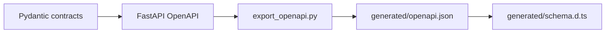
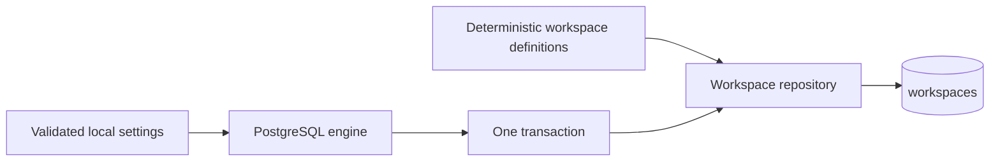
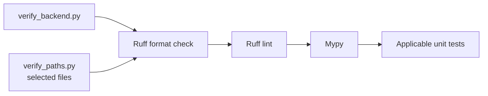
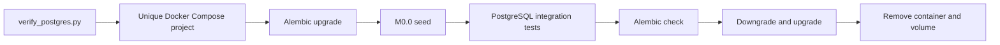

# Backend Scripts

This directory contains small, reviewable development utilities. Scripts support the application but are not imported by runtime request handlers.

## Contents

| File                       | Responsibility                                                                           |
| -------------------------- | ---------------------------------------------------------------------------------------- |
| `__init__.py`              | Makes development commands importable for tests and `python -m` execution.               |
| `export_openapi.py`        | Exports the FastAPI OpenAPI document or verifies that the committed snapshot is current. |
| `seed_m0_0.py`             | Idempotently creates the two deterministic synthetic M0.0 workspaces.                    |
| `verify_backend.py`        | Runs all deterministic backend static checks and unit tests.                             |
| `verify_backend_images.py` | Builds and exercises every backend image target in an isolated runtime.                  |
| `verify_object_storage.py` | Exercises SeaweedFS S3 contracts in an isolated internal Docker network.                 |
| `verify_paths.py`          | Runs deterministic checks for explicitly selected backend Python files.                  |
| `verify_postgres.py`       | Runs migrations, seeds, and integration tests in an isolated disposable PostgreSQL.      |

## Contract flow



The script uses test settings, produces stable sorted JSON, and writes to `frontend/src/lib/api/generated/openapi.json` by default. Its `--check` mode does not rewrite the snapshot; it fails when the committed file is missing or stale.

Generated artifacts must not be edited manually. The complete command sequence is documented in the repository [`README.md`](../../README.md#update-api-contracts).

## Seed flow



The seed command uses the same local workspace identifier as the fixed M0.0 identity provider and
adds a second sanitized workspace for negative isolation tests. Repeated runs leave identical rows
unchanged. An existing deterministic identifier with different data aborts and rolls back the whole
seed transaction instead of overwriting data.

The command uses the validated local PostgreSQL configuration from the root `.env`, while an
explicit process URL can override it for isolated tooling. It assumes Alembic has already migrated
the database to `head`. The verified command is documented in the repository
[`README.md`](../../README.md#run-database-migrations-and-seed-data).

## Python verification



Both commands are read-only checks: they report formatting differences but never rewrite source
files. `verify_backend.py` checks the complete backend and all unit tests. `verify_paths.py` accepts
one or more existing `.py` files inside the backend, removes duplicate paths, and passes only selected
`tests/**/test_*.py` modules to Pytest. It rejects missing, non-Python, and out-of-backend paths.

Run the complete deterministic backend check from `backend/`:

```shell
uv run --locked python -m scripts.verify_backend
```

For focused feedback while editing, provide both implementation and test files when applicable:

```shell
uv run --locked python -m scripts.verify_paths \
  src/investment_research/modules/evidence/persistence.py \
  tests/unit/test_evidence_persistence.py
```

Focused verification is not the final completion gate. Run the complete backend command after the
work block and the PostgreSQL command after persistence or migration changes.

## Isolated PostgreSQL verification



The verification command selects an available loopback port, generates a random disposable
password, and uses a unique Compose project name. Cleanup runs after success, command failure, or
test failure. It removes only resources owned by that invocation and never targets the normal M0.0
development database or its volume.

## Isolated object-storage verification

```mermaid
flowchart LR
    COMMAND[verify_object_storage.py] --> IMAGE[Locked non-root verification image]
    IMAGE --> COMPOSE[Unique SeaweedFS Compose project]
    COMPOSE --> BOOTSTRAP[Private bucket bootstrap]
    BOOTSTRAP --> CONTRACTS[S3 and isolation contract tests]
    CONTRACTS --> WRITE[Write persistence probe]
    WRITE --> RESTART[Restart storage services]
    RESTART --> READ[Read persistence probe]
    READ --> CLEANUP[Remove project, volumes, and test image]
```



Run the complete SeaweedFS gate from `backend/` with Docker running:

```shell
uv run --locked python -m scripts.verify_object_storage
```

The command generates disposable administrator and application credentials, a private bucket, a
unique Compose project, and a unique verification image. The test container reaches only the S3
gateway through the internal `storage-data` network; SeaweedFS publishes no host port. Tests cover
immutable conditional creation under concurrency, checksum and byte integrity, open and cleanup,
missing/foreign non-disclosure, workspace key scope, least-privilege application credentials, and
restart persistence. Runtime inspection also verifies non-root users, dropped capabilities,
`no-new-privileges`, read-only control-service filesystems, unpublished storage ports, secret-file
delivery, and control-plane network isolation.

The command does not load repository `.env` values. Its generated secrets are passed without values
in displayed command arguments. Cleanup always targets only that invocation's unique project,
volumes, and verification image, including after a failed build or test.

## Backend image verification

```mermaid
flowchart LR
    COMMAND[verify_backend_images.py] --> BUILD[Build API, worker, parser]
    BUILD --> METADATA[Check target metadata and secret absence]
    METADATA --> RUNTIME[Run minimal non-root smoke tests]
    RUNTIME --> POSTGRES[Create isolated PostgreSQL]
    POSTGRES --> MIGRATE[Alembic upgrade to head]
    MIGRATE --> API[Start API image]
    API --> HEALTH[Check Docker health, /health, and /ready]
    HEALTH --> CLEANUP[Remove images, container, network, and volume]
```



Run the complete image gate from `backend/` with Docker running:

```shell
uv run --locked python -m scripts.verify_backend_images
```

The command builds the `api`, `worker`, and `parser` targets from the committed lockfile. For every
target it verifies the declared non-root user, exact entry point, expected healthcheck, minimal
runtime contents, read-only application source for the runtime user, and the absence of forbidden
credential names from image configuration and build history.

It then creates a uniquely named PostgreSQL Compose project with a random disposable password,
migrates the empty database to Alembic `head`, and supplies the API database URL only through the
container's runtime environment. The API must become healthy and return the exact public liveness
and readiness responses. Displayed commands contain environment-variable names but never their
values. Cleanup removes only the resources and temporary image tags owned by that invocation,
including after a failed build or runtime check.
