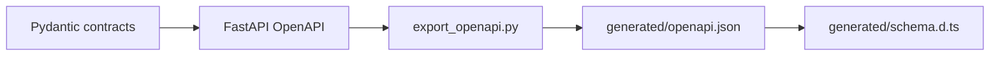

# Backend Scripts

This directory contains small, reviewable development utilities. Scripts support the application but are not imported by runtime request handlers.

## Contents

| File                | Responsibility                                                                           |
| ------------------- | ---------------------------------------------------------------------------------------- |
| `export_openapi.py` | Exports the FastAPI OpenAPI document or verifies that the committed snapshot is current. |

## Contract flow

The script uses test settings, produces stable sorted JSON, and writes to `frontend/src/lib/api/generated/openapi.json` by default. Its `--check` mode does not rewrite the snapshot; it fails when the committed file is missing or stale.

Generated artifacts must not be edited manually. The complete command sequence is documented in the repository [`README.md`](../../README.md#update-api-contracts).
