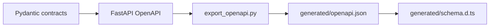
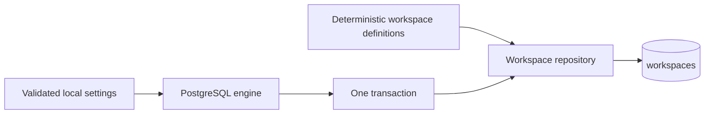

# Backend Scripts

This directory contains small, reviewable development utilities. Scripts support the application but are not imported by runtime request handlers.

## Contents

| File                | Responsibility                                                                           |
| ------------------- | ---------------------------------------------------------------------------------------- |
| `__init__.py`       | Makes development commands importable for tests and `python -m` execution.                |
| `export_openapi.py` | Exports the FastAPI OpenAPI document or verifies that the committed snapshot is current. |
| `seed_m0_0.py`      | Idempotently creates the two deterministic synthetic M0.0 workspaces.                    |

## Contract flow

The script uses test settings, produces stable sorted JSON, and writes to `frontend/src/lib/api/generated/openapi.json` by default. Its `--check` mode does not rewrite the snapshot; it fails when the committed file is missing or stale.

Generated artifacts must not be edited manually. The complete command sequence is documented in the repository [`README.md`](../../README.md#update-api-contracts).

## Seed flow

The seed command uses the same local workspace identifier as the fixed M0.0 identity provider and
adds a second sanitized workspace for negative isolation tests. Repeated runs leave identical rows
unchanged. An existing deterministic identifier with different data aborts and rolls back the whole
seed transaction instead of overwriting data.

The command requires an explicit validated local PostgreSQL URL and assumes Alembic has already
migrated the database to `head`. The verified command is documented in the repository
[`README.md`](../../README.md#run-database-migrations-and-seed-data).
