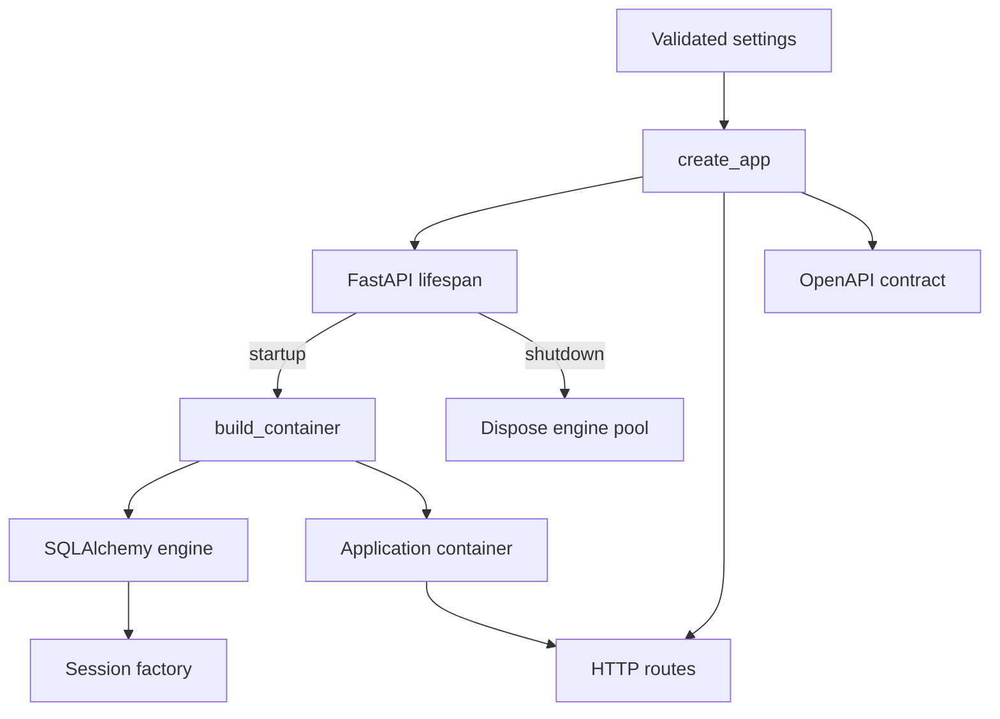

# Application Package

`investment_research` is the shared modular-monolith package. Entry points assemble dependencies here and invoke typed application boundaries; they do not own business state.

## Contents

| Path              | Responsibility                                                                                                         |
| ----------------- | ---------------------------------------------------------------------------------------------------------------------- |
| `main.py`         | Creates the FastAPI application, attaches the dependency container, registers routes, and installs OpenAPI generation. |
| `bootstrap.py`    | Composition root that selects concrete implementations for application-owned contracts.                                |
| `settings.py`     | Loads process-first local configuration and validates secret-safe runtime settings.                                     |
| `api/`            | HTTP transport models, dependencies, OpenAPI generation, and routes.                                                   |
| `infrastructure/` | Shared technical adapters; Step 3 provides SQLAlchemy metadata, engines, sessions, and transaction handling.            |
| `modules/`        | Business capabilities with explicit ownership and dependency boundaries.                                               |

## Startup flow

`main.py` and `bootstrap.py` are the outer composition layer. Module domain and application files must remain independent of this layer. Application startup must never create or mutate database schemas.

Importing `create_app` or exporting OpenAPI does not allocate database resources. The FastAPI
lifespan creates them only when the server starts and releases them during shutdown. Sessions are
still created per unit of work; they are never shared across requests or runner executions.

The package follows the boundaries in [`docs/02-system-design.md`](../../../docs/02-system-design.md#4-component-boundaries).
