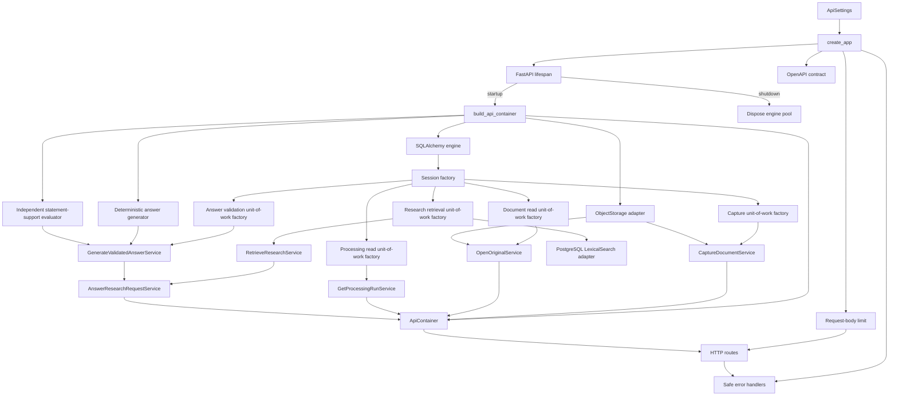
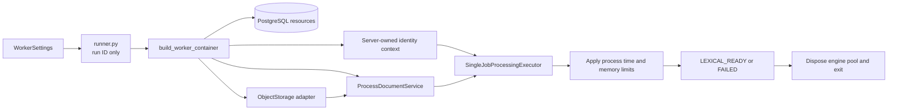

# Application Package

`investment_research` is the shared modular-monolith package. Entry points assemble dependencies here and invoke typed application boundaries; they do not own business state.

## Contents

| Path              | Responsibility                                                                                                         |
| ----------------- | ---------------------------------------------------------------------------------------------------------------------- |
| `main.py`         | Creates FastAPI, installs transport safeguards and error handlers, attaches the container, and registers routes.       |
| `runner.py`       | Executes exactly one processing run with process-level time and memory bounds outside FastAPI.                         |
| `bootstrap.py`    | Separate API and worker composition roots that select concrete implementations for application-owned contracts.          |
| `settings.py`     | Loads least-privilege API, worker, parser, and database-maintenance configuration.                                       |
| `api/`            | HTTP transport models, dependencies, OpenAPI generation, and routes.                                                   |
| `infrastructure/` | Technical database, logging, lexical-search, parsing, and secure local object-storage adapters.                          |
| `modules/`        | Business capabilities with explicit ownership and dependency boundaries.                                               |

## Startup flow

`main.py` and `bootstrap.py` are the outer composition layer. Module domain and application files must remain independent of this layer. Application startup must never create or mutate database schemas.

The runner is a second process entry point with its own composition root:

The command-line caller never supplies workspace scope or a database session. `runner.py` resolves
the fixed local identity, invokes one run, prints only a safe outcome, closes process-owned resources,
and exits. It is a development delivery adapter rather than a durable queue or retry system.

`ApiSettings` and `WorkerSettings` may load the ignored root development file. `ParserSettings`
loads only its allowlisted process variables, exposes no database field, and rejects known
application credential variables. `runtime_location=host` restricts bind and database targets to
loopback; `runtime_location=container` permits the fixed internal Compose targets required by the
service topology.

API requests pass through a server-owned correlation boundary before body limits and route
handling. `RequestLoggingMiddleware` replaces any client-supplied request ID, adds the generated UUID
to the response, and emits one completion or failure event. It matches only registered route
templates and never logs raw paths, query strings, headers, or bodies. `SafeJsonFormatter` emits a
fixed field allowlist; arbitrary messages, values, exception details, and traceback text are
discarded rather than copied into logs. Safe API error envelopes carry the same request ID.

Health reporting has two layers. `/health` reads only already-created FastAPI metadata and proves
that the API process can answer HTTP; it never calls a dependency probe. `/ready` asks the
container-owned `CompositeReadinessProbe` whether every required dependency is usable. Its current
`PostgreSQLReadinessProbe` requires both a successful connection and the exact Alembic head expected
by this application version. The response exposes only `ready` or `not_ready`; safe structured logs
retain the broad operational failure category. Later MinIO and Redis probes join the composite
without changing the route contract.

Importing `create_app` or exporting OpenAPI does not allocate database resources. The FastAPI
lifespan creates them only when the server starts and releases them during shutdown. Sessions are
still created per unit of work; they are never shared across requests or runner executions.

For document capture, the request-body middleware rejects excessive transport payloads before
multipart parsing. The route then resolves the server-owned workspace and capture service from the
application container. The service validates the PDF and coordinates immutable storage with one
database unit of work; the route only translates the typed result or a known safe error.

For original access, the route supplies only server-resolved workspace scope and path identifiers.
The read service resolves an eligible current original through a short-lived non-committing session,
then verifies the stored bytes against canonical size and checksum before allowing the response to
stream them.

For processing status, the route supplies the server-resolved workspace and one run identifier to
`GetProcessingRunService`. A separate short-lived read session resolves the canonical snapshot; the
API returns only its public state and sanitized failure summary and cannot invoke parsing.

For research retrieval, `RetrieveResearchService` creates the immutable request, executes the
eligible PostgreSQL lexical query, and stages the completed run and ordered candidates through one
shared short-lived transaction. `GenerateValidatedAnswerService` is wired with the deterministic
M0.0 generator, an independent support evaluator, and the answer-validation unit of work. It
reloads canonical evidence and persists only a safe terminal aggregate.

`AnswerResearchRequestService` composes those two focused services into the complete application
use case. The research HTTP route calls this single boundary and receives only
`ValidatedAnswerResult`; it does not coordinate retrieval and generation or gain access to
unvalidated generator output. The route serializes the validated terminal aggregate into typed SSE
events and never emits raw generator tokens or validation details.

The package follows the boundaries in [`docs/02-system-design.md`](../../../docs/02-system-design.md#4-component-boundaries).
