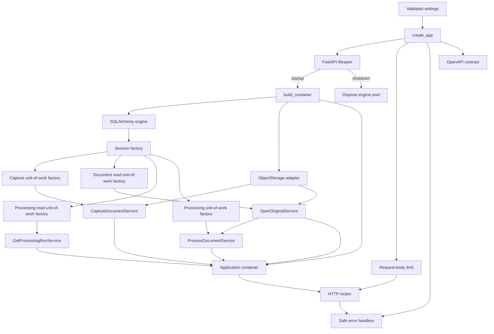
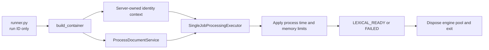

# Application Package

`investment_research` is the shared modular-monolith package. Entry points assemble dependencies here and invoke typed application boundaries; they do not own business state.

## Contents

| Path              | Responsibility                                                                                                         |
| ----------------- | ---------------------------------------------------------------------------------------------------------------------- |
| `main.py`         | Creates FastAPI, installs transport safeguards and error handlers, attaches the container, and registers routes.       |
| `runner.py`       | Executes exactly one processing run with process-level time and memory bounds outside FastAPI.                         |
| `bootstrap.py`    | Composition root that selects concrete implementations for application-owned contracts.                                |
| `settings.py`     | Loads process-first local configuration and validates secret-safe runtime settings.                                     |
| `api/`            | HTTP transport models, dependencies, OpenAPI generation, and routes.                                                   |
| `infrastructure/` | Shared technical adapters for SQLAlchemy transactions and secure local object storage.                                  |
| `modules/`        | Business capabilities with explicit ownership and dependency boundaries.                                               |

## Startup flow

`main.py` and `bootstrap.py` are the outer composition layer. Module domain and application files must remain independent of this layer. Application startup must never create or mutate database schemas.

The runner is a second entry point into the same composition root:

The command-line caller never supplies workspace scope or a database session. `runner.py` resolves
the fixed local identity, invokes one run, prints only a safe outcome, closes process-owned resources,
and exits. It is a development delivery adapter rather than a durable queue or retry system.

Importing `create_app` or exporting OpenAPI does not allocate database resources. The FastAPI
lifespan creates them only when the server starts and releases them during shutdown. Sessions are
still created per unit of work; they are never shared across requests or runner executions.

For document capture, the request-body middleware rejects excessive transport payloads before
multipart parsing. The route then resolves the server-owned workspace and capture service from the
application container. The service validates the PDF and coordinates immutable storage with one
database unit of work; the route only translates the typed result or a known safe error.

For original access, the route supplies only server-resolved workspace scope and path identifiers.
The read service resolves an eligible current original through a short-lived non-committing session,
then verifies the stored bytes against canonical size and checksum before allowing the response to
stream them.

For processing status, the route supplies the server-resolved workspace and one run identifier to
`GetProcessingRunService`. A separate short-lived read session resolves the canonical snapshot; the
API returns only its public state and sanitized failure summary and cannot invoke parsing.

The package follows the boundaries in [`docs/02-system-design.md`](../../../docs/02-system-design.md#4-component-boundaries).
