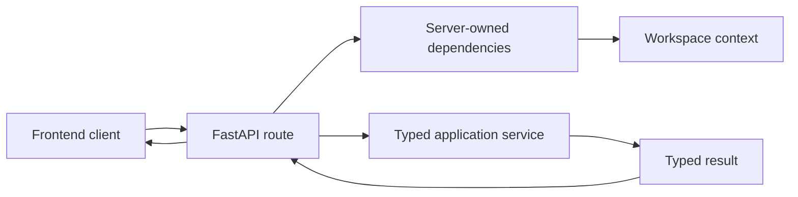

# API Boundary

This directory owns HTTP-facing concerns. It translates between FastAPI requests and typed application operations without becoming the owner of business rules or persistence.

## Contents

| Path              | Responsibility                                                                     |
| ----------------- | ---------------------------------------------------------------------------------- |
| `contracts.py`    | Strict request, result, error, evidence, and versioned stream-event schemas.       |
| `dependencies.py` | Exposes the application container and server-resolved workspace context to routes. |
| `openapi.py`      | Registers public Pydantic contracts in the generated OpenAPI document.             |
| `routes/`         | Thin HTTP endpoint modules.                                                        |

## Request boundary

Client-supplied identifiers are untrusted. In particular, `workspace_id` is not accepted as authorization proof; routes obtain workspace scope through `WorkspaceContextDependency`. Error responses expose stable codes and safe summaries rather than internal details.

Before evidence validation completes, research streaming may emit progress only. Statement and citation events represent already accepted output. The authoritative HTTP surface is defined in [`docs/08-m0-0-implementation-plan.md`](../../../../docs/08-m0-0-implementation-plan.md#41-http-surface).
