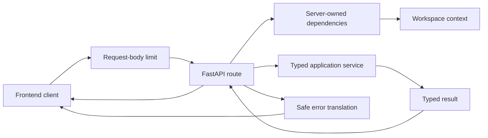

# API Boundary

This directory owns HTTP-facing concerns. It translates between FastAPI requests and typed application operations without becoming the owner of business rules or persistence.

## Contents

| Path              | Responsibility                                                                     |
| ----------------- | ---------------------------------------------------------------------------------- |
| `contracts.py`    | Strict request, result, error, evidence, and versioned stream-event schemas.       |
| `dependencies.py` | Exposes application services and the server-resolved workspace context to routes.  |
| `errors.py`       | Serializes expected failures and validation errors without exposing private input. |
| `middleware.py`   | Rejects oversized or ambiguously framed request bodies before multipart parsing.   |
| `openapi.py`      | Registers public Pydantic contracts in the generated OpenAPI document.             |
| `routes/`         | Thin HTTP endpoint modules.                                                        |

## Request boundary

Client-supplied identifiers are untrusted. In particular, `workspace_id` is not accepted as authorization proof; routes obtain workspace scope through `WorkspaceContextDependency`. Error responses expose stable codes and safe summaries rather than internal details.

The processing-status route accepts only a processing-run UUID and delegates to
`GetProcessingRunService`. That service opens a fresh read session and applies the same trusted
workspace boundary as the runner's repository operations. The API never starts parsing, shares a
runner session, or exposes processing configuration and exception details. Unknown and foreign run
identifiers are intentionally indistinguishable.

The transport-wide body limit includes a small allowance for multipart framing and rejects excessive
declared or streamed bytes before endpoint execution. The document capture service independently
enforces the configured PDF-byte limit and validates filename, media type, signature, and metadata;
the middleware is an early resource guard, not a replacement for application validation.

Research requests default to the current eligible archive state. Historical `PUBLIC_KNOWLEDGE` and `PERSONAL_ARCHIVE` requests require an explicit cutoff, while `CURRENT` requests must not provide one. The API boundary rejects inconsistent combinations before invoking an application service.

The research route maps its JSON body to `ResearchRetrievalInput` and calls only
`AnswerResearchRequestService`. It buffers no unvalidated model output: after the synchronous M0.0
use case returns, the route serializes `answer.statement` and `answer.citation` events only from the
validated aggregate, followed by one terminal event. Insufficient and rejected results contain no
statement or citation events. Genuine live progress events remain part of the versioned contract but
require a later observable execution boundary; the route does not fabricate progress after work has
already completed.

The evidence-span route accepts only a citation UUID and resolves it through the trusted workspace
context. The application rechecks that the span belongs to the current version of an active
document and is linked to a validated statement in a streamed answer. Unknown, foreign, stale, and
unlinked identifiers share one `404 NOT_FOUND` response. The result contains the canonical page,
character range, exact text, and hash plus a protected original-document URL; storage keys and
filesystem paths never cross the API boundary.

The authoritative HTTP surface is defined in
[`docs/08-m0-0-implementation-plan.md`](../../../../docs/08-m0-0-implementation-plan.md#41-http-surface).
