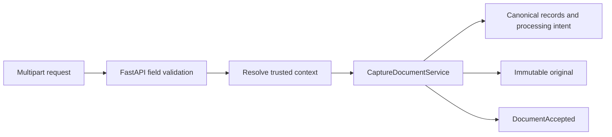
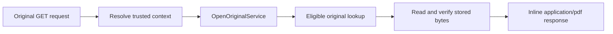
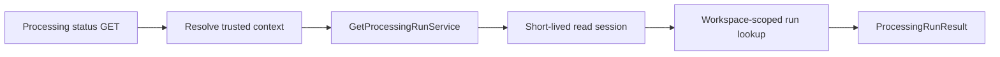
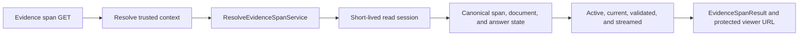

# API Routes

This directory contains thin FastAPI route modules. A route owns HTTP parsing, dependency resolution, status codes, and response serialization; it delegates business behavior to an application service.

## Current routes

| File            | Endpoint                                                             | Purpose                                                                             |
| --------------- | -------------------------------------------------------------------- | ----------------------------------------------------------------------------------- |
| `health.py`     | `GET /health`                                                        | Reports process liveness without dependency details or credentials.                 |
| `documents.py`  | `POST /api/v1/documents`                                             | Captures one validated PDF and returns canonical identifiers with HTTP 202.         |
| `documents.py`  | `GET /api/v1/documents/{document_id}/versions/{version_id}/original` | Streams one authorized and integrity-checked current PDF original.                  |
| `processing.py` | `GET /api/v1/processing-runs/{processing_run_id}`                    | Returns one workspace-scoped run state with safe failure details.                   |
| `research.py`   | `POST /api/v1/research-requests`                                     | Streams only validated statements, citation references, or a safe terminal outcome. |
| `evidence.py`   | `GET /api/v1/evidence-spans/{evidence_span_id}`                      | Resolves one authorized streamed citation to its exact active source.               |

Routes must not open another module's tables directly, choose infrastructure adapters, perform long-running parsing, or accept a client-provided workspace as authorization.

The capture route accepts `file`, `title`, `language`, `published_at`, and `available_at` as multipart
fields. `workspace_id` is intentionally absent. It returns document, document-version, and
processing-run identifiers plus the implemented processing-status URL; it does not parse the PDF.

The original route accepts only document and version UUIDs. Unknown, foreign, inactive, and
mismatched records share the same `404 NOT_FOUND` response. It uses a server-generated download
filename, disables content sniffing and private caching, and never exposes the storage key or local
filesystem path.

The status route accepts only the processing-run UUID. Its response contains the run identifier,
source document-version identifier, current state, and an optional application-sanitized failure
summary. Unknown and cross-workspace identifiers share the same `404 NOT_FOUND` response, and
successful responses disable private caching.

The research route accepts a question and optional document and temporal filters but no workspace
identifier. It calls one complete application use case and maps only its validated terminal result.
Streamed answers emit each statement followed by its ordered citation references and one completion
event. Insufficient and rejected results emit no statements or citations. Database failures are
translated before streaming begins, and successful responses disable private caching and content
sniffing.

The evidence route accepts no workspace identifier and exposes no object-storage location. It maps
unknown, foreign, stale, and unlinked span identifiers to the same `404 NOT_FOUND` response. A
successful response identifies the exact immutable document version, page, character range, text,
and hash, and its viewer target points back through the protected original-document route.
