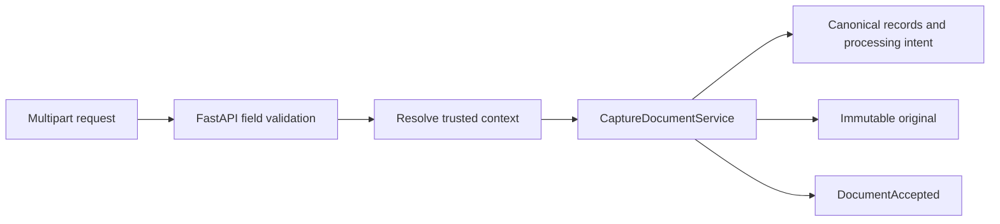

# API Routes

This directory contains thin FastAPI route modules. A route owns HTTP parsing, dependency resolution, status codes, and response serialization; it delegates business behavior to an application service.

## Current routes

| File           | Endpoint                 | Purpose                                                                    |
| -------------- | ------------------------ | -------------------------------------------------------------------------- |
| `health.py`    | `GET /health`            | Reports process liveness without dependency details or credentials.        |
| `documents.py` | `POST /api/v1/documents` | Captures one validated PDF and returns canonical identifiers with HTTP 202. |

Processing status, research, evidence resolution, and original viewing remain planned product routes.
They must not be advertised as working endpoints before their implementation block is complete.

Routes must not open another module's tables directly, choose infrastructure adapters, perform long-running parsing, or accept a client-provided workspace as authorization.

The capture route accepts `file`, `title`, `language`, `published_at`, and `available_at` as multipart
fields. `workspace_id` is intentionally absent. It returns document, document-version, and
processing-run identifiers plus the future processing-status URL; it does not parse the PDF.
