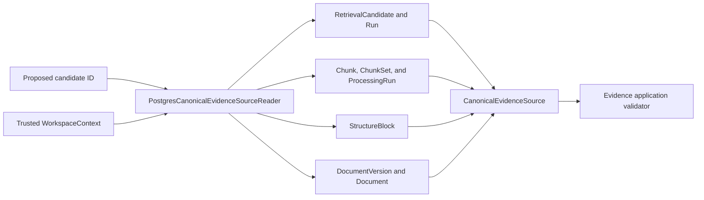
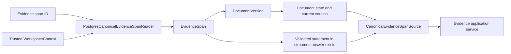
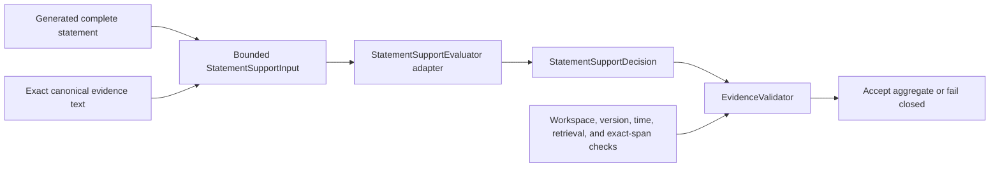

# Evidence Infrastructure

This package contains technical adapters used by the Evidence module's application-owned ports.
The adapters provide canonical source state and bounded statement-support decisions; they do not
persist, authorize, or publish generated answer content.

## Contents

| File               | Responsibility                                                             |
| ------------------ | -------------------------------------------------------------------------- |
| `__init__.py`      | Identifies the evidence-adapter package without exporting implementations. |
| `deterministic.py` | Implements the explicit synthetic M0.0 statement-to-evidence support rule. |
| `openai.py`        | Implements bounded individual and batched OpenAI statement checks.       |
| `postgresql.py`    | Reloads scoped candidate sources and already-persisted citation sources.   |

## Canonical reload

Every join includes the trusted `workspace_id`, and the query also requires the caller-provided
retrieval-run and candidate identifiers to match one stored relationship. Unknown identifiers,
identifiers from another run, and inaccessible workspace data all produce the same `None` result.
The reader returns canonical facts rather than deciding whether they pass current validation rules.

The M1.5 source-ID API and the standalone `document_attribution` profile enable an additional
first-block read.
It filters by the same trusted workspace, document version, and processing-run identifiers as the
candidate, orders by block ordinal, and returns an exact original prefix of at most 800 Unicode
code points. It never borrows a header from another processing output or searches arbitrary pages.
The legacy exact-quote reader skips the additional query. Initial answer validation and final
persistence use the same context policy, so a changed prefix invalidates the recorded judgment.

This cross-module physical read belongs in infrastructure because it must join mappings owned by
Search, Processing, and Documents. Business modules continue to avoid importing another module's
`persistence.py`.

## Citation reload

The citation reader filters the main query by the trusted workspace and uses a correlated `EXISTS`
query to establish whether the span participates in a validated statement whose answer reached the
`STREAMED` state. It returns the boolean and current document facts to the application service; it
does not make the authorization decision itself. A short-lived read unit of work owns the SQLAlchemy
session and never commits.

## Statement-support evaluators

The deterministic evaluator accepts only explicitly configured statement and exact-evidence pairs.
It remains useful for the frozen local fixture and deterministic tests.

The M1 OpenAI adapter independently evaluates one complete statement against one or two exact
canonical evidence texts. Its input is limited to 24,000 code points, and its strict response schema
contains only `supported: bool`. The request uses the independently selected `gpt-5.6-terra` or
`gpt-5.6-luna` model with low reasoning, a
30-second timeout, provider storage disabled, no tools, no background execution, and SDK retries
disabled. Its prompt, adapter, and configuration versions are separate from answer generation.

The evaluator is independent from the answer generator, so a generator cannot approve its own
output. A positive provider decision cannot authorize a citation, document, workspace, range, or
answer. The application-owned `EvidenceValidator` combines the decision with all canonical checks
and releases content only when the complete aggregate passes.

The M1.5 source-ID API uses `evaluate_contextual_batch` for all eligible statements in one
request, with their own exact quotes and document context. It requires one judgment and
bounded reason per submitted ordinal. Missing, repeated, or unexpected ordinals invalidate
the batch. The same-document context can identify the company, report, or date. Each other
factual detail requires exact quoted support. Standalone M1.5 evaluation retains individual
`attribution` and `document_attribution` options.
[M1.5 batch contract](../../../../../docs/13-m1-5-rag-quality-plan.md#batched-statement-support-in-the-local-api)

`openai.py` never loads credentials itself. `ApiSettings` supplies the API-role generation
credential, and the API composition root selects this evaluator only together with the complete M1
query and generation provider configuration. The container owns and closes its client separately
from the answer generator. Without that configuration, the deterministic evaluator remains active.
Provider failures are classified into application-owned categories before they reach the API, and
normal CI performs no provider network calls.
