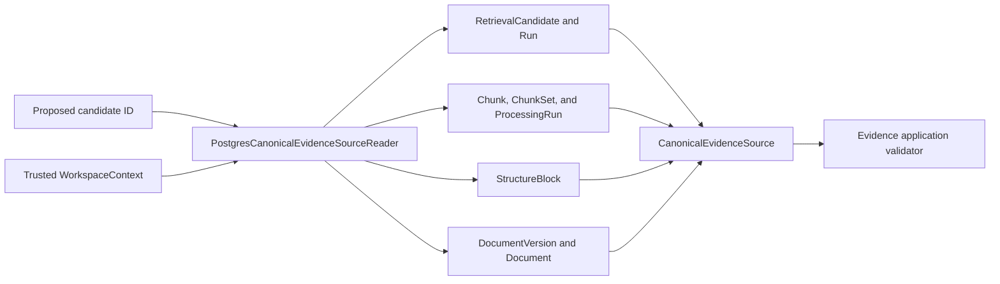
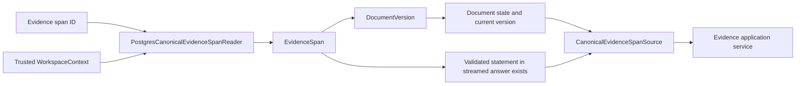

# Evidence Infrastructure

This package contains technical adapters used by the Evidence module's application-owned ports.
The adapters provide canonical source state and the bounded M0.0 statement-support rule; they do
not persist or publish generated answer content.

## Contents

| File               | Responsibility                                                             |
| ------------------ | -------------------------------------------------------------------------- |
| `__init__.py`      | Identifies the evidence-adapter package without exporting implementations. |
| `deterministic.py` | Implements the explicit synthetic M0.0 statement-to-evidence support rule. |
| `postgresql.py`    | Reloads scoped candidate sources and already-persisted citation sources.   |

## Canonical reload

Every join includes the trusted `workspace_id`, and the query also requires the caller-provided
retrieval-run and candidate identifiers to match one stored relationship. Unknown identifiers,
identifiers from another run, and inaccessible workspace data all produce the same `None` result.
The reader returns canonical facts rather than deciding whether they pass current validation rules.

This cross-module physical read belongs in infrastructure because it must join mappings owned by
Search, Processing, and Documents. Business modules continue to avoid importing another module's
`persistence.py`.

## Citation reload

The citation reader filters the main query by the trusted workspace and uses a correlated `EXISTS`
query to establish whether the span participates in a validated statement whose answer reached the
`STREAMED` state. It returns the boolean and current document facts to the application service; it
does not make the authorization decision itself. A short-lived read unit of work owns the SQLAlchemy
session and never commits.

## M0.0 support evaluator

The deterministic evaluator accepts only explicitly configured statement and exact-evidence pairs.
It is independent from the answer generator, so a generator cannot approve its own output. A later
support implementation may replace this fixture-only adapter behind `StatementSupportEvaluator`;
the server-side validation flow and fail-closed output decision remain application-owned.
