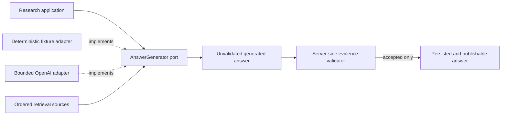
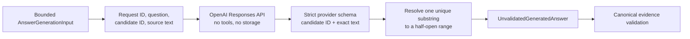
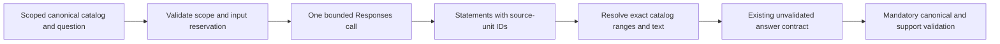

# Generation Infrastructure

This package contains answer-generation adapters that implement the Research module's
application-owned `AnswerGenerator` port. Generators may propose statements and source references,
but they cannot validate, persist, or publish them.

## Contents

| File                      | Responsibility                                                                          |
| ------------------------- | --------------------------------------------------------------------------------------- |
| `__init__.py`             | Identifies the generation-adapter package without exporting an implementation.          |
| `deterministic.py`        | Implements the bounded synthetic M0.0 fixture case without a model or network call.     |
| `openai.py`               | Implements the bounded M1 typed Responses API adapter behind the same application port. |
| `openai_citable_units.py` | Implements the standalone M1.5 source-unit ID profile, not yet wired into Research.     |

## Trust boundary

Pydantic validation makes the generator result schema-valid: fields have bounded types, evidence
offsets have the proposed text's length, and insufficient coverage contains no statements. It does
not make the result evidence-valid. The later validator must reload canonical records and prove the
workspace, active document version, retrieval-candidate membership, exact text and hash, statement
support, and answer coverage before persistence or output.

## M0.0 deterministic adapter

`DeterministicFixtureAnswerGenerator` recognizes one configured synthetic acceptance question. It
returns the configured statement only when the configured evidence text occurs exactly in an
ordered retrieval source. The proposed citation retains the selected candidate identifier and the
exact range within that source. An unknown question or missing passage returns explicit
`INSUFFICIENT` coverage with no statements.

`M0_0_FIXTURE_ANSWER_CASE` is the typed runtime configuration for the one answerable proof case, and
`M0_0_INSUFFICIENT_MESSAGE` is the application-owned safe fallback text. Their values mirror
[`fixtures/m0_0/manifest.yaml`](../../../../../fixtures/m0_0/manifest.yaml), which remains the
fixture and acceptance specification. M0.0 does not add a runtime YAML dependency merely to build
the deterministic adapter; the final acceptance suite is responsible for detecting manifest drift.

This adapter is deliberately M0.0-only. A later approved AI-provider adapter may replace it behind
the same port, while deterministic tests and server-side evidence validation remain.

## M1 OpenAI adapter

`OpenAIAnswerGenerator` makes one foreground, retry-free Responses API call with
the selected `gpt-5.6-terra` or `gpt-5.6-luna` model, low reasoning, `store=false`, no tools,
strict structured output, a 60-second
operation timeout, and at most 2,000 output tokens. Its application contract admits no more than
eight selected sources, 24,000 combined source characters, eight statements, and two evidence
references per statement.

The serialized provider payload omits document, version, chunk, and structure-block identifiers
because the model needs only the candidate identifier that it may cite. Instructions explicitly
treat the question and source text as untrusted data and forbid general-knowledge completion.
The model does not count source characters. The adapter derives offsets only for an exact substring
that occurs once in the cited selected source; missing, repeated, or foreign references fail closed.
The application's later canonical evidence validation remains mandatory.
Provider connection, configuration, schema, incomplete-output, and refusal failures become safe
application-owned errors without preserving provider messages as public details.
Failures also emit a bounded `answer_generation.provider_failed.<model>.<reason>` event in the API
log. Its reason is an application-owned code such as `output_limit` or
`quote_not_found`; prompts, source text, provider messages, and raw responses are omitted.

The adapter never selects credentials by itself. `ApiSettings` loads the API-role generation
credential, and the API composition root selects this adapter only when the complete M1 query and
generation provider configuration is present. It then owns and closes the adapter for the process
lifetime. When that configuration is absent, the deterministic fixture adapter remains selected.
Normal CI therefore performs no provider network calls; a separate explicit live-provider smoke
check owns any real-provider verification.

## Standalone M1.5 source-unit ID adapter

`OpenAICitableUnitAnswerGenerator` reuses `OpenAIAnswerGenerator`'s bounded request, token-usage
validation, safe failure mapping, and explicitly injected local-output callbacks. Its prompt,
schema, and evidence resolution are separate extension points; M1's exact-substring behavior and
version identifiers remain unchanged. Neither bootstrap nor the evaluation runner selects this
new profile yet. The [Step 2 contract](../../../../../docs/13-m1-5-rag-quality-plan.md#step-2-contract--citable-units-v1)
governs integration and adoption.

The adapter requires `CitableAnswerGenerationInput`, whose trusted workspace, request, ordered
sources, and canonical catalog must agree. It revalidates that input before requesting generation.
Each original source text appears once beside an ordered ID/range catalog. The strict provider
schema defines the catalog's UUID strings once in a shared `SourceUnitId` enum. Each statement
selects one or two IDs, never quote text, offsets, or candidate identifiers. Server-side membership
and duplicate checks remain independent of schema compliance.

Catalog preparation admits at most 256 units, but a request must also fit the existing 16,000-unit
input-overhead reservation. Preflight measures UTF-8 bytes for the serialized metadata, prompt,
and schema, reserving 512 additional units each for SDK schema expansion and request framing.
Question/source bytes are already reserved by M1 accounting and are not counted twice. A metadata
overflow fails before any generation call rather than raising the budget, silently dropping units,
or reverting to copied quotes. An empty catalog also makes no provider call; integration must route
it to the existing no-evidence path.

`citable_answer_profile` identifies the selected Terra/Luna model and English v1 unit policy with
new generator/configuration/prompt versions. `create_openai_citable_unit_answer_generator` disables
SDK retries and owns its client just like M1. A known ID still permits an unsupported proposal;
only subsequent support and canonical validation can make it publishable. No migration,
reprocessing, historical-citation rewrite, API, or frontend change is introduced here.
