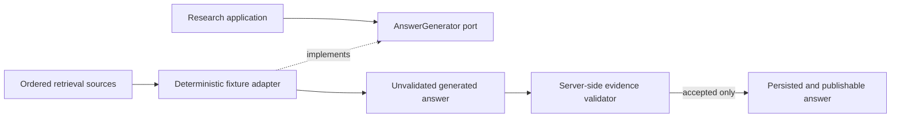

# Generation Infrastructure

This package contains answer-generation adapters that implement the Research module's
application-owned `AnswerGenerator` port. Generators may propose statements and source references,
but they cannot validate, persist, or publish them.

## Contents

| File               | Responsibility                                                                      |
| ------------------ | ----------------------------------------------------------------------------------- |
| `__init__.py`      | Identifies the generation-adapter package without exporting an implementation.      |
| `deterministic.py` | Implements the bounded synthetic M0.0 fixture case without a model or network call. |

## Trust boundary

Pydantic validation makes the generator result schema-valid: fields have bounded types, evidence
offsets have the proposed text's length, and insufficient coverage contains no statements. It does
not make the result evidence-valid. The later validator must reload canonical records and prove the
workspace, active document version, retrieval-candidate membership, exact text and hash, statement
support, and answer coverage before persistence or output.

## M0.0 deterministic adapter

`DeterministicFixtureAnswerGenerator` recognizes one configured synthetic acceptance question. It
returns the configured statement only when the configured evidence text occurs exactly in an
ordered retrieval source. The proposed citation retains the selected candidate identifier and the
exact range within that source. An unknown question or missing passage returns explicit
`INSUFFICIENT` coverage with no statements.

This adapter is deliberately M0.0-only. A later approved AI-provider adapter may replace it behind
the same port, while deterministic tests and server-side evidence validation remain.
