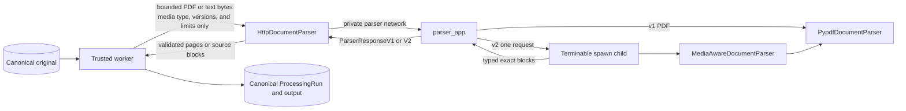

# Parsing infrastructure

This package keeps media parsing and transport details behind the application-owned
`DocumentParser` port. The trusted worker may access canonical stores; the isolated parser may
only receive bounded bytes and non-secret parsing metadata.

## Files

| File                  | Responsibility                                                                                          |
| --------------------- | ------------------------------------------------------------------------------------------------------- |
| `__init__.py`         | Declares the parsing infrastructure package without import-time work.                                   |
| `pypdf.py`            | Preserves the historical bounded PDF page extractor used by protocol v1 and the M1 PDF path.           |
| `media.py`            | Decodes canonical UTF-8 text and divides PDF pages or pasted text into exact bounded source blocks.     |
| `isolation.py`        | Runs each v2 parse in a terminable spawn child with bounded concurrency and a hard deadline.             |
| `http_protocol.py`    | Defines separate v1/v2 private paths, allowed media types, the metadata header, and its size limit.      |
| `client.py`           | Selects v1/v2 from the recorded parser profile and validates the complete untrusted HTTP response.       |
| `../../parser_app.py` | Hosts both private protocols in the credential-free parser container and owns child-process execution. |

## Trust boundary

The worker validates the authorized immutable original before opening this boundary. It never sends
an object key, workspace identifier, database identifier, credential, provider configuration, or
arbitrary target URL. `HttpDocumentParser` always calls the fixed endpoint from validated worker
settings and does not follow redirects.

The parser validates the request media type, metadata size, protocol version, parser version,
configuration version, requested limits, declared body size, and observed body size before parsing.
For v2 it then acquires one bounded execution slot and starts a fresh child. The parent terminates
and reaps that child at its server-owned deadline, which is shorter than the worker HTTP timeout.
It validates actual output counts again before serialization. The worker treats the entire response
as untrusted and independently validates schema, versions, media kind, block order, ranges, page
count, extracted-character count, and block size. For pasted text it also verifies every returned
slice against the canonical original bytes.

## Safe failures

| Condition                                                                                   | Application-owned error    |
| ------------------------------------------------------------------------------------------- | -------------------------- |
| PDF, page, text, block, request, or response limit exceeded                                 | `ParserLimitExceededError` |
| Parser rejects malformed PDF, invalid UTF-8, non-canonical text, or unsupported media       | `DocumentParserError`      |
| Child deadline/capacity, refused connection, interrupted response, or internal parser error | `ParserTransportError`     |
| Wrong media type, malformed JSON, unknown schema, mismatched version, or excessive response | `ParserProtocolError`      |

HTTP bodies contain only a bounded success contract or one fixed `ParserFailureV1`/
`ParserFailureV2` code. Exception messages, document text, and implementation details are not
included in failure responses.

## Active M1 boundary

Protocol v1 remains unchanged for historical M0.0 PDF runs. Newly captured M1 PDF and pasted-text
runs record the M1 media-aware parser profile and use protocol v2. The trusted worker constructs
only `HttpDocumentParser`; `parser_app.py` is the sole runtime composition root for concrete parser
implementations. Container isolation tests continue to verify that the parser receives no canonical
credentials and cannot reach Redis or external networks. Process-level tests additionally prove
that a hanging v2 child is terminated and that the following request can use the released slot.
