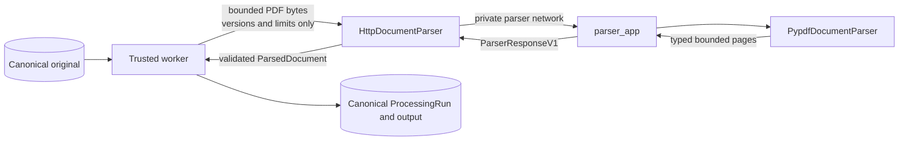

# Parsing infrastructure

This package keeps PDF implementation and transport details behind the application-owned
`DocumentParser` port. The trusted worker may access canonical stores; the isolated parser may
only receive bounded bytes and non-secret parsing metadata.

## Files

| File | Responsibility |
| --- | --- |
| `__init__.py` | Declares the parsing infrastructure package without import-time work. |
| `pypdf.py` | Extracts ordered page text and enforces page and character limits inside the parser runtime. |
| `http_protocol.py` | Defines the single private path, media types, metadata header, and header-size limit. |
| `client.py` | Implements `DocumentParser` for the worker through one bounded HTTP request. |
| `../../parser_app.py` | Hosts pypdf in the credential-free internal parser process. |

## Trust boundary

The worker validates the authorized immutable original before opening this boundary. It never sends
an object key, workspace identifier, database identifier, credential, provider configuration, or
arbitrary target URL. `HttpDocumentParser` always calls the fixed endpoint from validated worker
settings and does not follow redirects.

The parser validates the request media type, metadata size, protocol version, parser version,
configuration version, requested limits, declared body size, and observed body size before parsing.
It validates actual output counts again before serialization. The worker treats the entire response
as untrusted and independently validates media type, byte size, schema, versions, page order, page
count, and extracted-character count.

## Safe failures

| Condition | Application-owned error |
| --- | --- |
| PDF, page, text, request, or response limit exceeded | `ParserLimitExceededError` |
| Parser rejects malformed, encrypted, or unsupported PDF content | `DocumentParserError` |
| Timeout, refused connection, interrupted response, or internal parser failure | `ParserTransportError` |
| Wrong media type, malformed JSON, unknown schema, mismatched version, or excessive response | `ParserProtocolError` |

HTTP bodies contain only the bounded success contract or one fixed `ParserFailureV1.code`. Exception
messages, document text, and implementation details are not included in failure responses.

## Transitional M0.0 exception

`investment_research.runner` still injects `PypdfDocumentParser` directly so the already accepted
M0.0 fixture gate remains runnable until the Celery/Redis/isolated-parser acceptance path passes.
The real Celery worker does not use that injection. Delete the runner and its exception after the M0
replacement gate passes.
