# Queue infrastructure

This package adapts the application-owned processing contracts to Celery and the transient Redis
broker. It does not own document-processing state or business rules. PostgreSQL remains the
canonical source of `ProcessingRun` state and derived output.

## Files

| File | Responsibility |
| --- | --- |
| `__init__.py` | Declares the infrastructure package without import-time side effects. |
| `celery.py` | Builds the broker-only Celery application and publishes `ProcessingJobV1`. |
| `tasks.py` | Planned thin worker entry point that will validate a payload and invoke the processing application service. |

## Publication flow

```mermaid
flowchart LR
    CAPTURE[Document capture service] --> JOB[ProcessingJobV1]
    JOB --> PORT[ProcessingDispatcher port]
    PORT --> ADAPTER[CeleryProcessingDispatcher]
    ADAPTER --> REDIS[(Redis broker)]
    REDIS -. Step 3 continuation .-> TASK[Celery task adapter]
    TASK -. invokes .-> SERVICE[ProcessDocumentService]
    SERVICE -. reads and writes state .-> POSTGRES[(PostgreSQL)]
```

The job contains only its schema version, workspace identifier, processing-run identifier, and
deterministic idempotency key. It never contains PDF bytes, extracted text, storage keys, URLs,
credentials, ORM objects, or client-supplied authorization claims.

Celery accepts JSON only, does not store task results, and may deliver the same task more than once.
The processing application service and its canonical execution lease therefore provide
idempotency; a Celery task identifier alone is not a correctness boundary.
