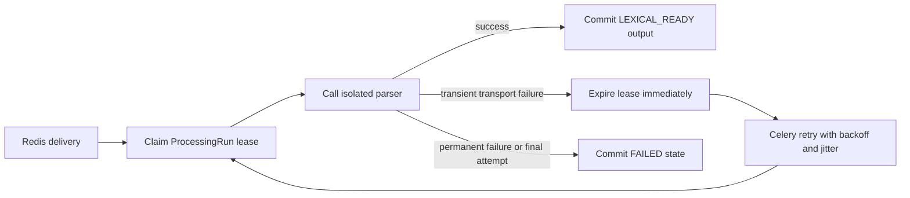

# Queue infrastructure

This package adapts the application-owned processing contracts to Celery and the transient Redis
broker. It does not own document-processing state or business rules. PostgreSQL remains the
canonical source of `ProcessingRun` state and derived output.

## Files

| File | Responsibility |
| --- | --- |
| `__init__.py` | Declares the infrastructure package without import-time side effects. |
| `celery.py` | Builds the broker-only Celery application and publishes `ProcessingJobV1`. |
| `tasks.py` | Validates broker payloads, acknowledges active duplicates, and invokes the application-owned job executor. |
| `../../worker.py` | Composes the Celery entry point and owns lazy process-local worker resources. |

## Publication flow

```mermaid
flowchart LR
    CAPTURE[Document capture service] --> JOB[ProcessingJobV1]
    JOB --> PORT[ProcessingDispatcher port]
    PORT --> ADAPTER[CeleryProcessingDispatcher]
    ADAPTER --> REDIS[(Redis broker)]
    REDIS --> TASK[Celery task adapter]
    TASK --> VALIDATE[ProcessingJobV1 validation]
    VALIDATE --> SCOPE[Server-controlled workspace check]
    SCOPE --> SERVICE[ProcessDocumentService]
    SERVICE -. reads and writes state .-> POSTGRES[(PostgreSQL)]
```

The job contains only its schema version, workspace identifier, processing-run identifier, and
deterministic idempotency key. It never contains PDF bytes, extracted text, storage keys, URLs,
credentials, ORM objects, or client-supplied authorization claims.

Celery accepts JSON only, does not store task results, and may deliver the same task more than once.
The task validates untrusted broker input before application execution. The job's `workspace_id`
must match the context reconstructed by the worker's server-controlled identity provider; the
message is not authorization proof. An active duplicate lease is acknowledged as a harmless no-op,
while unexpected errors remain visible. The processing application service and its canonical
execution lease provide idempotency; a Celery task identifier alone is not a correctness boundary.

## Acknowledgement and retry policy

The worker reserves one message at a time and acknowledges it only after task execution. Redis may
redeliver an unacknowledged message after 420 seconds. This exceeds the 360-second canonical
processing lease, so a replacement worker can reclaim the `ProcessingRun` before a broker
redelivery tries to execute it. A worker process lost after claiming work causes Celery to reject
the delivery for redelivery; PostgreSQL still decides whether the new delivery may run.

The processing profile permits three claimed attempts. Celery therefore schedules at most two
retries after the initial delivery, with exponential backoff, jitter, and a 30-second backoff cap.
Only `ProcessingRetryableError`, raised after a transient parser transport failure has made the
canonical lease reclaimable, enters this retry policy. Permanent parser, schema, authorization,
and payload failures are acknowledged without retry. Reaching the canonical attempt ceiling records
a sanitized terminal failure instead of scheduling another attempt.

The worker constructs database and storage resources lazily inside the worker child process and
reuses them until that process shuts down. This avoids sharing connection pools or provider clients
created before Celery forks its worker pool.
