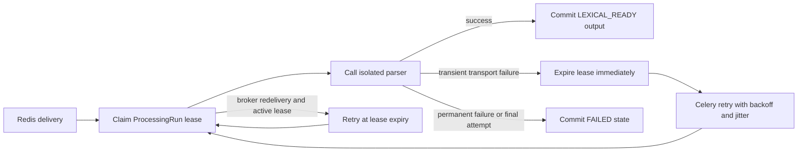
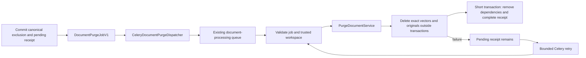

# Queue infrastructure

This package adapts the application-owned processing and permanent-deletion contracts to Celery
and the transient Redis broker. It does not own business state or rules. PostgreSQL remains the
canonical source of `ProcessingRun` state, derived output, and deletion receipts.

## Files

| File | Responsibility |
| --- | --- |
| `__init__.py` | Declares the infrastructure package without import-time side effects. |
| `celery.py` | Builds the broker-only Celery application and publishes processing and purge jobs. |
| `tasks.py` | Validates broker payloads, defers active redeliveries, and invokes the application-owned job executor. |
| `deletion_tasks.py` | Validates purge payloads and invokes canonical cleanup with bounded retries and per-attempt time limits. |
| `../../worker.py` | Composes the Celery entry point and owns lazy process-local worker resources. |

## Publication flow

```mermaid
flowchart LR
    CAPTURE[Document capture service] --> JOB[ProcessingJobV1]
    JOB --> PORT[ProcessingDispatcher port]
    PORT --> ADAPTER[CeleryProcessingDispatcher]
    ADAPTER --> REDIS[(Redis broker)]
    REDIS --> TASK[Celery task adapter]
    TASK --> VALIDATE[ProcessingJobV1 validation]
    VALIDATE --> SCOPE[Server-controlled workspace check]
    SCOPE --> SERVICE[ProcessDocumentService]
    SERVICE -. reads and writes state .-> POSTGRES[(PostgreSQL)]
```

The job contains only its schema version, workspace identifier, processing-run identifier, and
deterministic idempotency key. It never contains PDF bytes, extracted text, storage keys, URLs,
credentials, ORM objects, or client-supplied authorization claims.

Celery accepts JSON only, does not store task results, and may deliver the same task more than once.
The task validates untrusted broker input before application execution. The job's `workspace_id`
must match the context reconstructed by the worker's server-controlled identity provider; the
message is not authorization proof. An ordinary duplicate with an active lease is acknowledged as
a harmless no-op. A broker-marked redelivery with an active lease is deferred until the canonical
lease can be reclaimed, because acknowledging it would lose the only remaining delivery after a
worker failure. Unexpected errors remain visible. The processing application service and its
canonical execution lease provide idempotency; a Celery task identifier alone is not a correctness
boundary.

## Acknowledgement and retry policy

The worker reserves one message at a time and acknowledges it only after task execution. Redis may
redeliver an unacknowledged message after 420 seconds. This exceeds the 360-second canonical
processing lease, so a replacement worker can reclaim the `ProcessingRun` before a broker
redelivery tries to execute it. A worker process lost after claiming work causes Celery to reject
the delivery for redelivery; PostgreSQL still decides whether the new delivery may run. If that
redelivery arrives before the old lease expires, the task schedules itself for the remaining lease
duration instead of acknowledging the message or repeatedly polling PostgreSQL.

The processing profile permits three claimed attempts. Celery therefore schedules at most two
retries after the initial delivery, with exponential backoff, jitter, and a 30-second backoff cap.
Only `ProcessingRetryableError`, raised after a transient parser transport failure has made the
canonical lease reclaimable, enters this retry policy. Permanent parser, schema, authorization,
and payload failures are acknowledged without retry. Reaching the canonical attempt ceiling records
a sanitized terminal failure instead of scheduling another attempt.

The worker constructs database and storage resources lazily inside the worker child process and
reuses them until that process shuts down. This avoids sharing connection pools or provider clients
created before Celery forks its worker pool.

## Permanent-deletion delivery

`DocumentPurgeJobV1` contains only its fixed schema version, workspace/document UUIDs, and a
deterministic idempotency key. It carries neither content nor storage/provider targets. The worker
resolves its server-controlled identity and the service reads exact cleanup targets from canonical
state. A completed receipt makes duplicate execution a no-op; neither the broker nor its task ID
is the authority for completion.

Only `DocumentPurgePendingError` schedules automatic retries: up to four after the initial
delivery, with exponential backoff, jitter, and a 30-second cap. Each attempt has a 300-second soft
limit and a 330-second hard limit, below the 420-second broker visibility timeout. A soft timeout
becomes a safe pending-cleanup error. Malformed or unauthorized jobs are not retried. Worker-loss
redelivery is separate from the scheduled-retry count. Exhaustion never restores the source or
claims completion; PostgreSQL retains the pending receipt for a later explicit retry. Durable
outbox publication and periodic reconciliation remain M2 work.

Processing and purge reuse the same lazy process-local container and storage/vector clients.
Task definitions are registered on their own Celery application rather than shared between app
instances. The deterministic acceptance index supports the same exact-ID, workspace-scoped
cleanup contract; M0 has no dense index to purge.

`scripts.verify_queue_recovery` exercises the real worker against disposable PostgreSQL, Redis,
and SeaweedFS, including permanent cleanup after the recovery probe. The HTTP deletion endpoint
and website activation remain separate work blocks.
