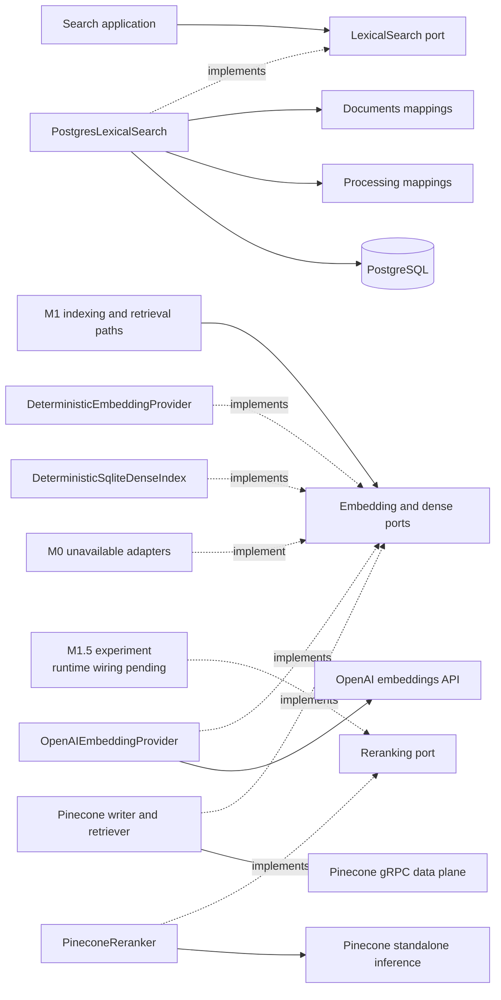

# Search Infrastructure

This package contains technical adapters that implement application-owned retrieval ports when one
query must read physical data owned by several business modules.

## Contents

| File                     | Responsibility                                                                          |
| ------------------------ | --------------------------------------------------------------------------------------- |
| `__init__.py`            | Identifies the search-adapter package without exporting a concrete implementation.      |
| `deterministic.py`       | Returns explicitly configured fixed embeddings for credential-free correctness tests.   |
| `deterministic_index.py` | Shares a content-free SQLite vector index across isolated acceptance-test processes.     |
| `openai.py`              | Creates bounded, correlated embeddings through one retry-free OpenAI SDK call.          |
| `pinecone.py`            | Writes, verifies, and queries bounded vectors through retry-free Pinecone gRPC clients. |
| `pinecone_reranking.py`  | Implements the opt-in M1.5 inference boundary; runtime wiring and adoption remain pending. |
| `postgresql.py`          | Implements `LexicalSearch` as one bounded, eligibility-first PostgreSQL query.          |
| `unavailable.py`         | Rejects embedding, dense-retrieval, and reranking calls before their assigned steps.    |

## Dependency direction

Business modules do not import another module's `persistence.py`. The outer infrastructure adapter
may join their physical read models because lexical retrieval needs canonical document and
processing eligibility in one SQL statement. The research-retrieval unit of work creates this
adapter with the same short-lived session as the Research and Retrieval repositories and exposes it
through the `LexicalSearch` port; application code does not depend on the concrete class.

## Eligibility-first query

The adapter joins each chunk to its chunk set, processing run, structure block, document version,
and document. Before ranking, it requires:

- the trusted workspace on the chunk;
- an active document whose `current_version_id` is the chunk's version;
- an active chunk set with the requested lexical configuration version;
- a `LEXICAL_READY` regression run or `SEARCHABLE` M1 run with the same lexical configuration
  version;
- optional requested-document, public-availability, and archive-capture filters;
- a positive match against PostgreSQL's English full-text query.

Only eligible rows are ranked with `ts_rank_cd`. Results use descending score and ascending
`chunk_id` as the final deterministic tie-breaker, then apply the validated candidate limit. The
adapter returns immutable `LexicalSearchHit` values and never commits a transaction.

## OpenAI embedding adapter

`OpenAIEmbeddingProvider` sends one already-bounded ordered text list to
`text-embedding-3-small` with the frozen 1536 dimensions and a maximum 30-second operation timeout.
Input identifiers, purposes, workspace identifiers, and application configuration objects remain
inside the application; only the text list and provider parameters cross the network boundary.

The SDK client has `max_retries=0`. The application service above this adapter owns the complete
two-attempt M1 retry policy. Transport, timeout, rate-limit, request-timeout, conflict, and service
failures become safe transient errors. Authentication, authorization, and deterministic request
failures become safe configuration errors. Malformed or contradictory output becomes a contract
error, and raw provider details are never included in those messages. Non-SDK exceptions propagate
unchanged so a worker shutdown or time limit cannot be mistaken for a retryable provider outage.
The internal error distinguishes an SDK timeout, connection failure, HTTP request timeout,
temporary conflict, HTTP 429, or provider 5xx status using only fixed text and, where available,
the numeric HTTP status. Known OpenAI credit, spend, and usage-limit codes inside an HTTP 429 are
mapped through a fixed allowlist to non-retryable configuration errors; other HTTP 429 responses
retain the bounded transient retry policy and an explicitly ambiguous rate-or-quota summary. A
rejected request likewise retains only its safe 4xx status. These details aid worker-log diagnosis;
the public processing status remains a bounded sanitized summary, and provider response bodies,
headers, URLs, unknown codes, and SDK exception text are never copied.

Before returning, the adapter requires the configured model, list object, exact item count, and
provider indexes `0..n-1` in request order. Every vector then passes the application contract's
dimension and finite-number validation. Pinecone is never called with an unvalidated embedding.

## Pinecone dense-index writer

`PineconeDenseIndexWriter` receives only validated `DenseIndexWriteRequest` values. It derives the
namespace from trusted `WorkspaceContext`, converts vectors to one bounded provider batch, and sends
only deterministic vector IDs plus chunk, document-version, chunk-set, embedding-configuration, and
dense-index-configuration identifiers. Raw chunk text and user-facing metadata never enter Pinecone
metadata.

The factory constructs `GrpcIndex` directly from the configured index host, avoiding a control-plane
lookup. TLS is mandatory, each operation is capped at 20 seconds, concurrency is one, and
`RetryConfig(max_retries=0)` makes the application the only retry owner. A successful transport
response is insufficient: the adapter requires complete item counts with no failed items or batch
errors. Fetch-based readiness rejects unexpected IDs and preserves application request order. Each
readiness fetch uses the smaller of the adapter's 20-second operation limit and the remaining
application deadline.

Pinecone connection, timeout, rate-limit, and service errors become bounded transient application
errors. Authentication, configuration, and other deterministic SDK failures become bounded
configuration errors. Partial or contradictory responses become contract errors. Provider exception
messages and request details never cross the adapter boundary.

## Pinecone dense retriever

`PineconeDenseRetriever` receives one validated query vector and candidate limit. It derives the
namespace only from trusted `WorkspaceContext`, filters by the exact embedding and dense-index
configuration versions, requests no vector values, and asks only for the bounded metadata needed to
recover a canonical chunk identifier. Raw source text is never returned from Pinecone.

Every match remains untrusted. The adapter requires finite scores, unique parseable chunk IDs,
matching configuration versions, and the deterministic vector identity derived from workspace,
chunk, and embedding configuration. It preserves provider order but makes no authorization or
canonical-eligibility decision. `PostgresDenseCandidateQualifier` performs that decision against
current PostgreSQL state before a candidate can enter context.

The reader uses the same TLS, 20-second timeout, zero-SDK-retry, and safe error-classification policy
as the writer, but receives a separate query-role credential at process composition time.

## Pinecone reranking experiment

`PineconeReranker` implements the application-owned `Reranker` port for the approved
[ADR-0018](../../../../../docs/adr/0018-pinecone-reranking-experiment.md) experiment. It is not
wired into normal API composition or the evaluator yet. Canonical eligibility, deduplication,
public/synthetic-data approval, and pre-call budget reservation remain caller responsibilities;
this adapter cannot authorize evidence or infer whether arbitrary text is public.

The version `m1-5-pinecone-bge-none-v1` permits at most 40 candidates, 1,000 query code points,
8,000 code points per passage, and 80,000 total query-plus-passage code points. These are local
payload bounds, not token estimates. The owner-provided Pinecone model descriptor on 2026-10-08
reports `max_sequence_length=1024`, `max_batch_size=100`, and `truncate` values `END` and `NONE`,
with `NONE` as default. The adapter explicitly sends `NONE`; it never shortens a passage, splits
the batch, drops a candidate, or retries a rejected over-token input.

Only the query, ordered text list, model, and fixed options go to `https://api.pinecone.io/rerank`.
Canonical candidate IDs remain local. Document echo is disabled and `top_n` equals the input
count. Every returned input position must occur exactly once; unexpected models, echoed text,
non-finite scores, and malformed usage fail closed. Sorting uses descending scores and original
input order for ties. Callers must supply RRF order for that tie-breaker to preserve it.

The synchronous port runs the existing SDK's async inference client inside a per-call event loop.
It must be invoked from synchronous application execution, not an active event loop. The fixed TLS
factory disables SDK retries, uses a one-connection pool, and closes each client after the call.
An `asyncio.timeout` bounds the operation at 20 seconds or less; a final deadline check rejects
late decoding success. Overlapping calls on the same adapter fail immediately. Unsafe SDK
debug-cURL and additional-header environment overrides are rejected rather than logging source
text or accepting injected headers. Exceptions expose fixed categories, not raw provider bodies.

`RerankResponse` contains the complete ranking, returned model, configuration version, and
`ProviderUsage(input_units=rerank_units, output_units=0)`. These units are Pinecone reranking units,
not OpenAI tokens or a dollar charge. Canonical accounting, quota/spend policy, runtime wiring,
and live quality/latency comparison belong to the subsequent work blocks. No dependency was added.

`tests/unit/test_pinecone_reranking.py` replaces only HTTP I/O with offline responses while retaining
the locked SDK's serialization, parsing, and retry transport. It exercises request privacy, result
mapping, ties, usage, malformed responses, input bounds, safe failures, cancellation, client
closure, and zero retries. No credentials or paid provider are needed.

## Deterministic embedding behavior

`DeterministicEmbeddingProvider` is a credential-free correctness-test adapter, not a semantic
embedding implementation. Its caller supplies explicit purpose-and-text cases with fixed
1536-dimensional finite vectors. The adapter preserves input order, identifiers, and the configured
embedding version. An unknown case or configuration-version mismatch fails closed instead of
inventing a vector.

Fixture texts and expected relationships stay in tests and acceptance-fixture configuration rather
than this infrastructure package. That keeps production code fixture-neutral while allowing normal
CI to prove document indexing and later dense-retrieval behavior without network access, credentials,
provider availability, or spend.

`DeterministicSqliteDenseIndex` supplies the process boundary needed by the isolated M1 acceptance
runtime: the worker and API open independent connections to one disposable SQLite file. The schema
contains only workspace namespaces, deterministic vector and canonical record identifiers,
configuration versions, and numeric vectors. It never stores questions, chunk text, filenames, or
other display metadata. Query results remain untrusted and still pass through the same PostgreSQL
canonical-eligibility qualifier as Pinecone results. Composition may select this adapter only for
the explicit test runtime; normal local and production-shaped M1 execution continues to use the
Pinecone adapter.

## Unavailable provider behavior

The unavailable embedding, dense-retrieval, and reranking adapters make a deliberately disabled
provider explicit. They hold no credentials and perform no network access. Each call raises
`SearchProviderUnavailableError` instead of returning an empty result that could be mistaken for a
valid insufficient-evidence outcome. Process composition replaces each fallback separately behind
the unchanged application-owned port only when its provider configuration and milestone gate are
active.
