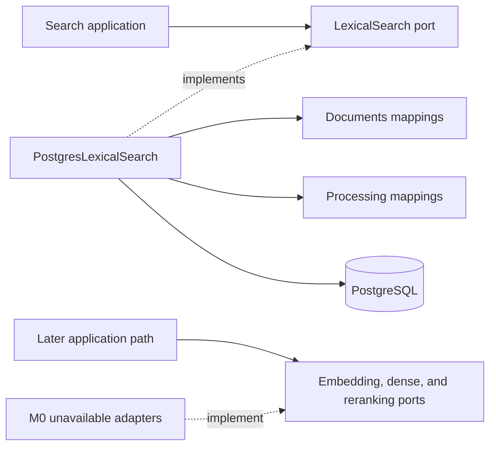

# Search Infrastructure

This package contains technical adapters that implement application-owned retrieval ports when one
query must read physical data owned by several business modules.

## Contents

| File             | Responsibility                                                                     |
| ---------------- | ---------------------------------------------------------------------------------- |
| `__init__.py`    | Identifies the search-adapter package without exporting a concrete implementation. |
| `postgresql.py`  | Implements `LexicalSearch` as one bounded, eligibility-first PostgreSQL query.     |
| `unavailable.py` | Rejects embedding, dense-retrieval, and reranking calls during M0.                 |

## Dependency direction

Business modules do not import another module's `persistence.py`. The outer infrastructure adapter
may join their physical read models because lexical retrieval needs canonical document and
processing eligibility in one SQL statement. The research-retrieval unit of work creates this
adapter with the same short-lived session as the Research and Retrieval repositories and exposes it
through the `LexicalSearch` port; application code does not depend on the concrete class.

## Eligibility-first query

The adapter joins each chunk to its chunk set, processing run, structure block, document version,
and document. Before ranking, it requires:

- the trusted workspace on the chunk;
- an active document whose `current_version_id` is the chunk's version;
- an active chunk set with the requested lexical configuration version;
- a `LEXICAL_READY` processing run with the same lexical configuration version;
- optional requested-document, public-availability, and archive-capture filters;
- a positive match against PostgreSQL's English full-text query.

Only eligible rows are ranked with `ts_rank_cd`. Results use descending score and ascending
`chunk_id` as the final deterministic tie-breaker, then apply the validated candidate limit. The
adapter returns immutable `LexicalSearchHit` values and never commits a transaction.

## M0 provider behavior

The unavailable adapters make the absence of later providers explicit. They import no Pinecone,
embedding, reranking, or tracing SDK, hold no credentials, and perform no network access. Each call
raises `SearchProviderUnavailableError` instead of returning an empty result that could be mistaken
for a valid insufficient-evidence outcome. A later milestone replaces one adapter at a time behind
the unchanged application-owned port after its provider, privacy, and evaluation decisions pass.
