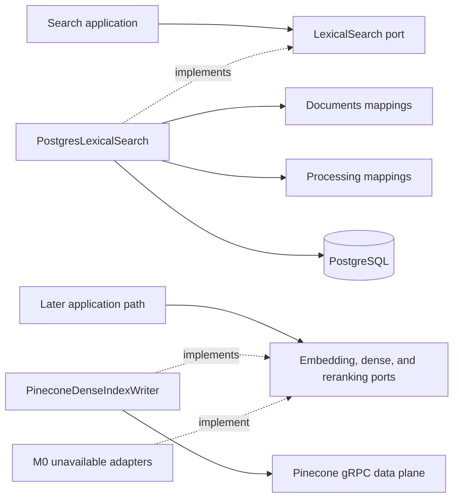

# Search Infrastructure

This package contains technical adapters that implement application-owned retrieval ports when one
query must read physical data owned by several business modules.

## Contents

| File             | Responsibility                                                                          |
| ---------------- | --------------------------------------------------------------------------------------- |
| `__init__.py`    | Identifies the search-adapter package without exporting a concrete implementation.      |
| `pinecone.py`    | Writes and verifies bounded vectors through a single-attempt Pinecone gRPC data client. |
| `postgresql.py`  | Implements `LexicalSearch` as one bounded, eligibility-first PostgreSQL query.          |
| `unavailable.py` | Rejects embedding, dense-retrieval, and reranking calls before their assigned steps.    |

## Dependency direction

Business modules do not import another module's `persistence.py`. The outer infrastructure adapter
may join their physical read models because lexical retrieval needs canonical document and
processing eligibility in one SQL statement. The research-retrieval unit of work creates this
adapter with the same short-lived session as the Research and Retrieval repositories and exposes it
through the `LexicalSearch` port; application code does not depend on the concrete class.

## Eligibility-first query

The adapter joins each chunk to its chunk set, processing run, structure block, document version,
and document. Before ranking, it requires:

- the trusted workspace on the chunk;
- an active document whose `current_version_id` is the chunk's version;
- an active chunk set with the requested lexical configuration version;
- a `LEXICAL_READY` processing run with the same lexical configuration version;
- optional requested-document, public-availability, and archive-capture filters;
- a positive match against PostgreSQL's English full-text query.

Only eligible rows are ranked with `ts_rank_cd`. Results use descending score and ascending
`chunk_id` as the final deterministic tie-breaker, then apply the validated candidate limit. The
adapter returns immutable `LexicalSearchHit` values and never commits a transaction.

## Pinecone dense-index writer

`PineconeDenseIndexWriter` receives only validated `DenseIndexWriteRequest` values. It derives the
namespace from trusted `WorkspaceContext`, converts vectors to one bounded provider batch, and sends
only deterministic vector IDs plus chunk, document-version, chunk-set, embedding-configuration, and
dense-index-configuration identifiers. Raw chunk text and user-facing metadata never enter Pinecone
metadata.

The factory constructs `GrpcIndex` directly from the configured index host, avoiding a control-plane
lookup. TLS is mandatory, each operation is capped at 20 seconds, concurrency is one, and
`RetryConfig(max_retries=0)` makes the application the only retry owner. A successful transport
response is insufficient: the adapter requires complete item counts with no failed items or batch
errors. Fetch-based readiness rejects unexpected IDs and preserves application request order.

Pinecone connection, timeout, rate-limit, and service errors become bounded transient application
errors. Authentication, configuration, and other deterministic SDK failures become bounded
configuration errors. Partial or contradictory responses become contract errors. Provider exception
messages and request details never cross the adapter boundary.

## Unavailable provider behavior

The unavailable embedding, dense-retrieval, and reranking adapters make the absence of their later
implementations explicit. They hold no credentials and perform no network access. Each call raises
`SearchProviderUnavailableError` instead of returning an empty result that could be mistaken for a
valid insufficient-evidence outcome. Each provider is replaced separately behind the unchanged
application-owned port after its implementation and evaluation gate passes.
