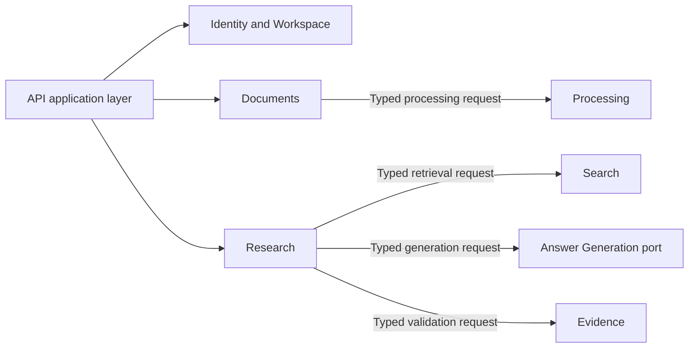

# Application Modules

This directory contains business capabilities with explicit ownership boundaries. Only modules required by the active implementation step are created; planned modules are not added as empty placeholders.

## Current modules

| Module        | Responsibility                                                                  |
| ------------- | ------------------------------------------------------------------------------- |
| `identity/`   | Resolves the trusted user and workspace boundary for each operation.            |
| `documents/`  | Owns logical documents, immutable versions, originals, and eligible retrieval. |
| `processing/` | Owns processing intent, parsed structure, chunk sets, and lexical chunks.       |
| `search/`     | Owns reproducible retrieval runs and their ordered candidate records.          |

## Target dependency direction

Arrows show allowed code dependency direction. Return values travel through typed contracts and do not create reverse imports.

When a module needs them, it may contain:

| File             | Role                                                             |
| ---------------- | ---------------------------------------------------------------- |
| `domain.py`      | Module-owned values, entities, and invariants.                   |
| `contracts.py`   | Commands, queries, and results exposed to other modules.         |
| `application.py` | Use cases and orchestration.                                     |
| `ports.py`       | Application-owned interfaces for external capabilities.          |
| `persistence.py` | Module-owned SQLAlchemy mappings and repository implementations. |

Core module files must not import FastAPI or concrete infrastructure. A module must never import another module's `persistence.py`; automated architecture tests enforce these rules.
