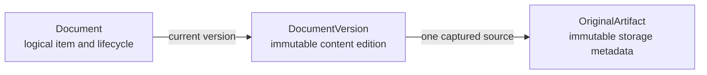
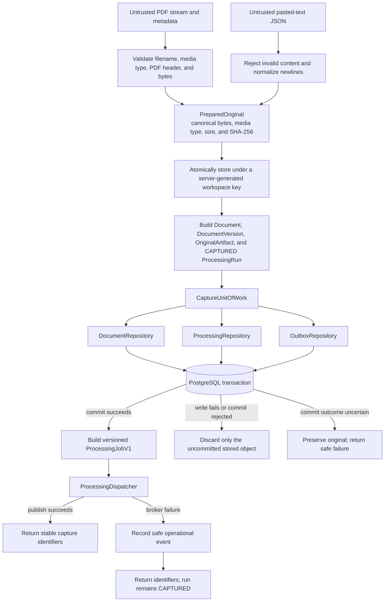
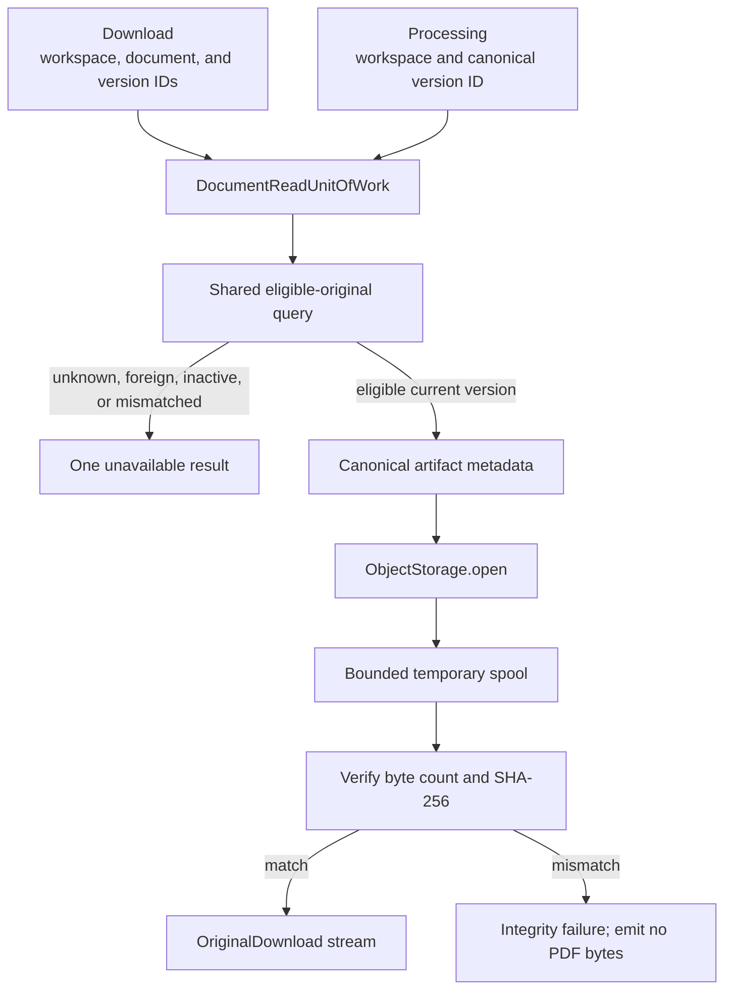
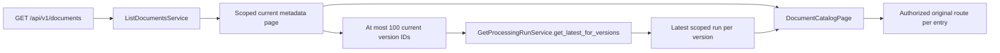
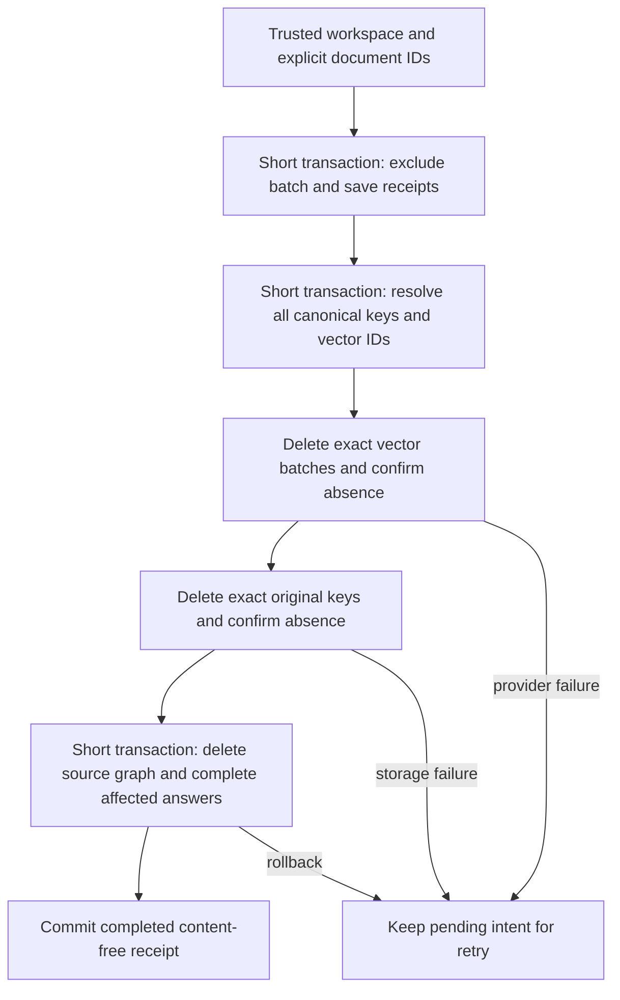

# Documents

This module owns logical archive documents, immutable content versions, and immutable metadata for captured originals. The canonical model accepts PDF and plain-text originals while preserving the same ownership boundaries for later lifecycle work.

## Contents

| File             | Responsibility                                                                                       |
| ---------------- | ---------------------------------------------------------------------------------------------------- |
| `contracts.py`   | Defines validated capture metadata, bounded catalog pages, and stable application results.           |
| `application.py` | Captures bounded PDF/text originals and resolves verified current originals.                         |
| `listing.py`     | Lists a workspace's current document metadata through a short-lived read unit of work.               |
| `domain.py`      | Defines validated document, version, artifact, lifecycle, media, hash, language, and storage values. |
| `ports.py`       | Defines object storage, repository, binary-stream, and write/read unit-of-work contracts.            |
| `persistence.py` | Maps document/deletion metadata and implements scoped capture and eligible reads.                    |

## Entity ownership

- `Document` owns `document_type`, lifecycle state, and the current-version pointer.
- `DocumentVersion` owns version number, title, language, content checksum, and source times.
- `OriginalArtifact` owns the server-generated storage key, media type, byte count, and original checksum. Source-location information is created later as versioned processing output rather than invented during capture.

## Capture transaction

The PDF path accepts only a declared `application/pdf` with a `.pdf` filename and a supported
`%PDF-…` signature. The pasted-text path accepts a strict JSON body with at most 100,000 Unicode
code points, rejects NUL and content without a visible character, converts `CRLF` and remaining `CR`
to `LF`, performs no trimming or Unicode normalization, and encodes strict UTF-8 without a byte-order
mark. Both paths enforce the configured byte limit before publishing an object, calculate SHA-256
over the exact stored bytes, and verify the storage adapter's returned key, size, and checksum.

`add_capture` rejects mismatched workspace or entity relationships before staging rows. It never
commits. The capture unit of work binds document, processing, and outbox repositories to one
caller-owned SQLAlchemy session, so all metadata and delivery intent commit or roll back together.
Because object storage cannot participate in PostgreSQL's transaction, failures before commit or
a definitive integrity rejection invoke narrowly scoped `discard_uncommitted` compensation.
An uncertain commit outcome preserves the potentially canonical original and returns a safe
error; it must not be mistaken for proven rollback or deletion permission.

The [delivery module](../delivery/README.md) documents the durable intent and migration boundary.
The current block does not enable an outbox dispatcher or automatic repair; the post-commit
fast path below remains active and does not yet write outbox publication receipts.

After the canonical transaction closes successfully, the service creates the strict versioned
`ProcessingJobV1` and calls the application-owned `ProcessingDispatcher`. An expected broker
publication failure records only the safe workspace and processing-run identifiers, returns the
committed capture result, and leaves the run visibly `CAPTURED` for recovery. Dispatch is outside the
compensation block, so neither a broker failure nor an unexpected post-commit error can delete an
already canonical original. The API container constructs the Celery adapter and provides its
`ProcessingDispatcher` to the capture service explicitly. Focused service tests use typed recording
dispatchers so they remain independent of a live broker.

## Original access

`OpenOriginalService` performs the scoped database lookup before opening storage. It copies the
bounded original into a private spool and verifies its recorded size and SHA-256 before returning a
stream. At most 1 MiB remains in memory for larger originals; the standard-library spool moves the
remainder to a temporary file. The stream owns that temporary resource and closes it after normal,
failed, or cancelled consumption.

The download path requires both document and version identifiers. The internal processing path
starts from the canonical version identifier already recorded on its `ProcessingRun`. Both paths use
the same active-current-workspace eligibility query and byte-integrity preparation. Processing sees
only the `ProcessingOriginalProvider` stream contract, not document tables or storage paths.

The read unit of work opens one short-lived SQLAlchemy session and exposes only the document
repository. It does not reuse the capture transaction, include the processing repository, or commit
on a read-only request.

## Current-document catalog reads

```mermaid
flowchart LR
    INPUT[Trusted WorkspaceContext and DocumentListQuery] --> SERVICE[ListDocumentsService]
    SERVICE --> READ[DocumentReadUnitOfWork]
    READ --> REPOSITORY[DocumentRepository.list_current_documents]
    REPOSITORY --> JOIN[Active document and its current version and original metadata]
    JOIN --> ORDER[Creation time and document UUID descending]
    ORDER --> BOUND[Page size plus one lookahead row]
    BOUND --> PAGE[DocumentListPage and optional next cursor]
```

The owner approved a small read-only document-selection follow-up ahead of the broader M3 archive
work. `GET /api/v1/documents` now composes this module's metadata page with Processing's bounded
latest-run status service. The website consumes this contract for saved-document listing,
independent original views, and explicit multi-source research selection; its UI flow is documented
in the [archive feature guide](../../../../../frontend/src/features/archive/README.md).

`DocumentListQuery` defaults to 20 entries and accepts 1–100. Its optional `after` cursor contains
the last returned document's timezone-aware creation time and UUID. The next query uses an
exclusive descending keyset boundary, not an offset. Equal timestamps remain deterministic, and
newer imports do not shift already traversed page boundaries. This is not a frozen snapshot across
requests; refresh the first page to see new arrivals. The cursor is a position, never authorization.

Every join includes the workspace relationship. Only `ACTIVE` documents with their current version
and original metadata are returned. Entries include opaque document/version IDs, title, language,
media type, byte size, and separately named creation, capture, publication, and availability times.
Unknown source times stay null. Storage keys, checksums, original bytes, and provider data are not
selected or exposed. Listing original metadata does not replace integrity and eligibility checks
when the original is subsequently opened.

The service closes its read session before returning and performs no writes, storage access,
processing-table reads, or paid-provider calls. The existing schema is unchanged. Unit tests cover
query bounds, field allowlists, SQL scope and ordering, and read-session cleanup; PostgreSQL tests
cover workspace isolation, equal-time pagination with concurrent newer imports, missing originals,
and current-version selection. Broader M3 browsing and lifecycle gates remain separate.

The API accepts `page_size`, `after_created_at`, and `after_document_id`; the continuation fields
must be supplied together. Unknown parameters, including `workspace_id`, are rejected. A response
adds a nullable `processing` result and a server-generated `original_url` to each metadata entry,
and uses `Cache-Control: private, no-store`. Neither list construction nor status composition opens
original bytes. A missing status remains null. A status read failure fails the request safely
rather than presenting incomplete data as success. The HTTP contract is documented in
[M1 contracts](../../../../../docs/11-m1-contracts.md#33-saved-document-catalog-follow-up).

## Database isolation and eligibility

Every table carries `workspace_id` and a direct foreign key to `workspaces`. Composite foreign keys additionally require related documents, versions, and originals to share that workspace. The deferred current-version constraint verifies that the selected version belongs to the same logical document while allowing both sides of the initial relationship to be inserted in one transaction.

Repository reads always filter by the trusted workspace. Version and original reads also require an `ACTIVE` document and the requested current version. Unknown, foreign, inactive, and mismatched identifiers therefore share the same `None` result.

Domain entities are frozen, and the capture repository exposes no update operation for
`DocumentVersion` or `OriginalArtifact`. PostgreSQL always rejects their updates. Deletes are
allowed only through the separately guarded permanent-purge path below.

## Permanent-deletion backend

The owner-approved local policy is defined in
[ADR-0019](../../../../../docs/adr/0019-permanent-local-document-deletion.md). It has no restore
period and includes complete affected stored answers. `deletion_contracts.py` requires 1–100
distinct explicit target IDs and defines content-free pending/completed receipts.
`DocumentDeletionRow` persists those receipts without a document foreign key, allowing the receipt
to outlive a physically removed document. `DocumentLifecycleState.PURGE_PENDING` is not `ACTIVE`
and therefore fails existing document/original admission queries.

| File | Responsibility |
| --- | --- |
| `deletion_contracts.py` | Explicit batch, content-free receipts/submission result, and ID-only versioned purge jobs. |
| `deletion_ports.py` | Repository, unit-of-work, exact-store purgers, dispatcher, and job executor interfaces. |
| `deletion.py` | Admission, post-commit publication, status reads, retry-safe cleanup, and trusted-worker execution. |
| `../../infrastructure/database/document_deletion.py` | Canonical target resolution and dependency-ordered PostgreSQL purge. |

Migration `0010_permanent_document_deletion` adds intent and accounting support.
`0011_document_purge_guards` rejects source-bound writes after exclusion and allows original/version
deletion only for the same pending document and receipt. It keeps immutable updates forbidden.
The deferred current-version FK uses `NO ACTION`, allowing both document and versions to disappear
in one transaction without dropping the relationship check.

Purging removes entire affected research graphs, including mixed-document answers, but preserves
unrelated documents and answers. Content-free costs keep `owner_deleted = true` and null owner FKs;
late provider finalization still records usage without restoring those FKs. Deletion never resets
the provider budget. Downgrade refuses to erase irreversible intent or detached accounting.

Original and Pinecone adapters implement exact scoped deletion; local S3 cleanup assumes the
unversioned SeaweedFS store. PostgreSQL tests cover repeat/failure behavior, mixed answers,
workspace isolation, write locking, and retained accounting. Provider adapter tests use doubles.
`DocumentPurgeJobV1` carries only workspace/document IDs, schema version, and a deterministic
idempotency key. `ExecuteDocumentPurgeJobService` compares the job's workspace with the worker's
server-controlled identity before calling `PurgeDocumentService`. Celery registration and the
dispatcher live behind these application-owned contracts; the worker reuses its existing storage
and vector clients. See the [queue guide](../../infrastructure/queue/README.md#permanent-deletion-delivery)
for retries and time limits.

The isolated queue-recovery verifier now publishes purge jobs and confirms completed canonical
and unversioned SeaweedFS cleanup for its synthetic fixture. `SubmitDocumentDeletionService`
commits admission before dispatch, skips completed receipts, and reports individual publication
failures without restoring sources. `GetDocumentDeletionService` reads scoped receipts after
physical removal. Both are exposed through the
[permanent-deletion HTTP contract](../../../../../docs/11-m1-contracts.md#34-permanent-deletion-follow-up).
Live Pinecone deletion verification and the active website button remain pending.
