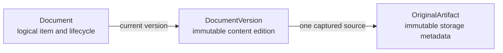
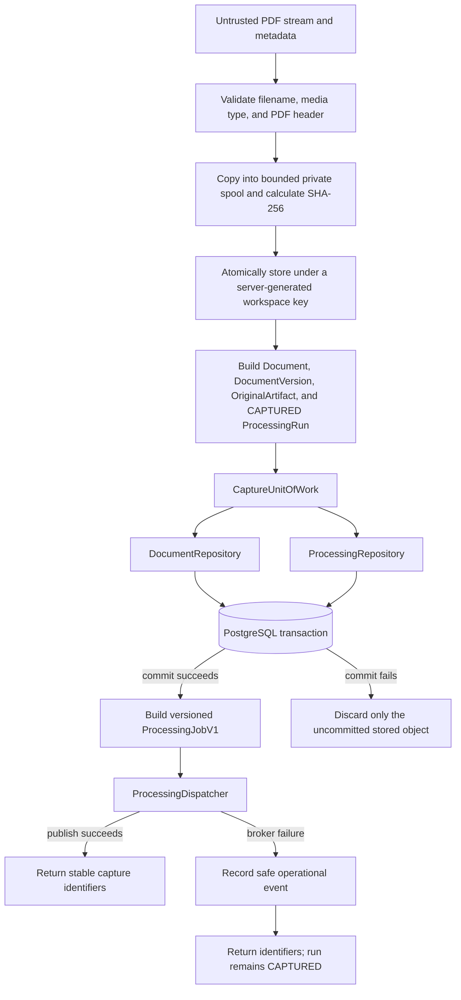
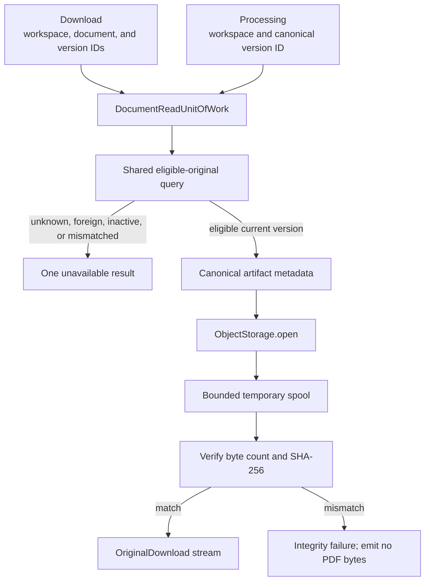

# Documents

This module owns logical archive documents, immutable content versions, and immutable metadata for captured originals. M0.0 supports one active version and PDF originals; later milestones extend lifecycle behavior without changing these ownership boundaries.

## Contents

| File             | Responsibility                                                                                         |
| ---------------- | ------------------------------------------------------------------------------------------------------ |
| `contracts.py`   | Defines validated capture metadata and the stable application result.                                 |
| `application.py` | Captures bounded PDFs and resolves verified current originals for downloads or processing.             |
| `domain.py`      | Defines validated document, version, artifact, lifecycle, media, hash, language, and storage values.  |
| `ports.py`       | Defines object storage, repository, binary-stream, and write/read unit-of-work contracts.             |
| `persistence.py` | Maps the three PostgreSQL tables and implements scoped capture and eligible-read behavior.             |

## Entity ownership

- `Document` owns `document_type`, lifecycle state, and the current-version pointer.
- `DocumentVersion` owns version number, title, language, content checksum, and source times.
- `OriginalArtifact` owns the server-generated storage key, media type, byte count, and original checksum. Page-aware information is created later as versioned processing output rather than invented during capture.

## Capture transaction

The service accepts only a declared `application/pdf` with a `.pdf` filename and a supported `%PDF-…` signature. It enforces the configured byte limit before publishing an object, keeps at most 1 MiB of the validation spool in memory, calculates SHA-256 while copying, and verifies the storage adapter's returned key, size, and checksum.

`add_capture` rejects mismatched workspace or entity relationships before staging rows. It never commits. The capture unit of work binds both module repositories to one caller-owned SQLAlchemy session, so document metadata and the processing intent commit or roll back together. Because object storage cannot participate in the PostgreSQL transaction, a failed canonical transaction invokes the narrowly scoped `discard_uncommitted` compensation. It is not a general deletion path for committed originals.

After the canonical transaction closes successfully, the service creates the strict versioned
`ProcessingJobV1` and calls the application-owned `ProcessingDispatcher`. An expected broker
publication failure records only the safe workspace and processing-run identifiers, returns the
committed capture result, and leaves the run visibly `CAPTURED` for recovery. Dispatch is outside the
compensation block, so neither a broker failure nor an unexpected post-commit error can delete an
already canonical original. The API container constructs the Celery adapter and provides its
`ProcessingDispatcher` to the capture service explicitly. Focused service and retained M0.0 runner
tests use typed recording dispatchers so they remain independent of a live broker.

## Original access

`OpenOriginalService` performs the scoped database lookup before opening storage. It copies the
bounded original into a private spool and verifies its recorded size and SHA-256 before returning a
stream. At most 1 MiB remains in memory for larger originals; the standard-library spool moves the
remainder to a temporary file. The stream owns that temporary resource and closes it after normal,
failed, or cancelled consumption.

The download path requires both document and version identifiers. The internal processing path
starts from the canonical version identifier already recorded on its `ProcessingRun`. Both paths use
the same active-current-workspace eligibility query and byte-integrity preparation. Processing sees
only the `ProcessingOriginalProvider` stream contract, not document tables or storage paths.

The read unit of work opens one short-lived SQLAlchemy session and exposes only the document
repository. It does not reuse the capture transaction, include the processing repository, or commit
on a read-only request.

## Database isolation and eligibility

Every table carries `workspace_id` and a direct foreign key to `workspaces`. Composite foreign keys additionally require related documents, versions, and originals to share that workspace. The deferred current-version constraint verifies that the selected version belongs to the same logical document while allowing both sides of the initial relationship to be inserted in one transaction.

Repository reads always filter by the trusted workspace. Version and original reads also require an `ACTIVE` document and the requested current version. Unknown, foreign, inactive, and mismatched identifiers therefore share the same `None` result.

Domain entities are frozen, and the repository exposes no update operation for `DocumentVersion` or `OriginalArtifact`. The reviewed Alembic migration adds PostgreSQL triggers that reject updates and deletes for both immutable tables, and the integration tests verify that protection directly against PostgreSQL.
