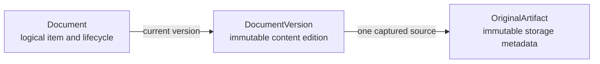
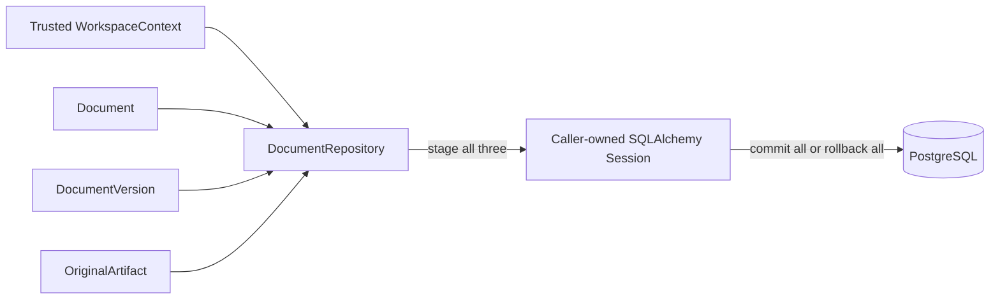

# Documents

This module owns logical archive documents, immutable content versions, and immutable metadata for captured originals. M0.0 supports one active version and PDF originals; later milestones extend lifecycle behavior without changing these ownership boundaries.

## Contents

| File             | Responsibility                                                                                         |
| ---------------- | ------------------------------------------------------------------------------------------------------ |
| `domain.py`      | Defines validated document, version, artifact, lifecycle, media, hash, language, and storage values.  |
| `ports.py`       | Defines the application-owned `DocumentRepository` contract.                                          |
| `persistence.py` | Maps the three PostgreSQL tables and implements scoped capture and eligible-read behavior.             |

## Entity ownership

- `Document` owns `document_type`, lifecycle state, and the current-version pointer.
- `DocumentVersion` owns version number, title, language, content checksum, and source times.
- `OriginalArtifact` owns the server-generated storage key, media type, byte and page counts, and original checksum.

## Capture transaction

`add_capture` rejects mismatched workspace or entity relationships before staging rows. It never commits. The caller-owned transaction ensures that a logical document cannot be committed without its first version and original metadata.

## Database isolation and eligibility

Every table carries `workspace_id` and a direct foreign key to `workspaces`. Composite foreign keys additionally require related documents, versions, and originals to share that workspace. The deferred current-version constraint verifies that the selected version belongs to the same logical document while allowing both sides of the initial relationship to be inserted in one transaction.

Repository reads always filter by the trusted workspace. Version and original reads also require an `ACTIVE` document and the requested current version. Unknown, foreign, inactive, and mismatched identifiers therefore share the same `None` result.

Domain entities are frozen, and the repository exposes no update operation for `DocumentVersion` or `OriginalArtifact`. The reviewed Alembic migration adds PostgreSQL triggers that reject updates and deletes for both immutable tables, and the integration tests verify that protection directly against PostgreSQL.
