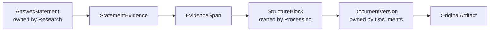
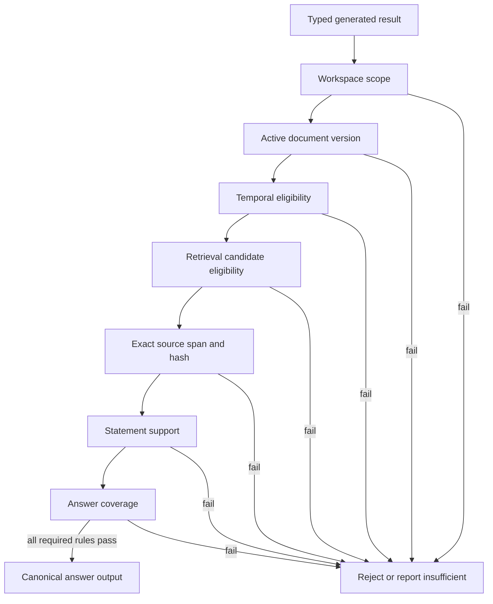
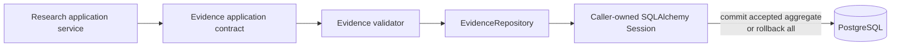

# Evidence

This module owns exact source spans, statement-to-source relationships, and immutable server-side validation records. It decides whether proposed answer content is eligible for canonical storage and later output; it does not generate prose or own documents, chunks, retrieval runs, or answers.

## Contents

| File             | Responsibility                                                                    |
| ---------------- | --------------------------------------------------------------------------------- |
| `domain.py`      | Defines exact spans, relationships, validation rules, hashes, and invariants.     |
| `ports.py`       | Defines the application-owned `EvidenceRepository` contract.                      |
| `persistence.py` | Maps three PostgreSQL tables and implements workspace-scoped repository behavior. |

## Evidence chain



`StatementEvidence` records whether a source span `SUPPORTS` or `CONFLICTS` with a statement and preserves display order. Every canonical M0.0 answer statement requires at least one supporting relationship. Conflicting spans remain attached and attributable rather than being hidden.

The composite span-to-block foreign key includes workspace, document version, and structure-block identifiers. PostgreSQL therefore rejects a span connected to a block from another workspace or document version.

## Exact span identity

```text
StructureBlock text
       ↓ select [start_character:end_character]
EvidenceSpan.exact_text
       ↓ UTF-8 SHA-256
EvidenceSpan.text_sha256
```

Offsets are relative to the referenced structure block. A valid span has ordered offsets, matching character length, visible exact text, and the correct SHA-256 hash. Step 7 additionally reloads the canonical block and verifies that slicing it at those offsets produces exactly the stored text before a citation can be emitted.

## Validation records



Each `AnswerValidation` stores the rule, target answer and optional statement, pass/fail result, safe reason, configuration version, and validation time. Failed rules require a reason. Partial unique indexes allow one result per answer-level rule and one result per statement-level rule.

## Transaction and dependency boundary



Evidence exposes contracts that Research may call; Evidence never imports Research persistence or application code. Its SQLAlchemy mappings use identifier-based foreign keys to module-owned tables. Every repository query and write includes the trusted workspace boundary, and repositories never commit independently.

This Step 3 module establishes persistence and local invariants. Step 7 implements canonical block lookup, candidate and temporal eligibility, complete server-side validation, and the rule that only accepted results may reach output.
