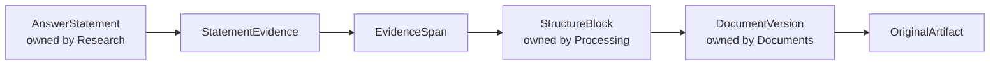
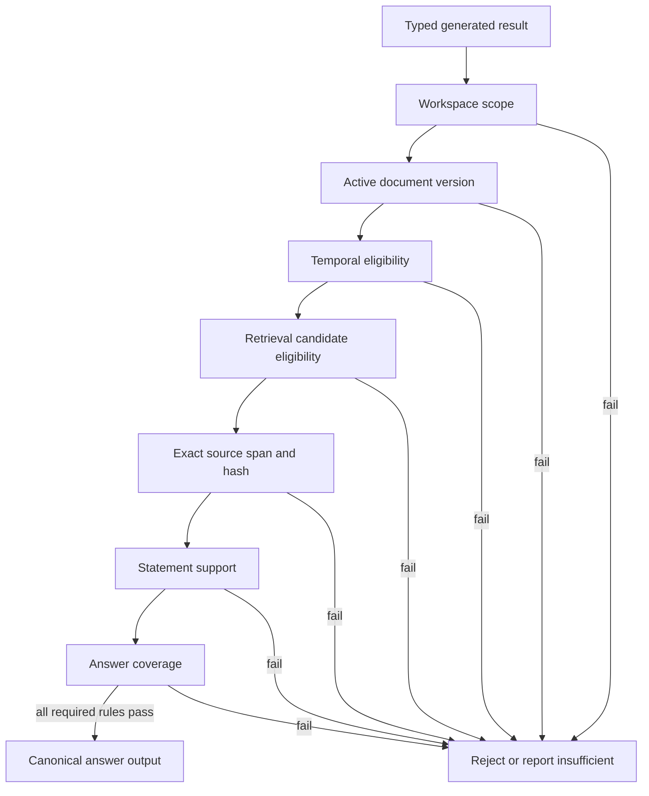
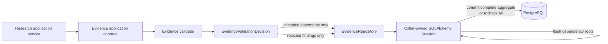
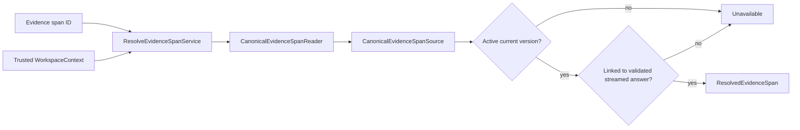

# Evidence

This module owns exact source spans, statement-to-source relationships, and immutable server-side validation records. It decides whether proposed answer content is eligible for canonical storage and later output; it does not generate prose or own documents, chunks, retrieval runs, or answers.

## Contents

| File             | Responsibility                                                                     |
| ---------------- | ---------------------------------------------------------------------------------- |
| `application.py` | Revalidates generated claims and authorizes later citation resolution.             |
| `contracts.py`   | Defines canonical source snapshots, validation decisions, and resolved spans.      |
| `domain.py`      | Defines exact spans, relationships, validation rules, hashes, and invariants.      |
| `ports.py`       | Defines canonical source, citation-read, statement-support, and persistence ports. |
| `persistence.py` | Maps three PostgreSQL tables and implements workspace-scoped repository behavior.  |

## Evidence chain



`StatementEvidence` records whether a source span `SUPPORTS` or `CONFLICTS` with a statement and preserves display order. Every canonical M0.0 answer statement requires at least one supporting relationship. Conflicting spans remain attached and attributable rather than being hidden.

The composite span-to-block foreign key includes workspace, document version, and structure-block identifiers. PostgreSQL therefore rejects a span connected to a block from another workspace or document version.

## Exact span identity

```text
StructureBlock text
       ↓ select [start_character:end_character]
EvidenceSpan.exact_text
       ↓ UTF-8 SHA-256
EvidenceSpan.text_sha256
```

Offsets are relative to the referenced structure block. A valid span has ordered offsets, matching character length, visible exact text, and the correct SHA-256 hash. Step 7 reloads the canonical block and verifies that slicing it at those offsets produces exactly the proposed text before the range becomes a validated reference.

## Validation records



Each `AnswerValidation` stores the rule, target answer and optional statement, pass/fail result, safe reason, configuration version, and validation time. Failed rules require a reason. Partial unique indexes allow one result per answer-level rule and one result per statement-level rule.

## Transaction and dependency boundary



Evidence exposes contracts that Research may call; Evidence never imports Research persistence or application code. Its SQLAlchemy mappings use identifier-based foreign keys to module-owned tables. Every repository query and write includes the trusted workspace boundary, and repositories never commit independently.

Step 7 now reloads the complete candidate source through a workspace-scoped port and applies
workspace, retrieval-candidate, active-version, temporal, exact-span, statement-support, and coverage
rules. A rejected decision contains no coverage or statements. The Research application maps an
accepted decision to canonical statements, exact spans, supporting relationships, and immutable
validation records in one unit of work. Insufficient and rejected outcomes persist their terminal
answer and validation findings without creating usable statements or citations.

## Citation resolution



`CanonicalEvidenceSpanSource` is a set of database facts, not an authorization result. The
application service fails closed unless the span belongs to the trusted workspace, its document is
active, its version is still current, and at least one validated statement in a streamed answer
links to it. Every failed condition raises the same application error, so callers cannot distinguish
an unknown identifier from inaccessible or stale evidence.

`ResolvedEvidenceSpan` contains only the authorized domain span and its document identifier. The
HTTP layer constructs the protected viewer URL because URLs are a transport concern rather than an
Evidence domain value.
