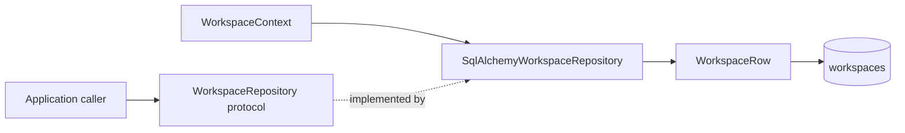

# Identity and Workspace

This module owns the trusted identity and workspace scope used by every product operation. M0.0 uses one fixed local identity; later authentication replaces the provider behind the same application-owned boundary.

## Contents

| File             | Responsibility                                                                                     |
| ---------------- | -------------------------------------------------------------------------------------------------- |
| `domain.py`      | Defines immutable workspace entities, types, scope errors, and the trusted `WorkspaceContext`.     |
| `ports.py`       | Defines the application-owned `WorkspaceRepository` contract without persistence dependencies.    |
| `persistence.py` | Maps `WorkspaceRow` to PostgreSQL and implements context-scoped repository behavior.               |
| `application.py` | Defines `IdentityContextProvider` and its fixed local M0.0 implementation.                         |

## Resolution flow

The provider accepts no client workspace value. A query parameter, request body field, or arbitrary UUID therefore cannot change the effective M0.0 workspace. Repository methods introduced in Step 3 must still require this explicit context; possessing an identifier alone never proves authorization.

## Persistence flow

The protocol keeps application callers independent of SQLAlchemy. The concrete repository receives one caller-owned session, stages writes without committing, and returns immutable `Workspace` domain values rather than ORM rows. A write whose workspace differs from the trusted context fails before database access. Reads return `None` for both unknown and inaccessible identifiers so callers cannot use response differences to discover another workspace.

`workspaces` is the root authorization boundary and therefore does not contain a `workspace_id` column pointing to itself. Every M0.0 product table beneath it carries `workspace_id` and enforces its relationships in PostgreSQL.

The fixed provider has no production authentication guarantee. M1 replaces it with an authenticated server-side implementation without changing downstream consumers.
