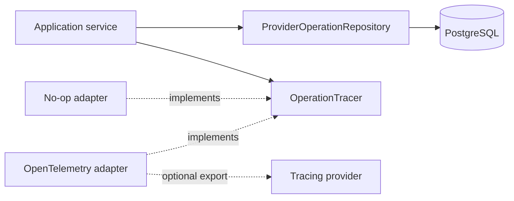
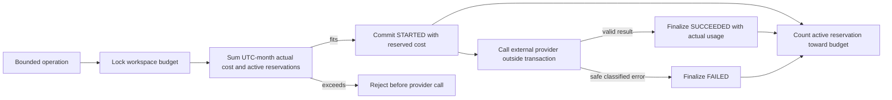

# Operations

This module owns the provider-neutral boundaries for canonical provider-operation accounting and
optional operational tracing. PostgreSQL records each paid provider operation and its bounded
usage; traces add diagnostic context but never replace that canonical record.

## Contents

| File             | Responsibility                                                                 |
| ---------------- | ------------------------------------------------------------------------------ |
| `__init__.py`    | Marks the application-owned operations package.                                |
| `application.py` | Reserves monthly budget and finalizes canonical usage in short transactions.   |
| `domain.py`      | Defines provider-operation kinds, lifecycle rules, usage, and safe failures.   |
| `ports.py`       | Defines the canonical repository and optional tracing contracts.               |
| `persistence.py` | Maps provider operations to PostgreSQL and implements workspace-scoped access. |

## Dependency direction

## Provider-operation lifecycle

Each operation belongs to exactly one research request or processing run. The repository requires a
`WorkspaceContext`, and PostgreSQL composite foreign keys reject cross-workspace ownership even if
application code is wrong. Repositories participate in the caller's transaction and never commit
independently. A workspace-scoped PostgreSQL transaction lock makes the combined monthly check and
reservation safe under concurrency without blocking unrelated workspaces.

Provider-operation records and traces may contain identifiers, configuration versions, unit counts,
costs, durations, trace IDs, and safe error categories. They must not contain document text, user
questions, prompts, generated answers, credentials, complete URLs, or provider error messages.
`ProviderUsage` is the shared immutable input/output-unit result returned by provider adapters; it
contains no SDK object or raw request or response content.

The canonical ledger, atomic reservation, safe finalization services, usage-bearing embedding result
contract, and content-safe in-process OpenTelemetry adapter are present. The adapter produces W3C
trace IDs without an exporter and degrades to no-op behavior when tracing fails. M1 query embedding
document embedding, and answer generation now use the complete reserve-call-finalize path. Every
application-owned retry creates a separate canonical operation. Unknown failure usage
conservatively consumes the full reservation. The remaining Step 5 provider integration applies
the same executor to statement-support calls.
