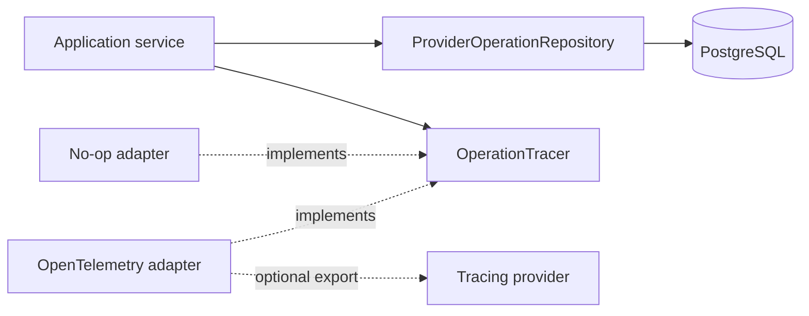
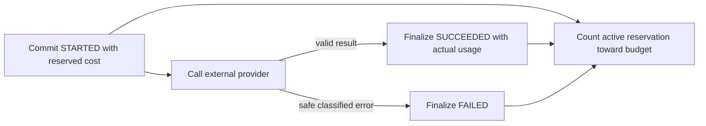

# Operations

This module owns the provider-neutral boundaries for canonical provider-operation accounting and
optional operational tracing. PostgreSQL records each paid provider operation and its bounded
usage; traces add diagnostic context but never replace that canonical record.

## Contents

| File             | Responsibility                                                                 |
| ---------------- | ------------------------------------------------------------------------------ |
| `__init__.py`    | Marks the application-owned operations package.                                |
| `domain.py`      | Defines provider-operation kinds, lifecycle rules, usage, and safe failures.   |
| `ports.py`       | Defines the canonical repository and optional tracing contracts.               |
| `persistence.py` | Maps provider operations to PostgreSQL and implements workspace-scoped access. |

## Dependency direction

## Provider-operation lifecycle

Each operation belongs to exactly one research request or processing run. The repository requires a
`WorkspaceContext`, and PostgreSQL composite foreign keys reject cross-workspace ownership even if
application code is wrong. Repositories participate in the caller's transaction and never commit
independently.

Provider-operation records and traces may contain identifiers, configuration versions, unit counts,
costs, durations, trace IDs, and safe error categories. They must not contain document text, user
questions, prompts, generated answers, credentials, complete URLs, or provider error messages.

The canonical ledger and persistence boundary are present in this work block. A later Step 5 work
block will reserve and finalize these records around the embedding and generation provider calls,
then add OpenTelemetry/OpenInference without making trace export part of product correctness.
