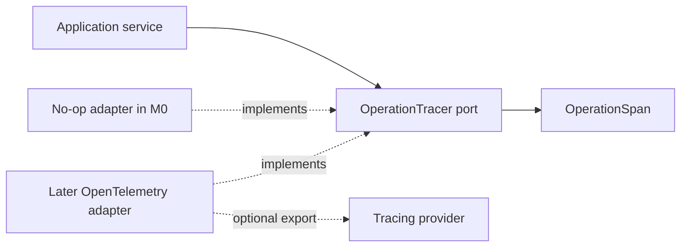

# Operations

This module owns the small provider-neutral boundary for optional operational tracing. It owns no
business records and does not replace canonical audit or provenance state in PostgreSQL.

## Contents

| File          | Responsibility                                                          |
| ------------- | ----------------------------------------------------------------------- |
| `__init__.py` | Marks the application-owned operations package.                         |
| `ports.py`    | Defines tracing spans, safe scalar attributes, and the tracer contract. |

## Dependency direction

Application code may attach identifiers, version names, counts, timing categories, and other safe
scalar metadata. It must not attach raw document text, prompts, credentials, complete URLs, or
private source content. A tracing-provider failure must not invalidate an otherwise correct product
operation, and traces are never the only copy of business-critical state.

M0 uses the no-op adapter and makes no observability-provider network call. A later adapter can add
OpenTelemetry/OpenInference and optional LangSmith export without changing application services.
