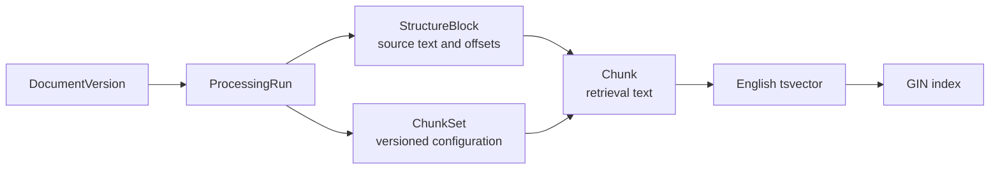
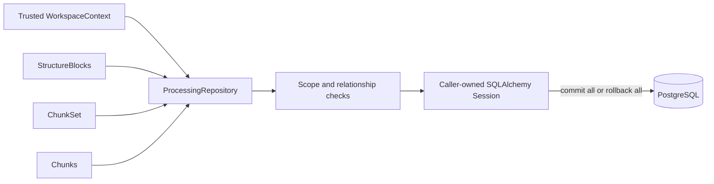

# Processing

This module owns canonical processing intent, page-aware parsed structure, versioned chunk sets, and lexical retrieval chunks. M0.0 executes one run in a separate development process; later Celery delivery invokes the same application-owned contracts.

## Contents

| File             | Responsibility                                                                                          |
| ---------------- | ------------------------------------------------------------------------------------------------------- |
| `domain.py`      | Defines processing lifecycle snapshots, source blocks, chunk sets, chunks, and their invariants.       |
| `ports.py`       | Defines the application-owned `ProcessingRepository` contract.                                         |
| `persistence.py` | Maps four PostgreSQL tables, generated lexical vectors, indexes, and scoped repository behavior.        |

## Ownership and provenance



`StructureBlock` preserves page, order, exact text, and source offsets independently of chunking strategy. `Chunk` is the retrieval unit. The M0.0 subset anchors each chunk to one block; a later reviewed schema may add an ordered association for chunks spanning several blocks without changing block or chunk identity.

## Lifecycle

```text
CAPTURED → PARSING → LEXICAL_READY
               ↘ FAILED
```

State, timestamps, and safe error summaries must agree. Parser, parser configuration, chunker, chunking configuration, and lexical configuration versions are immutable properties of a run. `update_run` changes only lifecycle fields.

## Lexical output transaction



Composite foreign keys repeat workspace, run, and document-version identifiers so PostgreSQL can reject cross-workspace or cross-run relationships directly. A partial unique index permits only one active chunk set per document version and lexical configuration.

PostgreSQL derives `chunks.search_vector` from `chunks.text` using the explicit English configuration and stores it as a generated column. A GIN index supports lexical candidate lookup. The application never writes the vector directly, and the configuration version records which retrieval behavior produced the active set.
