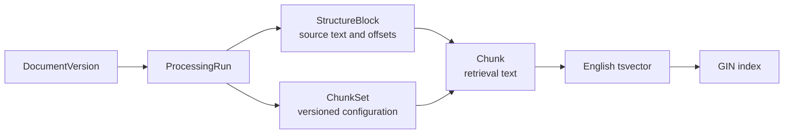
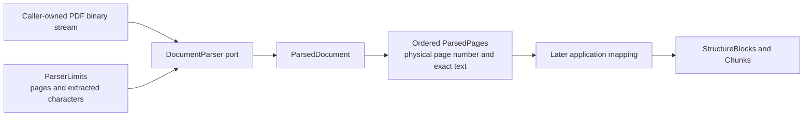
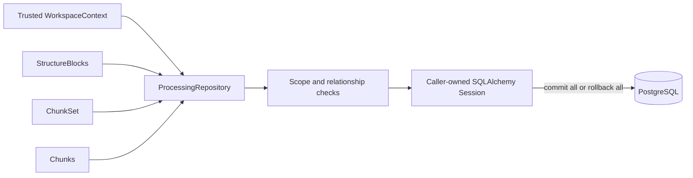

# Processing

This module owns canonical processing intent, page-aware parsed structure, versioned chunk sets, and lexical retrieval chunks. M0.0 executes one run in a separate development process; later Celery delivery invokes the same application-owned contracts.

## Contents

| File             | Responsibility                                                                                           |
| ---------------- | -------------------------------------------------------------------------------------------------------- |
| `application.py` | Defines the versioned M0.0 processing profile and creates a valid initial `CAPTURED` run.               |
| `contracts.py`   | Defines bounded, immutable parser input and page-aware output types.                                    |
| `domain.py`      | Defines processing lifecycle snapshots, source blocks, chunk sets, chunks, and their invariants.        |
| `ports.py`       | Defines the application-owned parser and `ProcessingRepository` contracts.                              |
| `persistence.py` | Maps four PostgreSQL tables, generated lexical vectors, indexes, and scoped repository behavior.         |

## Ownership and provenance



`StructureBlock` preserves page, order, exact text, and source offsets independently of chunking strategy. `Chunk` is the retrieval unit. The M0.0 subset anchors each chunk to one block; a later reviewed schema may add an ordered association for chunks spanning several blocks without changing block or chunk identity.

## Lifecycle

```text
CAPTURED → PARSING → LEXICAL_READY
               ↘ FAILED
```

State, timestamps, and safe error summaries must agree. `start_parsing`, `mark_lexical_ready`, and
`mark_failed` are the only domain operations that advance an existing run. Each operation returns a
new fully validated immutable snapshot; it does not mutate the earlier state. Direct jumps such as
`CAPTURED → LEXICAL_READY`, failure before parsing starts, and restarting a terminal run raise
`InvalidProcessingTransitionError`.

Parser, parser configuration, chunker, chunking configuration, and lexical configuration versions
are immutable properties of a run. `update_run` changes only lifecycle fields. The later processing
service supplies a bounded, sanitized failure summary rather than storing an exception message or
document content directly.

The capture use case asks this module's `create_captured_processing_run` factory to create the initial durable intent. The factory applies the versioned M0.0 profile and the trusted workspace context, so the documents module does not duplicate processing configuration knowledge. Later runner behavior must use the same recorded profile rather than silently substituting different parser, chunking, or lexical semantics.

## Parser boundary



The application owns both sides of this boundary: `ParserLimits` describes fail-closed extraction
limits, and `ParsedDocument` contains only ordered page text. A concrete PDF library remains behind
the `DocumentParser` port and cannot leak library-specific page objects into domain or persistence
code. The parser does not create blocks, chunks, or evidence spans; those require application-level
versioning and provenance rules.

Individual blank pages remain in the result so later citations retain physical PDF page numbering.
A later application service rejects a document with no usable text before it creates lexical output.
Process-level time and memory bounds belong to the separate runner rather than this in-process data
contract.

## Lexical output transaction



Composite foreign keys repeat workspace, run, and document-version identifiers so PostgreSQL can reject cross-workspace or cross-run relationships directly. A partial unique index permits only one active chunk set per document version and lexical configuration.

PostgreSQL derives `chunks.search_vector` from `chunks.text` using the explicit English configuration and stores it as a generated column. A GIN index supports lexical candidate lookup. The application never writes the vector directly, and the configuration version records which retrieval behavior produced the active set.
