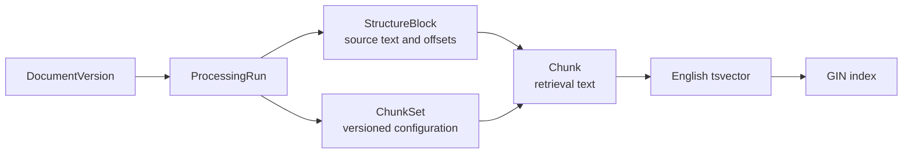
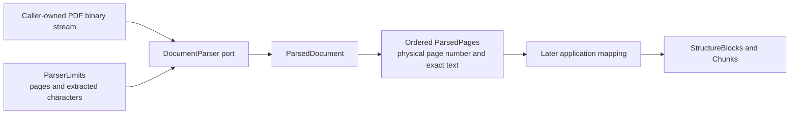
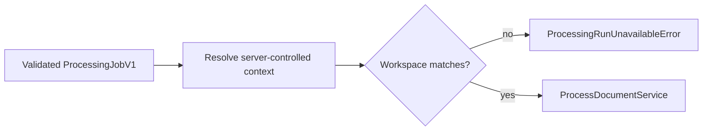
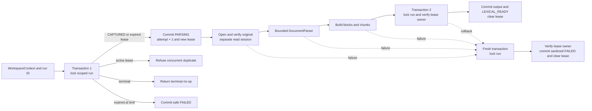
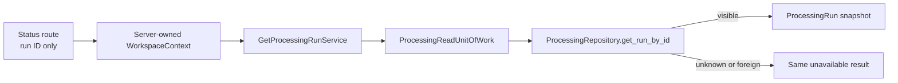
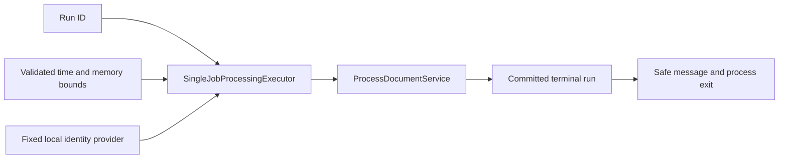
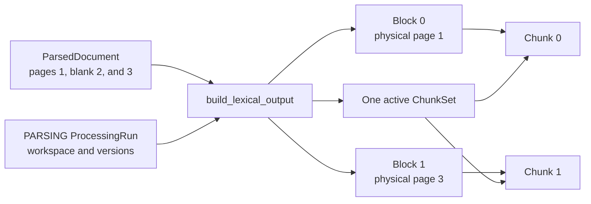
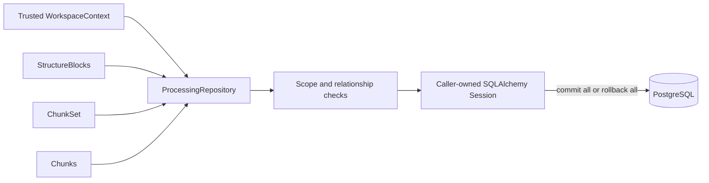

# Processing

This module owns canonical processing intent, page-aware parsed structure, versioned chunk sets, and lexical retrieval chunks. M0.0 executes one run in a separate development process; later Celery delivery invokes the same application-owned contracts.

## Contents

| File             | Responsibility                                                                                           |
| ---------------- | -------------------------------------------------------------------------------------------------------- |
| `application.py` | Creates and reads runs, builds lexical output, and orchestrates one bounded processing attempt.        |
| `contracts.py`   | Defines bounded, immutable parser input and page-aware output types.                                    |
| `domain.py`      | Defines processing lifecycle snapshots, source blocks, chunk sets, chunks, and their invariants.        |
| `ports.py`       | Defines parser, verified-original-provider, repository, and processing unit-of-work contracts.          |
| `persistence.py` | Maps four PostgreSQL tables, generated lexical vectors, indexes, and scoped repository behavior.         |

## Ownership and provenance



`StructureBlock` preserves page, order, exact text, and source offsets independently of chunking strategy. `Chunk` is the retrieval unit. The M0.0 subset anchors each chunk to one block; a later reviewed schema may add an ordered association for chunks spanning several blocks without changing block or chunk identity.

## Lifecycle

```text
CAPTURED ──claim──► PARSING + active lease ──owner completes──► LEXICAL_READY
                         │
                         ├─ owner fails permanently ──────────► FAILED
                         ├─ lease expires ──reclaim──► PARSING + new lease
                         └─ lease expires at attempt limit ───► FAILED
```

State, timestamps, attempt metadata, and safe error summaries must agree. `claim_for_processing`
claims `CAPTURED` or reclaims an expired `PARSING` run. `mark_lexical_ready` and `mark_failed`
require the current `lease_id` and clear the lease on the terminal snapshot.
`expire_lease_for_retry` makes an owned lease immediately reclaimable, while
`mark_attempts_exhausted` closes an abandoned run after the configured attempt ceiling. Each
operation returns a new fully validated immutable snapshot; it does not mutate the earlier state.
Direct jumps, active-lease theft, stale-lease completion, and restarting a terminal run raise typed
processing transition errors.

`attempt_count` records successful canonical claims, not broker deliveries. `lease_id` is the
current attempt's ownership token, and `lease_expires_at` is the earliest UTC instant at which a new
attempt may reclaim the run. M0 permits three attempts and uses a 360-second lease, which exceeds
the maximum configurable 300-second processing timeout plus shutdown grace. The later Celery task
will use `expire_lease_for_retry` only for classified transient infrastructure failures; this
application-service block still maps its existing parser and execution failures to terminal
`FAILED`.

Parser, parser configuration, chunker, chunking configuration, and lexical configuration versions
are immutable properties of a run. `update_run` changes only lifecycle fields. The processing
service supplies a bounded, sanitized failure summary rather than storing an exception message or
document content directly.

The capture use case asks this module's `create_captured_processing_run` factory to create the
initial durable intent. The factory applies the versioned M0.0 profile and the trusted workspace
context, so the documents module does not duplicate processing configuration knowledge. The runner
requires its parser version to match that recorded profile rather than silently substituting
different parsing semantics.

## Parser boundary



The application owns both sides of this boundary: `ParserLimits` describes fail-closed extraction
limits, and `ParsedDocument` contains only ordered page text. A concrete PDF library remains behind
the `DocumentParser` port and cannot leak library-specific page objects into domain or persistence
code. The parser does not create blocks, chunks, or evidence spans; those require application-level
versioning and provenance rules.

M0.0 uses the BSD-3-Clause-licensed `pypdf` adapter in `infrastructure/parsing`. It opens PDFs in
strict mode, rejects encrypted documents, checks the page limit before extraction, and checks the
cumulative extracted-character limit after every page. The processing profile records the exact
locked parser version. `INVESTMENT_RESEARCH_MAX_PDF_PAGES` and
`INVESTMENT_RESEARCH_MAX_EXTRACTED_CHARACTERS` configure the active bounds, while the contracts
retain absolute safety ceilings.

Individual blank pages remain in the result so later citations retain physical PDF page numbering.
The application service rejects a document with no usable text before it creates lexical output.
Process-level time and memory bounds belong to the separate runner rather than this in-process data
contract.

## Processing application flow

`ExecuteProcessingJobService` is the application boundary for a validated `ProcessingJobV1`. It
resolves the trusted context from server-controlled identity state and requires the job's workspace
identifier to match before forwarding only the run identifier to `ProcessDocumentService`. A
foreign job and an unknown run therefore produce the same non-disclosing unavailable result.



`ProcessDocumentService` accepts only a trusted `WorkspaceContext` and a processing-run identifier.
It does not receive ORM objects from the API or hold a database transaction open while pypdf works.
The repository locks a run with `SELECT ... FOR UPDATE` before each lifecycle write, preventing two
workers from claiming or completing the same snapshot concurrently.



Only short database operations occur inside the write transactions. Parser errors are raised back
to the active execution adapter after the canonical `FAILED` state is committed. Exception text is
untrusted and is therefore mapped to bounded application-owned summaries instead of being stored
verbatim. Missing and foreign run identifiers both produce `ProcessingRunUnavailableError`. An
active duplicate raises `ProcessingRunAlreadyActiveError` without opening the original; the Celery
task acknowledges an ordinary concurrent duplicate as a no-op. When the broker marks the delivery
as a redelivery after worker loss, the same exception carries the canonical lease expiry so the
task can defer itself until that run is reclaimable. A stale worker whose lease was replaced
receives `ProcessingRunConflictError` before derived output is written.

## Processing status

`GetProcessingRunService` is the read-only application boundary used by FastAPI. It accepts the
trusted workspace context and one processing-run UUID, opens a short-lived read unit of work, and
returns the immutable domain snapshot. It does not claim a run, update state, or invoke the parser.



The API maps a visible snapshot to `ProcessingRunResult`, which contains no workspace identifier or
processing configuration. `error_summary` is present only for `FAILED` and was sanitized by the
processing service before persistence.

## Isolated parser adapter

The Celery worker receives `HttpDocumentParser` through the existing `DocumentParser` port. The
adapter sends bounded PDF bytes and `ParserRequestV1` metadata to the fixed private parser endpoint,
then validates `ParserResponseV1` before returning a `ParsedDocument`. The application service does
not know whether parsing occurred locally or across the isolated transport.


Transport, protocol, document, and limit failures use application-owned exception types. This lets
the processing service persist a safe canonical failure without storing HTTP, pypdf, or untrusted
exception details. See the [parsing infrastructure README](../../infrastructure/parsing/README.md)
for the complete protocol boundary.

| Observed parser failure | Application category | Canonical outcome |
| --- | --- | --- |
| Timeout or abrupt connection loss | `ParserTransportError` | Expire the lease and retry; after the third claim, store `FAILED` with `Processing attempt limit exceeded`. |
| Malformed or contract-breaking response | `ParserProtocolError` | Store `FAILED` after the first claim with `Document parsing failed safely`. |

PostgreSQL integration tests exercise these categories through the real HTTP adapter. They require
the original bytes to remain unchanged, the terminal lease to be cleared, and no structure block,
chunk set, or chunk to be committed for a failed parse.

## Single-job runner

`investment_research.runner` is the development-only `ProcessingExecutor` adapter. It accepts one
processing-run UUID, resolves the fixed local `WorkspaceContext`, applies the configured process
bounds, explicitly injects the in-process `PypdfDocumentParser`, calls `ProcessDocumentService`, and
exits. This remains only as the documented M0.0 fixture exception until the isolated Celery path
passes its acceptance gate. It cannot accept an API session or client-chosen workspace identifier.



The wall-clock bound uses a process signal that raises `ProcessingExecutionLimitError` inside the
active service call. The service can therefore commit a safe `FAILED` state before the command exits.
The runner measures its already-loaded virtual address space and adds the configured processing
budget before setting the kernel's virtual-memory soft limit. This avoids undercutting the Python
runtime while still bounding new allocations, and it never relaxes a stricter operating-system
limit. A `MemoryError` is translated to a fixed safe summary. This is defense in depth around the
parser's page and extracted-character limits; it is not a durability or retry mechanism.

## M0.0 lexical mapping

`build_lexical_output` accepts only a run in `PARSING`. It maps every non-blank parsed page to one
`PARAGRAPH` structure block and one matching chunk. The complete extracted page text is preserved
without trimming; block source offsets are therefore `0` through `len(text)`. Blank pages create no
database records, but later page numbers do not shift.



M0.0 records whitespace-separated word units in `token_count`; the versioned
`m0.0-structure-block-config-v1` identifier makes this deliberately simple counting rule explicit.
A later tokenizer or structure-aware strategy creates a new chunking configuration and chunk set
rather than altering historical output. A document whose pages are all blank fails before any
lexical records are created.

## Lexical output transaction



Composite foreign keys repeat workspace, run, and document-version identifiers so PostgreSQL can reject cross-workspace or cross-run relationships directly. A partial unique index permits only one active chunk set per document version and lexical configuration.

PostgreSQL derives `chunks.search_vector` from `chunks.text` using the explicit English configuration and stores it as a generated column. A GIN index supports lexical candidate lookup. The application never writes the vector directly, and the configuration version records which retrieval behavior produced the active set.
