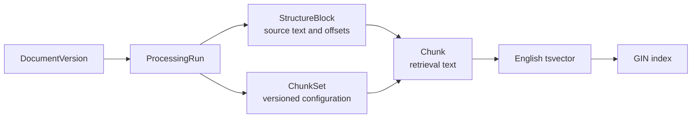
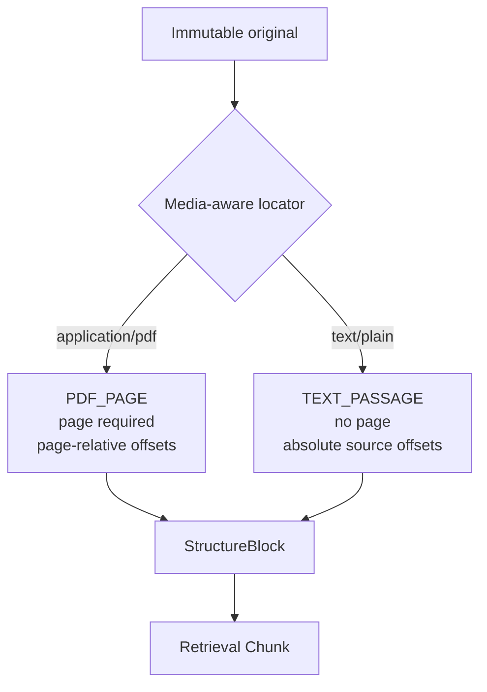
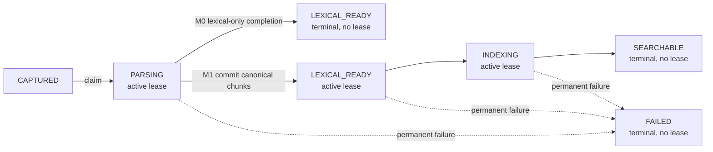
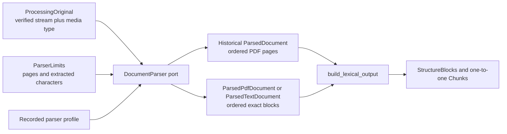
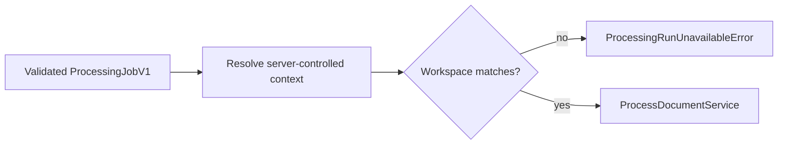
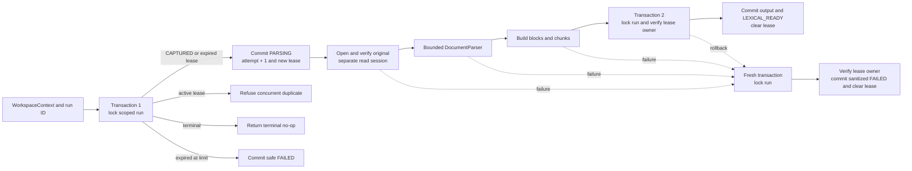
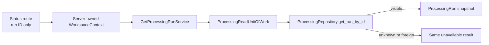
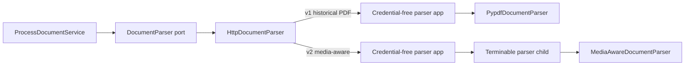
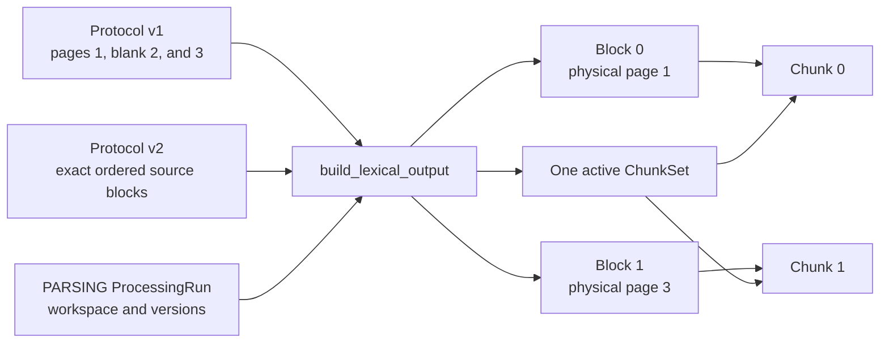
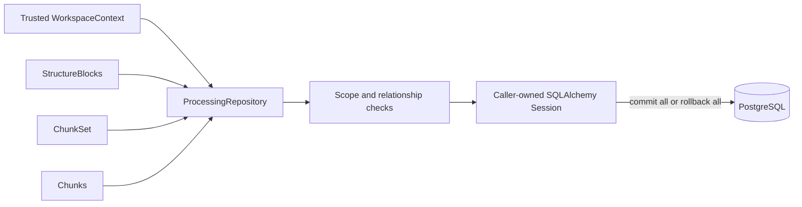

# Processing

This module owns canonical processing intent, source-aware parsed structure, versioned chunk sets,
and lexical retrieval chunks. Celery delivery invokes the same application-owned services for
historical M0.0 PDF runs and new media-aware M1 runs.

## Contents

| File             | Responsibility                                                                                   |
| ---------------- | ------------------------------------------------------------------------------------------------ |
| `application.py` | Creates and reads runs, builds lexical output, and orchestrates one bounded processing attempt.  |
| `contracts.py`   | Defines immutable v1 page and v2 media-aware parser protocols, bounds, and exact block outputs.  |
| `domain.py`      | Defines processing lifecycle snapshots, source blocks, chunk sets, chunks, and their invariants. |
| `indexing.py`    | Orchestrates canonical claims, retries, and completion around derived dense indexing.            |
| `ports.py`       | Defines parser, verified-original-provider, repository, and processing unit-of-work contracts.   |
| `persistence.py` | Maps four PostgreSQL tables, generated lexical vectors, indexes, and scoped repository behavior. |

## Ownership and provenance

`StructureBlock` preserves locator kind, order, exact text, and source offsets independently of chunking strategy. A `PDF_PAGE` block requires a physical page number and stores page-relative offsets. A `TEXT_PASSAGE` block has no page number and stores absolute character offsets into the immutable plain-text original. The database enforces these mutually exclusive shapes. `Chunk` is the retrieval unit. The M0.0 subset anchors each chunk to one block; a later reviewed schema may add an ordered association for chunks spanning several blocks without changing block or chunk identity.

## Lifecycle

State, timestamps, attempt metadata, and safe error summaries must agree. `claim_for_processing`
claims `CAPTURED` or reclaims an expired `PARSING` run. Historical M0 runs use
`mark_lexical_ready`, which clears the lease and makes `LEXICAL_READY` terminal. M1 runs use
`mark_lexical_ready_for_indexing`, retain the same lease through `begin_indexing`, and clear it only
when `mark_searchable` confirms completion. `claim_for_indexing` can reclaim an expired active
`LEXICAL_READY` or `INDEXING` run without repeating parsing. `mark_failed` applies to every active
stage. `expire_lease_for_retry` makes an owned lease immediately reclaimable, while
`mark_attempts_exhausted` closes an abandoned run after the configured attempt ceiling.

Each operation returns a new fully validated immutable snapshot; it does not mutate the earlier
state. Direct jumps, active-lease theft, stale-lease completion, restarting a terminal run, and
dense-index transitions with an M0 disabled configuration raise typed processing transition errors.
Migration `0006_m1_indexing_lifecycle` enforces the same rules in PostgreSQL while preserving
historical M1 runs that already ended at terminal `LEXICAL_READY` before indexing orchestration
existed.

`attempt_count` records successful canonical claims, not broker deliveries. `lease_id` is the
current attempt's ownership token, and `lease_expires_at` is the earliest UTC instant at which a new
attempt may reclaim the run. M0 permits three attempts and uses a 360-second lease, which exceeds
the maximum configurable 300-second processing timeout plus shutdown grace. The Celery task uses
`expire_lease_for_retry` only for classified transient infrastructure failures; permanent parser
and protocol failures become terminal `FAILED` states.

`IndexProcessingRunService` owns the database boundary around derived indexing. Its first short
transaction locks the run, verifies or reclaims the lease, advances `LEXICAL_READY` to `INDEXING`,
and loads the active canonical chunks. It then closes the transaction before invoking Search's
provider-neutral `IndexActiveChunksService`. Only after every deterministic vector is visible does
a second short transaction verify the unchanged leased snapshot and commit `SEARCHABLE`.
Transient provider failures expire the owned lease and request bounded redelivery; permanent or
exhausted failures store only a safe terminal summary. An expired `LEXICAL_READY` or `INDEXING` run
reloads chunks from PostgreSQL and never reparses the original.

Parser, parser configuration, chunker, chunking configuration, lexical configuration, embedding
configuration, and dense-index configuration versions are immutable properties of a run.
`update_run` changes only lifecycle fields. The processing service supplies a bounded, sanitized
failure summary rather than storing an exception message or document content directly.

The capture-time profile snapshots the complete processing intent before asynchronous work begins:

| Profile | Lexical configuration     | Embedding configuration                 | Dense-index configuration                          |
| ------- | ------------------------- | --------------------------------------- | -------------------------------------------------- |
| M0.0    | `m0.0-english-lexical-v1` | `m0.0-embedding-disabled-v1`            | `m0.0-dense-index-disabled-v1`                     |
| M1      | `m1-english-lexical-v1`   | `openai-text-embedding-3-small-1536-v1` | `pinecone-serverless-cosine-1536-aws-us-east-1-v1` |

These values describe which versioned behavior a run requires; storing them does not itself call an
embedding or vector provider. The canonical indexing service now consumes the M1 snapshots, but the
default worker remains on the earlier lexical completion path until the approved embedding adapter
can be wired in the same complete change. Migration `0005_m1_indexing_config` preserves historical
lexical intent, backfills disabled values for M0-era runs, and backfills the fixed M1 values for M1
lexical runs.

The capture use case asks this module's `create_captured_processing_run` factory to create the
initial durable intent. The caller supplies the active versioned profile and trusted workspace
context, so the documents module does not duplicate processing configuration knowledge. API
captures now use the M1 media-aware profile; historical tests and records retain the explicit M0.0
profile. The processing service requires its configured parser version to match the recorded
profile rather than silently substituting different parsing semantics.

## Parser boundary

The application owns both sides of this boundary. `ParserLimits` describes fail-closed extraction
limits. Protocol v1 retains ordered PDF page text. Protocol v2 adds the canonical media type and
returns validated PDF-page or pasted-text source blocks. A concrete PDF library remains behind
the `DocumentParser` port and cannot leak library-specific page objects into domain or persistence
code. The parser does not create blocks, chunks, or evidence spans; those require application-level
versioning and provenance rules.

The isolated parser runtime uses the BSD-3-Clause-licensed `pypdf` adapter in
`infrastructure/parsing`. It opens PDFs in strict mode, rejects encrypted documents, checks the page
limit before extraction, and checks the cumulative extracted-character limit after every page. The
processing profile records the exact locked parser version. `INVESTMENT_RESEARCH_MAX_PDF_PAGES` and
`INVESTMENT_RESEARCH_MAX_EXTRACTED_CHARACTERS` configure the active bounds, while the contracts
retain absolute safety ceilings.

Individual blank pages remain in the result so later citations retain physical PDF page numbering.
The application service rejects a document with no usable text before it creates lexical output.
Process-level CPU, memory, process-count, temporary-storage, and wall-clock bounds belong to the
isolated parser and Celery runtime rather than this in-process data contract.

## Processing application flow

`ExecuteProcessingJobService` is the application boundary for a validated `ProcessingJobV1`. It
resolves the trusted context from server-controlled identity state and requires the job's workspace
identifier to match before forwarding only the run identifier to `ProcessDocumentService`. A
foreign job and an unknown run therefore produce the same non-disclosing unavailable result.

`ProcessDocumentService` accepts only a trusted `WorkspaceContext` and a processing-run identifier.
It does not receive ORM objects from the API or hold a database transaction open while pypdf works.
The repository locks a run with `SELECT ... FOR UPDATE` before each lifecycle write, preventing two
workers from claiming or completing the same snapshot concurrently.

Only short database operations occur inside the write transactions. Parser errors are raised back
to the active execution adapter after the canonical `FAILED` state is committed. Exception text is
untrusted and is therefore mapped to bounded application-owned summaries instead of being stored
verbatim. Missing and foreign run identifiers both produce `ProcessingRunUnavailableError`. An
active duplicate raises `ProcessingRunAlreadyActiveError` without opening the original; the Celery
task acknowledges an ordinary concurrent duplicate as a no-op. When the broker marks the delivery
as a redelivery after worker loss, the same exception carries the canonical lease expiry so the
task can defer itself until that run is reclaimable. A stale worker whose lease was replaced
receives `ProcessingRunConflictError` before derived output is written.

## Processing status

`GetProcessingRunService` is the read-only application boundary used by FastAPI. It accepts the
trusted workspace context and one processing-run UUID, opens a short-lived read unit of work, and
returns the immutable domain snapshot. It does not claim a run, update state, or invoke the parser.

The API maps a visible snapshot to `ProcessingRunResult`, which contains no workspace identifier or
processing configuration. `error_summary` is present only for `FAILED` and was sanitized by the
processing service before persistence.

## Isolated parser adapter

The Celery worker receives `HttpDocumentParser` through the existing `DocumentParser` port. The
adapter selects the immutable protocol from the run's recorded parser profile. Historical M0.0 PDF
runs use `ParserRequestV1`/`ParserResponseV1`; M1 PDF and pasted-text runs use
`ParserRequestV2`/`ParserResponseV2`. The application service does not know whether parsing occurred
locally or across the isolated transport.

Transport, protocol, document, and limit failures use application-owned exception types. This lets
the processing service persist a safe canonical failure without storing HTTP, pypdf, or untrusted
exception details. See the [parsing infrastructure README](../../infrastructure/parsing/README.md)
for the complete protocol boundary.

| Observed parser failure                 | Application category   | Canonical outcome                                                                                           |
| --------------------------------------- | ---------------------- | ----------------------------------------------------------------------------------------------------------- |
| Timeout or abrupt connection loss       | `ParserTransportError` | Expire the lease and retry; after the third claim, store `FAILED` with `Processing attempt limit exceeded`. |
| Malformed or contract-breaking response | `ParserProtocolError`  | Store `FAILED` after the first claim with `Document parsing failed safely`.                                 |

PostgreSQL integration tests exercise these categories through the real HTTP adapter. They require
the original bytes to remain unchanged, the terminal lease to be cleared, and no structure block,
chunk set, or chunk to be committed for a failed parse.

## Lexical mapping

`build_lexical_output` accepts only a run in `PARSING`. Historical v1 output still maps every
non-blank parsed page to one `PARAGRAPH` structure block and one matching chunk. The complete page
text remains untrimmed with offsets `0` through `len(text)`; blank physical pages create no records
but later page numbers do not shift.

For v2, the isolated parser has already produced exact bounded blocks. The builder copies each
locator kind, physical page number when present, block type, ordinal, text, and source range without
reinterpretation. It creates exactly one chunk per block with identical text and the same ordinal.
Pasted-text ranges are absolute codepoint offsets into the normalized immutable original; PDF
ranges are relative to the extracted text of the named physical page.

M0.0 and M1 currently record whitespace-separated word units in `token_count`; their distinct
versioned profiles make that deliberately simple rule and their different block policies explicit.
A later tokenizer or chunking strategy creates a new configuration and chunk set rather than
altering historical output. A document with no visible blocks fails before any lexical records are
created.

## Lexical output transaction

Composite foreign keys repeat workspace, run, and document-version identifiers so PostgreSQL can reject cross-workspace or cross-run relationships directly. A partial unique index permits only one active chunk set per document version and lexical configuration.

`list_active_chunks` is the canonical handoff from processing persistence to the embedding
orchestrator. It requires trusted workspace context, joins the requested run to an active chunk set
with the same lexical configuration, and returns immutable chunks ordered by ordinal and chunk ID.
Unknown and foreign run identifiers both return an empty sequence. A resumed `LEXICAL_READY` or
`INDEXING` attempt can therefore rebuild the same embedding inputs from PostgreSQL without parsing
the original again or trusting vector-provider state.

PostgreSQL derives `chunks.search_vector` from `chunks.text` using the explicit English configuration and stores it as a generated column. A GIN index supports lexical candidate lookup. The application never writes the vector directly, and the configuration version records which retrieval behavior produced the active set.
