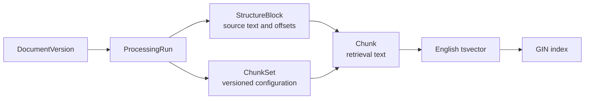
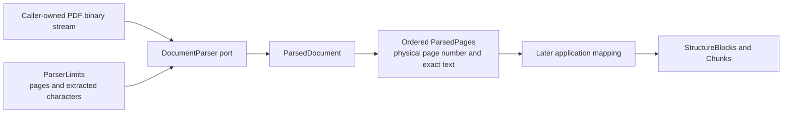
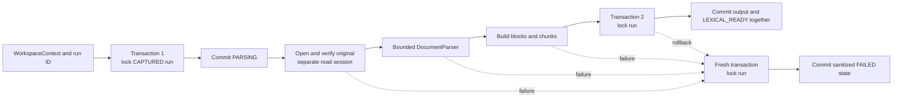
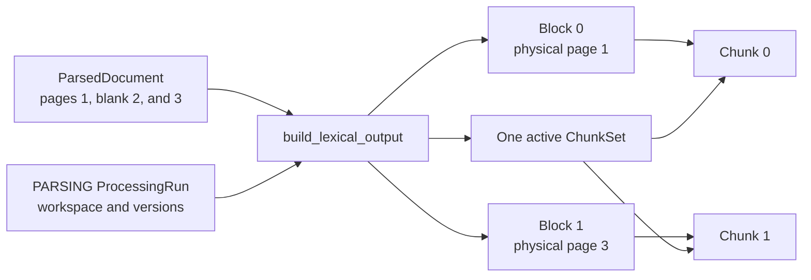
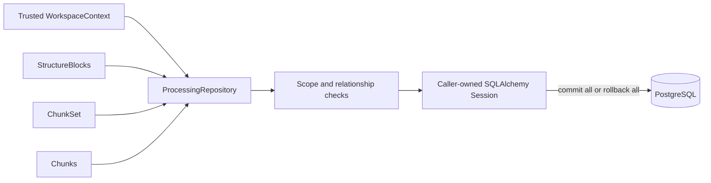

# Processing

This module owns canonical processing intent, page-aware parsed structure, versioned chunk sets, and lexical retrieval chunks. M0.0 executes one run in a separate development process; later Celery delivery invokes the same application-owned contracts.

## Contents

| File             | Responsibility                                                                                           |
| ---------------- | -------------------------------------------------------------------------------------------------------- |
| `application.py` | Creates `CAPTURED` runs, builds lexical output, and orchestrates one bounded processing attempt.       |
| `contracts.py`   | Defines bounded, immutable parser input and page-aware output types.                                    |
| `domain.py`      | Defines processing lifecycle snapshots, source blocks, chunk sets, chunks, and their invariants.        |
| `ports.py`       | Defines parser, verified-original-provider, repository, and processing unit-of-work contracts.          |
| `persistence.py` | Maps four PostgreSQL tables, generated lexical vectors, indexes, and scoped repository behavior.         |

## Ownership and provenance



`StructureBlock` preserves page, order, exact text, and source offsets independently of chunking strategy. `Chunk` is the retrieval unit. The M0.0 subset anchors each chunk to one block; a later reviewed schema may add an ordered association for chunks spanning several blocks without changing block or chunk identity.

## Lifecycle

```text
CAPTURED → PARSING → LEXICAL_READY
               ↘ FAILED
```

State, timestamps, and safe error summaries must agree. `start_parsing`, `mark_lexical_ready`, and
`mark_failed` are the only domain operations that advance an existing run. Each operation returns a
new fully validated immutable snapshot; it does not mutate the earlier state. Direct jumps such as
`CAPTURED → LEXICAL_READY`, failure before parsing starts, and restarting a terminal run raise
`InvalidProcessingTransitionError`.

Parser, parser configuration, chunker, chunking configuration, and lexical configuration versions
are immutable properties of a run. `update_run` changes only lifecycle fields. The processing
service supplies a bounded, sanitized failure summary rather than storing an exception message or
document content directly.

The capture use case asks this module's `create_captured_processing_run` factory to create the
initial durable intent. The factory applies the versioned M0.0 profile and the trusted workspace
context, so the documents module does not duplicate processing configuration knowledge. The runner
requires its parser version to match that recorded profile rather than silently substituting
different parsing semantics.

## Parser boundary



The application owns both sides of this boundary: `ParserLimits` describes fail-closed extraction
limits, and `ParsedDocument` contains only ordered page text. A concrete PDF library remains behind
the `DocumentParser` port and cannot leak library-specific page objects into domain or persistence
code. The parser does not create blocks, chunks, or evidence spans; those require application-level
versioning and provenance rules.

M0.0 uses the BSD-3-Clause-licensed `pypdf` adapter in `infrastructure/parsing`. It opens PDFs in
strict mode, rejects encrypted documents, checks the page limit before extraction, and checks the
cumulative extracted-character limit after every page. The processing profile records the exact
locked parser version. `INVESTMENT_RESEARCH_MAX_PDF_PAGES` and
`INVESTMENT_RESEARCH_MAX_EXTRACTED_CHARACTERS` configure the active bounds, while the contracts
retain absolute safety ceilings.

Individual blank pages remain in the result so later citations retain physical PDF page numbering.
The application service rejects a document with no usable text before it creates lexical output.
Process-level time and memory bounds belong to the separate runner rather than this in-process data
contract.

## Processing application flow

`ProcessDocumentService` accepts only a trusted `WorkspaceContext` and a processing-run identifier.
It does not receive ORM objects from the API or hold a database transaction open while pypdf works.
The repository locks a run with `SELECT ... FOR UPDATE` before each lifecycle write, preventing two
workers from claiming or completing the same snapshot concurrently.



Only short database operations occur inside the write transactions. Parser errors are raised back
to the future command-line runner after the canonical `FAILED` state is committed. Exception text
is untrusted and is therefore mapped to bounded application-owned summaries instead of being stored
verbatim. Missing and foreign run identifiers both produce `ProcessingRunUnavailableError`.

## M0.0 lexical mapping

`build_lexical_output` accepts only a run in `PARSING`. It maps every non-blank parsed page to one
`PARAGRAPH` structure block and one matching chunk. The complete extracted page text is preserved
without trimming; block source offsets are therefore `0` through `len(text)`. Blank pages create no
database records, but later page numbers do not shift.



M0.0 records whitespace-separated word units in `token_count`; the versioned
`m0.0-structure-block-config-v1` identifier makes this deliberately simple counting rule explicit.
A later tokenizer or structure-aware strategy creates a new chunking configuration and chunk set
rather than altering historical output. A document whose pages are all blank fails before any
lexical records are created.

## Lexical output transaction



Composite foreign keys repeat workspace, run, and document-version identifiers so PostgreSQL can reject cross-workspace or cross-run relationships directly. A partial unique index permits only one active chunk set per document version and lexical configuration.

PostgreSQL derives `chunks.search_vector` from `chunks.text` using the explicit English configuration and stores it as a generated column. A GIN index supports lexical candidate lookup. The application never writes the vector directly, and the configuration version records which retrieval behavior produced the active set.
