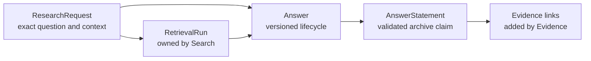
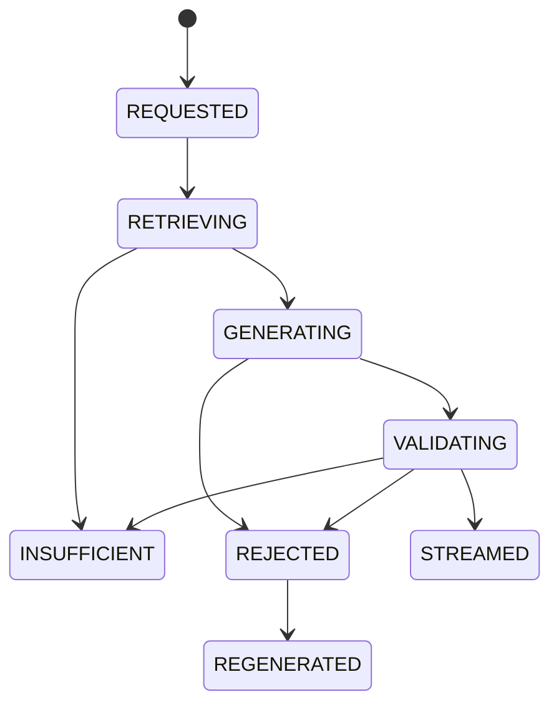
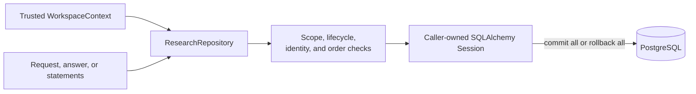

# Research

This module owns immutable research requests, versioned answer lifecycles, and validated answer statements. It orchestrates Search and Evidence through typed contracts in later implementation steps; it does not own retrieval candidates, source spans, or validation records.

## Contents

| File             | Responsibility                                                                       |
| ---------------- | ------------------------------------------------------------------------------------ |
| `domain.py`      | Defines requests, temporal modes, answer states, coverage, statements, and invariants. |
| `ports.py`       | Defines the application-owned `ResearchRepository` contract.                         |
| `persistence.py` | Maps three PostgreSQL tables and implements workspace-scoped repository behavior.     |

## Ownership and traceability



An answer references the exact retrieval run that supplied its context. The composite database relationship includes workspace, request, and run identifiers, so a run from another request or workspace cannot be attached accidentally.

Research imports only typed domain contracts from dependencies when application orchestration requires them. It never imports another module's `persistence.py`.

## Temporal request context

```text
CURRENT               → no cutoff
PUBLIC_KNOWLEDGE      → cutoff required; later checks use public availability
PERSONAL_ARCHIVE      → cutoff required; later checks also require workspace eligibility
```

The request preserves the user's exact question and explicit document filters. The Search module separately records the normalized query and effective retrieval-filter snapshot because those are execution details needed to reproduce a specific run.

## Answer lifecycle



`REGENERATED` closes the rejected attempt; regeneration creates a new answer row with the next version number. Only `STREAMED` and `INSUFFICIENT` contain user-visible rendered text. A streamed answer has `COMPLETE`, `PARTIAL`, or `CONFLICTING` archive coverage. An insufficient answer explicitly uses `INSUFFICIENT` coverage and has no archive-derived statements.

Answer statements represent accepted archive-derived claims, not raw model output. M0.0 persists only the `ARCHIVE_DERIVED` statement type with `VALIDATED` support status. The Evidence module adds the required source links and validation records in the same caller-owned transaction before any statement is emitted.

## Transaction and isolation boundary



Every table and relationship carries `workspace_id`. Unknown and inaccessible identifiers produce the same repository result. The repository stages changes but never commits; the application service owns the unit of work across Research, Search, and Evidence.

This Step 3 module provides persistence only. Retrieval execution starts in Step 6, while answer generation, evidence validation, and safe output begin in Step 7.
